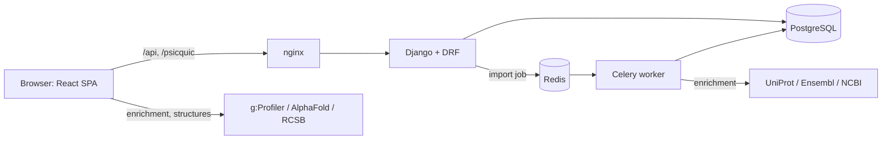

# Current architecture assessment

Phase 0 audit for the generalization project ([PROJECT_BRIEF.md](PROJECT_BRIEF.md)).
It records what openPIP 2.0 does today, measured on `main` at `94345c3`
(2026-10-28). Where it disagrees with older notes elsewhere in `docs/project/`,
this file follows the code. The proposed design is in
[GENERALIZATION_ARCHITECTURE.md](GENERALIZATION_ARCHITECTURE.md).

**Method.** Seven readers each audited one subsystem in full and cited a
`file:line` for every claim. A critic pass then checked the seven maps against
each other and against the code, and filled the gaps between them. Nothing was
run against a live database. The baseline checks in section 2 ran in throwaway
containers with their own Postgres, no published ports and no shared volumes.

## 1. Repository and deployment boundaries

- `origin` is the fork `MilesGithub/openpip-2.0`. `upstream` is
  `Helmy-Lab/openpip-2.0`, and its push URL is set to `DISABLED`. `gh` defaults
  to the fork. At audit time `main`, `origin/main` and `upstream/main` were all
  `94345c3`, so the fork had not yet diverged.
- GitHub Issues are disabled on the fork.
- `MilesGithub/HuRI` is a separate private repository, not a fork. This project
  does not touch it.
- The HuRI and YeRI stacks running on the development machine are deployed from
  other folders (`openPIP2 - HuRI` and `openpip-yeri`). Nothing in this working
  tree is mounted into them.
- Each portal is an independent install, with its own compose project,
  Postgres, media volume and one `AdminSettings` row. Every container start runs
  `migrate` and then `ensure_initial_data` (`docker-compose.yml:43-46`,
  `docker-compose.prod.yml:37-41`). **A migration merged here runs on every
  portal the next time it upgrades.**
- The unmerged branch `feature/species-config` (`5e42c68`) sets
  `SPECIES = FLY` as a build-time constant. Merged as it is, it would switch the
  enrichment and external links of every human portal to fly.

## 2. Baseline checks

All checks ran on `94345c3`: Postgres 16 and Redis 7 containers, the backend
image built from `backend/`, and Node 20.20.2, the version the frontend image
uses.

| Check | Result |
|---|---|
| `pytest` (backend) | 582 passed, 2 skipped, 80 deselected (parity), in 6 min 48 s |
| `core/tests/test_docs_contract.py` (the 2 skipped) | 2 passed when run with the whole checkout mounted |
| `ruff check .`, `black --check .` | clean |
| `manage.py makemigrations --check` | no changes |
| `npx vitest run` | 555 of 582 passed on the first run; the 27 failures were timeouts while the CPU was saturated, and all 10 affected files (122 tests) pass when run alone |
| `npm run lint`, `npm run build` | pass |
| `mkdocs build --strict` | pass |

Points about the baseline itself:

- **Tests silently fall back to SQLite.** The database comes only from
  `DATABASE_URL`, which defaults to `sqlite:///dev.db`
  (`backend/openpip/settings/base.py:90`). The `DATABASE_URL` line in
  `backend/pytest.ini:4` is not read by any installed plugin, and pytest warns
  "Unknown config option: DATABASE_URL". This clone's `.env` sets no
  `DATABASE_URL`. A bare `pytest` on the host therefore tests SQLite, not
  Postgres.
- **Parity tests use whatever database is configured.**
  `backend/tests/parity/` turns off test-database creation and runs against the
  configured database, which is meant to be the live HuRI database. It also
  calls the live legacy site, and one test PATCHes `AdminSettings`
  (`backend/tests/parity/test_catalog_parity.py:232-260`). The default run
  excludes them (`backend/pytest.ini:9`). Never run them against a database
  that matters.
- **The docs contract tests skip themselves** when `docs/` is not next to
  `backend/` (`backend/core/tests/test_docs_contract.py:17-20`). Inside the
  compose containers, which mount only `backend/`, they never run.
- **The frontend suite is timing-sensitive.** It uses Vitest's 5 s test timeout
  and Testing Library's 1 s `findBy` default (`frontend/vite.config.ts:34-39`).
  Under load, whole files fail.
- **No CI runs any of these checks** (there is no `.github/`). The pre-commit
  lint hook is opt-in (`scripts/git-hooks/pre-commit`).

## 3. Architecture at a glance

| Backend app | Owns |
|---|---|
| `proteins` | `Protein`, `Identifier`, `Organism`, annotations, domains, complexes (unused), and the UniProt, Ensembl and NCBI clients |
| `interactions` | `Interaction`, categories, `InteractionDataset`, `InteractionParticipant`, saved networks, `/api/search` |
| `datasets` | `Dataset`, file storage, the importer (`upload_parser.py`), the Celery import task, downloads |
| `psicquic` | MIQL parser, PSI-MI TAB 2.5–2.8 writer, ROGID/RIGID checksums |
| `sharing` | Saved views, shares, comments, notifications, public links |
| `admin_panel` | The `AdminSettings` singleton, `SiteText`, announcements, counts, user admin |
| `core` | `User`, JWT authentication, throttles |

The frontend is one `createBrowserRouter` with about 25 flat routes
(`frontend/src/App.tsx:35-96`). Its feature folders are `search`, `proteins`,
`sharing`, `admin`, `auth`, `home` and `static`. It uses TanStack Query for
server state, Zustand for the search page, and Cytoscape.js for networks.

## 4. Subsystems

### 4.1 Data model

- The schema is a Django translation of the legacy MySQL schema. 33 of its 38
  table names are pinned with `db_table`, and the FK column names are kept
  (for example `"interactor_A"`). `migration/migrate_legacy.py` copies data by
  matching table and column names (`migration/migrate_legacy.py:39-69, 102-117`).
- **`Protein` is the only entity** (`backend/proteins/models.py:4-18`). Every
  field is nullable and none is unique. Live data holds duplicate rows for one
  accession, kept deliberately (`docs/BUGS.md:201-211`). Molecules that are not
  proteins, such as ncRNA gene names, are already stored as `Protein` rows
  (`docs/operator-guide/data-formats.md:48-49`).
- **Identifiers have no type.** `Identifier(identifier, naming_convention)` is
  free text, and nothing is unique (`backend/proteins/models.py:21-47`). Lookups
  ignore both namespace and organism and match case-insensitively through an
  `UPPER()` index (`backend/proteins/migrations/0004_add_search_indexes.py`).
  At least eight resolution rules exist, and they disagree. Search returns every
  protein linked to a matching identifier. Upload, protein detail and
  interactors take the first match. MIQL ORs Protein columns but never checks
  `ensembl_id` (`backend/interactions/search_service.py:159-177`,
  `backend/datasets/upload_parser.py:89-151`, `backend/proteins/views.py:28-51`,
  `backend/psicquic/miql.py:60-69`).
- **`Interaction` is a binary edge between proteins**
  (`backend/interactions/models.py:33-86`). Its fields:
  - `interactor_A` and `interactor_B`: NOT NULL, CASCADE FKs to `Protein`
  - `score`: `CharField(10)`
  - `negative`: MITAB column 36, a reported non-interaction
  - `interaction_type`: an optional PSI-MI code
  - `removed`: filtered on everywhere, never set by 2.0
  - `binding_start`, `binding_end` and `domain`

  The model has no direction, effect, relationship type, score namespace or
  context. Pairs have no DB uniqueness; dedupe happens only in application code.
- **Provenance stops at the dataset.** `InteractionDataset` is a join with no
  attributes (`backend/interactions/models.py:88-103`). Detection methods and
  MITAB annotations are `Annotation` rows keyed by `str(interaction.pk)`.
  Publications exist only on `Dataset`; per-row MITAB publication IDs are
  dropped.
- **`InteractionParticipant`** (`backend/interactions/models.py:229-294`, new in
  2.0) stores per-side PSI-MI interactor type, roles and biological effect.
  `UniqueConstraint(interaction, side)` caps an edge at two participants. Only
  the MITAB writer reads it.
- **`Dataset`** (`backend/datasets/models.py:4-52`) has citation fields
  (PubMed, author, year, title, journal, DOI, URL, publication status) and About
  fields. Its name is its identity and cannot be edited. It has no release,
  version, licence, organism, checksum or withdrawn state, and
  `number_of_interactions` is a string.
- **Categories.** The four interaction categories (Published, Validated,
  Verified, Literature, `order` 1–4) belong to `AdminSettings` pk=1 and set the
  edge colour. Saved filters key them by display name.
- **DB-level unique constraints** exist only on `organism.taxonomy_id`,
  `interaction_participant(interaction, side)`, `site_text(key, locale)`,
  `user.username`, `lower(user.email)` and `saved_views.public_token`.
- **Data migrations.** Two migrations change data: `datasets/0003` (raw SQL with
  hard-coded HuRI row ids) and `admin_panel/0006`. Latest migrations: proteins
  0006, interactions 0009, datasets 0004, core 0006, sharing 0003,
  admin_panel 0011.

### 4.2 Ingestion

- **Upload flow.** The admin wizard (`frontend/src/features/admin/AdminDataPage.tsx`)
  converts 3–14-column tables into 28-column MITAB in the browser
  (`frontend/src/lib/convertTable.ts:19-20`). It previews through
  `POST /api/datasets/check-proteins`, then posts the whole file to
  `POST /api/datasets/import-async`.
- **The whole file travels as one Celery argument.** `AsyncImportView` reads
  the upload into memory, splits it into lines, finds or creates the dataset by
  name, and calls `import_dataset_task.delay(lines, ...)`
  (`backend/datasets/views.py:600-647`, `backend/datasets/tasks.py:11-88`).
  Nothing records the import run, the file's checksum or source row numbers.
  The client's 30 s axios timeout can abandon a large upload before the server
  replies with the task id (`frontend/src/api/client.ts:22`).
- **Resolution creates proteins.** `_protein_handler` tries the identifier table
  first (blind to namespace and taxon), then the Protein column for the
  prefix's convention, and otherwise creates a new `Protein`
  (`backend/datasets/upload_parser.py:117-151`). Any prefix other than
  uniprotkb, ensembl or entrez becomes a "gene name", so `chebi:` or `intact:`
  IDs are stored as gene names (`backend/datasets/upload_parser.py:63-77`).
- **Pair dedupe is undirected, and the first writer wins.**
  `_existing_interaction` matches `(A,B)` or `(B,A)` and returns `.first()`.
  `_credit_dataset` links the existing row to the new dataset. Score, `negative`,
  type and participants come only from the row that created the interaction
  (`backend/datasets/upload_parser.py:154-174, 621-653`). A negative row for a
  pair that already has a positive interaction is merged into it, and its
  negativity is lost (`backend/datasets/upload_parser.py:625-633`).
- **Batching and post-processing.** TAB imports run in 300-line batches, each in
  one transaction with a savepoint per row. CSV runs in one pass. After every
  import or dataset delete, the counters for every protein and every dataset are
  recomputed (`backend/datasets/views.py:125-161`). UniProt, then Ensembl, then
  NCBI enrichment runs on the proteins created in that run.
- **Deletion.** Deleting a dataset hard-deletes the interactions linked to no
  other dataset, and the CASCADE silently removes them from users' saved
  networks (`backend/datasets/views.py:528-562`). There is no withdraw state.

### 4.3 Search and REST API

- **One unversioned `api/` prefix** (`backend/openpip/urls.py:17-24`). The
  global default permission is `IsAuthenticated`, and public views declare
  `AllowAny`. Throttles: anonymous 600/min, user 1200/min, PSICQUIC 60/min
  (`backend/openpip/settings/base.py:132-138`). drf-spectacular is installed,
  but no view is annotated.
- **`GET /api/search`** (`backend/interactions/search_service.py:148-362`)
  matches each term case-insensitively against the identifier table and expands
  one hop.
  - Keys returned: `all_proteins`, `all_interactions`, `domains` (always ''),
    `complexes` (always ''), `query_protein_id_array`, `search_term`, and the
    found and unfound summaries.
  - The query protein is swapped into `interactor_A`
    (`backend/interactions/search_service.py:325-335`).
  - The response has no size cap and no pagination. A hub protein or a long
    gene list returns its whole one-hop neighbourhood. The empty query, which
    once returned the whole database, is fixed (BUG-005, `docs/BUGS.md:26-30`).
  - `negative` and direction are never emitted, so reported non-interactions
    are drawn as ordinary edges.
- **Other consumers of the same builders.** `POST /api/search/interactors`,
  `GET /api/home/network` and saved-network snapshots
  (`backend/interactions/views.py:60-205`) reuse them. The home network is
  anonymous and uncached, and can run up to ten full searches per request.
- **Docs drift.** The API docs say the web interface calls
  `POST /api/search/interactors` when the filter changes
  (`docs/developer/api/proteins-and-search.md:124-125`). It never does: filter
  modes are applied in the browser.
- **Downloads.** Datasets download as tab (four columns plus a `#` citation
  header), SIF and CSV. Per-dataset tab rows are generated in two places
  (`backend/datasets/views.py:172-337`).
- **Docs contract.** `backend/core/tests/test_docs_contract.py:98-101` requires
  a `## METHOD /path` heading in `docs/developer/api/*.md` or
  `docs/developer/psicquic.md` for every routed endpoint, and a route for every
  heading. It also requires every environment variable to be documented.

### 4.4 PSICQUIC and PSI-MI TAB

- **Service.** `/psicquic/rest/{query,query/count,formats,version}` is public
  and read-only. It supports a subset of MIQL; unsupported fields get a 400,
  never an empty 200. Both views share one base queryset,
  `Interaction.objects.filter(removed='0')`, ordered by pk with at most 2,500
  rows per page (`backend/psicquic/miql.py:230-242`). That makes the base
  queryset the natural place to keep PSICQUIC PPI-only.
- **MITAB output.** `mitab.format_queryset` builds 46 cells and cuts them to
  15, 36, 42 or 46 columns for TAB 2.5–2.8. Column 36 comes from `negative`
  and column 12 from `interaction_type`. The interactor type is the constant
  `MI:0326` (protein) unless an upload stated otherwise. CausalTAB columns
  43–46 are left empty (`backend/psicquic/mitab.py:413-501`). This writer is the
  only reader of `Interaction.negative` anywhere in the codebase.
- **Score labelling.** The importer strips a score's namespace, so PSICQUIC
  relabels a provider's score as `openPIP:<value>`.

### 4.5 Frontend search page and network

- **Data flow.** The search page calls only `GET /api/search?q=`
  (`frontend/src/api/search.ts:5-11`) and copies the result into a module-level
  Zustand store (`frontend/src/features/search/searchStore.ts`). It filters the
  whole result in the browser (`frontend/src/features/search/filterInteractions.ts:30-86`):
  - score at or above the slider, with a missing score counted as 0;
  - category by name;
  - query–query or query–partner mode;
  - GTEx tissue expression ≥ 5.0, ANDed across the selected tissues.
- **Element building.** `buildElements` makes node `p{protein_id}` and edge
  `i{interaction_id}`, from `interactor_A` to `interactor_B`. The order is
  presentation only. Colours are baked into element data
  (`frontend/src/features/search/network/cytoscapeElements.ts:120-171`). The
  stylesheet has no arrows, line styles, classes or type selectors
  (`cytoscapeStyles.ts:6-55`). Tap handlers parse integer ids
  (`CytoscapeNetwork.tsx:128-164`).
- **Re-layout.** `SearchResultsPage` subscribes to the whole store, and the
  filter returns new arrays on every call, so the layout re-runs on any store
  change (`frontend/src/features/search/SearchResultsPage.tsx:120-156`).
- **Protein- and human-specific code.** The node and edge panels, tables,
  enrichment, external links and structure viewer all assume proteins. Human is
  hard-coded on `main`: g:Profiler `hsapiens` (`frontend/src/api/enrichment.ts:24`)
  and taxon 9606 in external links
  (`frontend/src/features/search/externalLinks.ts:37-80`).
- **Third-party disclosure.** The browser sends every result's gene list to
  g:Profiler, and no setting turns that off
  (`frontend/src/features/search/tables/ResultTablePanel.tsx:97-121`).

### 4.6 Saved views, sharing, admin and text

- **Saved views, shares and public links** store `query` plus an opaque,
  unversioned `state` object (the 8 ViewState keys) and re-run
  `GET /api/search?q=` when opened (`backend/sharing/models.py:5-30`,
  `frontend/src/features/search/searchStore.ts:13-33`). `applyViewState`
  ignores unknown keys, so ViewState can grow additively.
- **Saved networks** are snapshots of `Interaction` primary keys
  (`backend/interactions/models.py:160-194`).
- **Site configuration** is one `AdminSettings` row, always read by pk=1, and
  served as camelCase JSON at `/api/settings`
  (`backend/admin_panel/views.py:30-47`). User-facing copy comes from the
  compile-time registry `TEXT_GROUPS` plus `SiteText` overrides
  (`frontend/src/text/registry.ts:25-77`). The multi-row admin resources
  (`Announcement`, `InteractionCategory`) are the precedent for anything
  admin-managed with several rows, such as a browser instance.

### 4.7 Security and roles

- **Roles are binary:** anonymous, authenticated, and `is_staff` admin, carried
  as the `is_admin` JWT claim (`backend/core/tokens.py:19-51`). There are no
  groups or model permissions, so no role fits a per-browser curator.
- **Client-side risks.** Both JWTs are kept in `localStorage`
  (`frontend/src/store/authStore.ts:28-53`). Admin-authored HTML is rendered
  with `dangerouslySetInnerHTML` and no sanitizer, in 15 places across 10 files
  (for example the About, FAQ, Contact and Download pages, the footer and
  announcements). `frontend/nginx.conf` sets no Content-Security-Policy.
- **Throttle identity** depends on a host proxy adding `X-Forwarded-For`
  (`backend/openpip/settings/prod.py:28-33`, BUG-033).

## 5. Assumptions that block generalization

Ranked by how much of the system each one touches.

| # | Assumption | Where | Consequence |
|---|---|---|---|
| 1 | Every node is a `Protein`, every edge a protein pair | `interactions/models.py:34-45`, search, PSICQUIC, `cytoscapeElements.ts` | A gene, RNA, disease or variant endpoint cannot be stored without new tables |
| 2 | Nothing that reads `interaction` filters by type | search, snapshots, home network, counts, degree counters, downloads, delete sweep, interactors, PSICQUIC, importer dedupe, saved-network count, Django admin | Non-PPI rows stored in `interaction` would appear in all of these at once, so new relationship types need their own tables |
| 3 | A pair is undirected, and one row per pair aggregates every dataset | `upload_parser.py:154-174`; the search swap at `search_service.py:325-335` | A→B and B→A collapse, and later datasets' scores, types and negativity are lost |
| 4 | Provenance is per dataset only | `InteractionDataset` has no columns; per-row publications are dropped | Evidence cannot be attributed to a release, source row, publication or method |
| 5 | One score per interaction, with no namespace or scale | `models.py:46`; the frontend's single 0–1 slider | Scores from different sources would be compared as if they were the same quantity |
| 6 | Identifiers are global strings | `naming_convention` is ignored; matching is case-insensitive and blind to organism | Cross-species symbols and namespaces collide silently |
| 7 | The organism is fixed per build | `enrichment.ts:24`, `externalLinks.ts`; `SPECIES = FLY` on the unmerged branch | A hub that mixes organisms needs the organism as runtime data, per instance and per entity |
| 8 | The whole result fits in the browser | Unbounded `/api/search`, client-side filtering | A multi-dataset graph needs server-side bounded queries |
| 9 | The negative flag lives on the interaction and is otherwise ignored | Only `mitab.py:478-480` reads it | A typed "tested, not observed" outcome must not inherit this behaviour |

## 6. Compatibility contracts to preserve

- **Database:**
  - legacy table and column names;
  - protein and interaction primary keys, including the `openPIP:{pk}` IDs in
    MITAB;
  - `AdminSettings` pk=1;
  - the four category rows and their order.
- **`/api/search`:**
  - the exact key set and nesting, with '' rather than null for missing text;
  - the query protein in `interactor_A`;
  - edge ordering;
  - the `filter` values.
- **PSICQUIC:**
  - paths and parameters;
  - formats and their order;
  - TAB widths, each version a prefix of the next;
  - column 36 semantics;
  - MIQL refusing what it does not support;
  - ROGID/RIGID values;
  - the 60/min throttle;
  - `SERVICE_VERSION` 2.0.0.
- **Importer** (as documented in `docs/operator-guide/data-formats.md`):
  - datasets found by name;
  - case-insensitive identifiers;
  - pairs reused in either order;
  - the first score wins;
  - the Celery task signature (`lines, dataset_name, interaction_status, category_id, fmt`).
- **Downloads:** the tab, SIF and CSV columns and file names, the `#` citation
  header, and `datasets.zip` invalidation.
- **Saved state:**
  - `SavedView.state` keys;
  - re-running the search on open;
  - saved networks as interaction-PK snapshots;
  - stored links (`/shared/:id`, `/public/:token`, `/views/:id`,
    `/networks/:id`, `/search/:term`).
- **Frontend:** the element id scheme (`p…`, `i…`), the palette rule from order
  to colour, the `SiteText` keys, and the `proteinLinkTarget` placeholders.
- **Process:** applied migrations are never edited; every endpoint and
  environment variable is documented; Conventional Commits.

## 7. The brief's starting snapshot, checked

| Brief claim | Verdict | Evidence or correction |
|---|---|---|
| `Interaction` references two `Protein` rows | Confirmed | `backend/interactions/models.py:34-45` |
| Identifiers include untyped, free-form entries | Confirmed | `naming_convention` is free text with no constraint (`backend/proteins/models.py:21-23`) |
| No direction, sign or context on the interaction | Confirmed | `backend/interactions/models.py:33-67` |
| `_existing_interaction()` matches either orientation and credits the next dataset | Confirmed | `backend/datasets/upload_parser.py:154-174` |
| `negative` means a tested non-interaction, not an inhibitory effect | Confirmed | Model comment at `backend/interactions/models.py:47-55`; column 36 at `backend/psicquic/mitab.py:478-480` |
| `score` is a short string with no scale | Confirmed | `CharField(max_length=10)`; the importer drops the namespace and truncates (`backend/datasets/upload_parser.py:635-641`) |
| `Dataset` has citation and About fields | Confirmed | `backend/datasets/models.py:12-46` |
| Search and the Cytoscape mapping assume protein IDs | Confirmed | `search_service.py:165-175`; `cytoscapeElements.ts:139, 160` |
| `types/search.ts` assumes `all_proteins` and `all_interactions` | Confirmed | `frontend/src/types/search.ts:1-12` |
| Existing PSI-MI round-trips preserve MITAB `negative` | Partly true | Only when the upload creates a new interaction; a negative row merged into an existing pair loses the flag |
| Celery tasks report progress and enrich new proteins | Partly true | Progress is per 300-line batch for TAB, but only 0 then 100 for CSV |
| The repository has documentation contract tests | Confirmed | They cover API endpoints and environment variables only. No test checks links, despite a comment in `frontend/Dockerfile:16-18` saying one does |
| Router has `/`, `/search`, `/proteins`, admin, "downloads" and the saved and shared pages | Confirmed | The download path is `/download` (singular) |
| Tests could run against a fallback SQLite database | Confirmed | Section 2 |

## 8. Defects and hazards found during the audit

None of these are fixed in Phase 0. The plan schedules two of them: the legacy
reload (ML1) and admin HTML with a CSP (SEC1). The rest wait for the owner
(open question E14).

- **Data integrity:**
  - Negative rows merged into positive interactions lose their negativity
    (`backend/datasets/upload_parser.py:625-633`).
  - `/api/counts` and the protein degree counters count non-interactions as
    interactions.
  - Concurrent imports can create duplicate pairs: no DB constraint, and
    check-then-insert without a lock.
  - Deleting a dataset silently shrinks users' saved networks.
- **Migration and operations:**
  - `datasets/0003` hard-codes HuRI row ids
    (`backend/datasets/migrations/0003_fix_audit_data.py:4-34`). It matches no
    rows on a fresh or legacy-copied database, but would mislink rows on a
    database that already held data when it first reached 0003.
  - `migrate_legacy.py --reset` uses `TRUNCATE ... CASCADE`
    (`migration/migrate_legacy.py:128`), which also empties every 2.0 table with
    an FK to a legacy table: today `interaction_participant`, `user_datasets`,
    `user_interaction_networks` and `user_protein`.
  - **The script cannot load seven tables into today's schema, and a
    `--reset` run loses data.** Checked on 2026-10-29 on a throwaway
    PostgreSQL built by 2.0's migrations, without running the script. An
    insert of each table's legacy columns failed with a NOT NULL error, and
    each `TRUNCATE ... CASCADE`, rolled back, named the tables it would
    empty.
    - The script copies only same-named columns, and 2.0 added or renamed a
      required column with no database default in each of these seven
      tables:
      - `admin_settings`: `show_tissue_expression`,
        `show_subcellular_location`, `horizontal_filter_bar` and
        `protein_link_target` (`admin_panel` 0007, 0008 and 0011);
      - `organism`: `name` and `taxonomy_id`; the legacy table has
        `taxid_id` and `common_name`;
      - `interaction`: `negative` (`interactions` 0007);
      - `dataset`: `publication_status`, `show_on_about` and `about_order`
        (`datasets` 0004);
      - `interaction_network`: `note` (`interactions` 0009);
      - `data_file`: `file_name` and `file_path`; the legacy table has
        `name` and `path`;
      - `external_link`: `url` and `name`; the legacy table has `link` and
        `database_name`.

      Without `--reset` these tables are not copied, and the script exits
      with an error.
    - Each table's TRUNCATE is committed before its insert (`:126-130`), and
      the loop reports a failed table and moves on (`:195-203`). So with
      `--reset`, each failed table is left empty whenever the dump has rows
      for it.
    - The cascade reaches further. Truncating `protein` also empties
      `interaction` and every table attached to interactions, and truncating
      `dataset` empties its links to interactions, users, data files and
      dataset requests. `interaction_participant`, `user_datasets`,
      `user_interaction_networks` and `user_protein` are emptied this way and
      never reloaded.
    - Later child tables still load, pointing at missing parents, because
      foreign-key triggers are off (`:129`).
    - The help text calls `--reset` "safe for dev re-runs", and the operator
      guide recommends it (`docs/operator-guide/migrating.md:80-86`). A
      docs-only warning is open as PR #2 on the fork (branch
      `docs/legacy-reset-warning`, BUG-052); the script is unchanged.
  - Importing many lines in one Celery message gives no checkpoint and no
    restart.
- **Performance:**
  - Search has no cap.
  - The home network runs up to ten searches per anonymous request.
  - Every import and delete rewrites the counters for all proteins.
  - The search page re-runs its layout on every store change.
- **Robustness:**
  - `_safe_float` turns a stored `'NaN'` or `'inf'` score into a non-finite
    float (`backend/interactions/search_service.py:39-43`). DRF's default
    strict JSON renderer would then fail with a 500. This is inferred, not
    reproduced.
- **Security:**
  - Admin HTML is rendered unsanitized, with no CSP.
  - Tokens are kept in `localStorage`.
  - Uploaded logos keep their client-supplied type, including SVG, and are
    served from the same origin.
  - Login has only the global throttle.
- **Docs drift:**
  - The `POST /api/search/interactors` claim (section 4.3).
  - Comments that still say "the negative flag is false"
    (`backend/psicquic/mitab.py:13-16`).
  - `pytest.ini`'s unused `DATABASE_URL`. T1 (PR #1, merged) removed it,
    which also silenced pytest's "Unknown config option" warning.
  - `CLAUDE.md` is referenced from `mkdocs.yml:14-16`, but it is gitignored and
    absent.
  - `npm run build` type-checks with the non-strict root `tsconfig.json`
    (`frontend/tsconfig.json:14`).

## 9. Where new work attaches

- **New Django apps** next to the existing ones, mounted as separate includes in
  `backend/openpip/urls.py`. nginx already proxies everything under `/api/`.
- **`InteractionParticipant`** is the precedent for additive tables that touch
  no legacy column.
- **`InteractionDataset`** is the natural anchor if legacy PPI evidence is later
  projected per (interaction, dataset).
- **A typed neighbourhood service** can sit beside `execute_search`, which is a
  pure function returning a dict.
- **The PSICQUIC base queryset** (`backend/psicquic/miql.py:231`) and
  `mitab._row` (with the CausalTAB columns) are where PPI-only scoping and
  causal output would go.
- **Frontend routes:**
  - New routes go in the root children of `frontend/src/App.tsx`.
  - Navigation goes in `frontend/src/components/Navbar.tsx`.
  - Page copy goes in a new `TEXT_GROUPS` entry.
  - New admin pages go under `/admin/*`, with a path that does not prefix-match
    `/admin/data`.
- **Reusable frontend pieces:**
  - `SearchResultsPage` accepts `term`, `viewState`, `banner` and `result`
    props.
  - `cytoscapeElements.ts` and `cytoscapeStyles.ts` can take a sibling builder
    and stylesheet.
  - `SavedView.state` can carry new keys.

## 10. Not verified

- The production data itself: how many rows have `negative = true`, whether any
  stored score is `NaN`, and whether the dataset audit's orphan fix was applied
  to HuRI.
- An end-to-end `migrate_legacy.py --reset` run. The failing inserts and the
  cascade were checked on a scratch database (section 8), but the script
  itself was never run, by decision. ML1 would run it against a scratch
  database only.
- Whether production HuRI runs this repository's `main` or code from
  `MilesGithub/HuRI`, and how the FlyBi portal is deployed.
- Each deployment's host proxy and its handling of `X-Forwarded-For`.
- The authoritative legacy dump (`dev10.0_huri.sql`), which is gitignored and
  absent. Legacy comparisons used `migration/legacy-schema/openpip.sql`.
