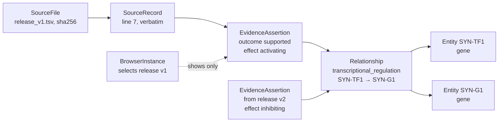
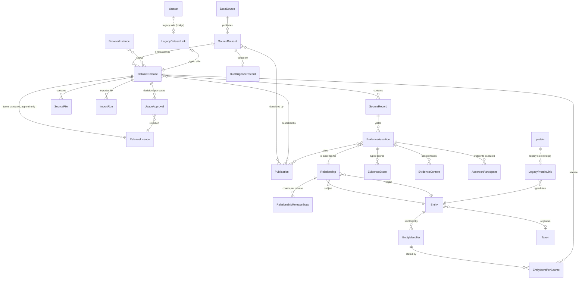

# Generalization architecture

Proposed design for the generalization project ([PROJECT_BRIEF.md](PROJECT_BRIEF.md)).
It builds on the audit in
[CURRENT_ARCHITECTURE_ASSESSMENT.md](CURRENT_ARCHITECTURE_ASSESSMENT.md) and is
turned into work in [IMPLEMENTATION_PLAN.md](IMPLEMENTATION_PLAN.md).

**Status: proposed (Phase 0), with the owner's decisions of 2026-10-29
applied.** Nothing here is implemented. Section 15 lists those decisions and
where each one changed the design. Departures from the brief are collected in
section 12. Statements about today's code cite `file:line` on `main` at
`94345c3`. Biological and licensing facts that have not been checked against
their authority are marked *(verify)*.

**How it was produced.** Three independent proposals were written, each
starting from a different priority:

- compatibility: zero risk to the running portals;
- scientific semantics: identity and evidence done right first;
- product: the shortest path to the brief's MVP.

Two judges then checked them against the code and scored them, one for
engineering and migration safety and one for scientific and data integrity.
This document combines the strongest choices. Section 14 lists what the
reviews changed.

## 1. Summary

openPIP becomes two systems in one codebase. The existing PPI portal stays
exactly as it is. A typed, evidence-centred relationship graph is added beside
it, in new Django apps that the PPI code never sees.

- **Nothing is replaced.** The legacy tables remain the only store for:
  - the PPI pages, `/api/search` and PSICQUIC;
  - downloads, saved views and the importer.

  No typed row is ever written to `interaction`, `protein` or `dataset`, and
  no column is added to a legacy table.
- **Typed data lives in new apps.** `graph` holds registries, entities,
  identifiers, provenance, relationships, evidence and licensing. `browsers`
  holds the gallery's instances. Neither has a database foreign key into a
  legacy table. A `graph_bridge` app, built only if an existing PPI portal
  adopts the typed graph, would link legacy rows to typed ones (D11); it
  would be the only app allowed to reference legacy tables.
- **Cross-dataset integration is central.** Every dataset resolves to one
  shared set of typed entities: HGNC IDs for human genes, and UniProtKB
  accessions for proteins and, separately, their isoforms. Genes and proteins
  stay distinct. They are joined only by reference links that approved,
  versioned releases state: `encodes` from a gene-to-protein mapping release,
  and `isoform_of` from a UniProt release. A search for a gene follows those
  links, labelled, to its protein's interaction partners (section 4.6).
- **One relationship per scientific claim; one assertion per source
  statement.**
  - A canonical relationship is identified by its type, its endpoints
    (ordered or not, as the type says) and any qualifiers the type declares.
  - Effect, tested-absent outcome, genetic sign, method, score, context and
    publication belong to each assertion.
  - What an edge shows is computed from the assertions the caller is allowed
    to see, by rules stated in section 4.5.
- **Provenance and licensing come first.**
  - Every assertion traces to a verbatim source record in an immutable,
    checksummed release.
  - Internal use, public view, bulk download and disclosure to third-party
    services are separate, recorded decisions per release, and the default is
    no.
  - One server-side function decides what each request may see.
- **Off by default.** `TYPED_GRAPH_ENABLED` defaults to false. When it is
  false, HuRI, YeRI and FlyBi gain empty tables, plus the bookkeeping rows
  Django adds for any new model (section 6.2), and nothing else. Every new
  API route then returns 404, except one status endpoint, and every typed
  management command refuses to write.
- **Synthetic first, real data early.** The first non-PPI network is a small
  synthetic, directed regulatory fixture written for this repository. Right
  after the brief's MVP, a real-data milestone joins a real gene-level
  regulatory network to a real protein-level interaction network through an
  approved, versioned gene-to-protein mapping. Real datasets are imported
  only after a due-diligence record and a recorded approval exist, and PPI
  datasets are imported directly as typed releases.
- **PostgreSQL only.** Bounded one-hop neighbourhoods with hard caps. No graph
  database or search engine until benchmarks show a need.

## 2. The concepts, and how they differ

The brief (§13, item 4) asks for the distinction between a dataset, a release,
a source record, an evidence assertion, a canonical relationship and a browser
instance. In this design:

| Concept | What it is | Changes? | Example |
|---|---|---|---|
| **Source dataset** (`SourceDataset`) | The identity of a study or resource as its publisher defines it. It is named in code to avoid a clash with the legacy `datasets.Dataset` | Its descriptive metadata can be edited | "Synthetic regulation example" |
| **Release** (`DatasetRelease`) | One immutable, versioned snapshot of a dataset: its files and checksums, the adapter version, its licence snapshots and the approvals. It is the unit of import, licensing, visibility and withdrawal | Never after publication. While still `staged` it can be discarded back to draft and imported again. A correction is a new release that supersedes it; the old one stays available for auditing | "v1, retrieved 2026-11-02, sha256 …" |
| **Source record** (`SourceRecord`) | One verbatim row of a release file, with a stable key, kept exactly as read | Its content never. Its mapping status and issues follow the latest run while the release is unpublished; each import run's report keeps its own copy | line 7 of `release_v1.tsv` |
| **Evidence assertion** (`EvidenceAssertion`) | One statement a source record makes about one relationship: its outcome, effect, method, scores, context, publications, and the source's own wording | Never once its release is published; it belongs to its release | "record 7 says SYN-TF1 activates SYN-G1" |
| **Canonical relationship** (`Relationship`) | The claim itself (type and endpoints, plus any site or role the type needs), with no counts or effect stored on it. Many assertions from many releases attach to one relationship | Never; it holds identity only | "transcriptional regulation, SYN-TF1 → SYN-G1" |
| **Browser instance** (`BrowserInstance`) | A configured view: which releases, layers and filters to show, with its own citation, text and presentation, or a link to an independent portal. It holds no data | Edited by admins | `/browsers/synthetic-regulation` |

How one row travels through them:



An edge drawn in a browser restricted to v1 shows one activating assertion.
If v2 supersedes v1, the unified explorer shows only v2's inhibiting
assertion by default, because superseded releases do not contribute to
default views (section 3.7). With both releases selected explicitly, it shows
two assertions and a "mixed" effect summary. No view changes the stored data,
and v1's records stay available for auditing.

## 3. Data model

### 3.1 Apps and boundaries

| App | Holds | May reference legacy tables? | Arrives |
|---|---|---|---|
| `graph` | Registries, entities, identifiers, data sources, datasets, releases, files, import runs, source records, publications, licences, approvals, relationships, evidence | No foreign key, and no import of `proteins`, `interactions`, `datasets`, `admin_panel`, `sharing` or `psicquic` | Phase 1 |
| `browsers` | `BrowserInstance` and its release selection | No | Phase 2 |
| `graph_bridge` | Derived, rebuildable links from legacy proteins and datasets to typed rows, and the read-time federation provider | Yes; it would be the only app that may | Deferred. Built on demand, only when an existing PPI portal adopts the typed graph (D11) |

The only pre-existing table the new apps reference is `user`, for "decided by"
and "triggered by". `migrate_legacy.py` skips it
(`migration/migrate_legacy.py:37-38`). Tests enforce these boundaries from the
first PR (see [TEST_PLAN.md](TEST_PLAN.md)).

Why the boundary matters: `migrate_legacy.py --reset` runs
`TRUNCATE ... RESTART IDENTITY CASCADE` on each legacy table it reloads
(`migration/migrate_legacy.py:126-128`). The operator guide documents that as
the normal reload path. PostgreSQL then also empties every table with a
foreign key into the truncated table, and every table that references those.
That already includes four 2.0 tables the script does not reload:
`interaction_participant`, `user_datasets`, `user_interaction_networks` and
`user_protein` (`backend/interactions/models.py:251-262`,
`backend/core/models.py:44-95`).

- A single typed foreign key to `protein` or `organism` would therefore empty
  the typed graph during a legacy reload.
- Bridge tables are designed to be emptied that way (they fail empty, not
  wrong) and rebuilt by a command.
- A bare-integer "soft" reference would survive the truncation but point at
  different rows once another dump is loaded, because the script copies the
  source ids and resets the sequences (`:156-162`). Soft references are
  therefore not used.

Django is pinned at 5.0.6 (`backend/requirements.txt:1`). Check constraints
take `check=`, and `db_default` is available.

### 3.2 Diagram



Lower-case boxes (`protein`, `dataset`) are existing legacy tables, unchanged.
The dotted lines are the only foreign keys into them, and they would live in
`graph_bridge`. The registries (section 3.3) are omitted for readability:
entity types, namespaces, relationship types, score types and terms are
foreign-key targets of the models shown.

Not everything in the diagram arrives at once:

- `EntityIdentifierSource` comes with RF1a, the first releases that state
  identifiers beyond an entity's defining one.
- `RelationshipReleaseStats` comes in P1, and only if the benchmark needs it.
- The `graph_bridge` tables are built on demand (D11).

### 3.3 Registries

Entity types, identifier namespaces, relationship types, score types, taxa and
controlled-vocabulary terms are **database tables with slug (or taxid) primary
keys** (decision D5). The models that use them hold real foreign keys with
`on_delete=PROTECT`, so the database refuses data of an unknown type.

**Seeding.** The rows come from versioned, reviewed JSON files in
`backend/graph/registry/v1/`, loaded by the operator command
`graph_sync_registry`:

- It is idempotent, and has `--dry-run`.
- It reports, and never deletes, rows that are missing from the JSON.
- On existing rows it updates only descriptive fields: labels, definitions,
  display tokens, URL templates and authority references.
- It refuses a change to any field that stored data depend on while rows
  already use it, and names those rows. Those fields are:
  - for a namespace: its case policy, version policy, scope, fixed taxon,
    allowed entity types or `defines_identity`;
  - for an entity type: its taxon policy or identity scheme;
  - for a relationship type: its orientation, polarity, allowed endpoint types
    or identity qualifiers; from G3, every field but its label, definition,
    role labels, display token and PSI-MI anchors, so its family and
    self-pair rule too;
  - for a score type (G3): every field but its label, definition and
    defining document.

  Each of these shapes stored rows: `lookup`, the immutable `identity_key` or
  `Relationship.ordered`. A silent change would split one accession into two
  entities, or one pair into two relationships. Such a change goes through a
  deliberate re-key command instead (section 4.2).
- It decides under locks (G3). Inside its write transaction it plans again:
  it locks each row it will change (`select_for_update()`, in key order)
  and only then counts the rows that use it. Every writer that validates
  against those rows (recording evidence, creating relationships, scores and
  entities) first holds them in shared mode, so whichever of a sync and a
  commit comes second sees the other's result.
- It records the registry version it loaded.
- The import commands refuse to run when the database's registry version
  differs from the code's, and the status endpoint reports both.

No migration writes registry rows. HuRI, YeRI and FlyBi therefore receive
empty registry tables. The Django admin shows registries read-only.

| Registry | Key fields |
|---|---|
| `Taxon` | NCBI taxid (primary key, check > 0), scientific name, common name, rank, `parent` (so a strain can match its species without rewriting either), `merged_into`, the source of the label. PSI-MI's pseudo-taxa (−1 *in vitro* and the rest) are never taxa; they are evidence context |
| `EntityType` | slug, label, definition, taxon policy (`required` / `optional` / `forbidden`), identity scheme (`identifier` / `coordinates` / `allele` / `source_local`), whether an assembly is required, display token |
| `IdentifierNamespace` | slug, label, CURIE prefix, allowed entity types (M2M), scope (`global` / `taxon` / `assembly`), fixed taxon for organism-owned nomenclatures, case policy (`exact` / `upper` / `insensitive`), version policy, `defines_identity` (an import run with `--create-entities` may create entities of its types; section 4.1), pattern, URL template, the authority document its rules were copied from |
| `RelationshipType` | slug, label, a definition saying what the edge claims and what it does not, family (G3's check lists every family of section 4.2, so a later family needs no constraint change), orientation (`symmetric` / `directed` / `role_ordered`), polarity (`none` / `effect` / `genetic_sign`), allowed subject and object types (M2M) with role labels, identity qualifiers (none in G3: every type declares `[]` until P2), whether self-pairs are allowed, PSI-MI crosswalk anchors, display tokens, `is_reference` (a link between entity layers rather than an evidence-backed claim) |
| `ScoreType` | slug (`<source>:<name>` or `stats:<name>`), label, definition, value kind (`probability`, `p_value`, `q_value`, `rank`, `count`, `continuous`), direction (`higher_is_stronger`, `lower_is_stronger`, `signed`, `unordered`), range, unit, null model, defining document, `comparable_across_datasets` (default false) |
| `Term` (G3) and `TermParent` (V1, deferred) | CURIE (the primary key, in canonical form such as `MI:0915` or `ECO:0000353`; `graph.terms` accepts the MI and ECO prefixes, and others arrive with the first adapter that maps them), ontology (`psi-mi`, `eco`, `uberon`, `cl`, `efo`, …; derived from the prefix by code, with no database check, so an ontology is added without a constraint change), label, the release whose commit supplied the label (`label_release`, written only when the term is created, and on every insert path only naming a draft release; a term never changes, so it keeps naming that release after the release moves past draft, and is emptied only if that draft release is deleted), definition, obsolete flag, the ontology release it came from, and `is_a` parents. Adapters may create a term from a source-supplied CURIE and label, and never invent one. G3 creates one only inside a commit that may record evidence (a draft release, a running commit run, an effective `internal` approval unless the release is synthetic), race-safely; a term keeps its first label, and a later label that differs, or one that differs from the PSI-MI crosswalk's, is reported and never written. A crosswalk term keeps the crosswalk's label, and `label_release` names the release whose commit created the term only when that commit stated the crosswalk's label; otherwise it stays empty, even after a later release states that label. A label is shown beside real evidence only while the release that supplied it is visible to the caller and not synthetic (D12), so the synthetic demo never labels a term that real evidence names. Until V1 loads versioned, licence-recorded ontology releases, each adapter maps the terms it accepts through an explicit, test-pinned list (M1), a subset of G3's PSI-MI physical crosswalk (D20); V1 is what later lets crosswalks and filters work by subtree |

**At most one identity namespace per entity type and taxon.** For each
entity type and taxon, at most one namespace defines identity:

- a namespace fixed to the taxon, if one defines identity for the type;
- otherwise the single global one, if there is one.

Where none applies, no entity of that type and taxon can be created. For
example, there are no fly or yeast genes until their namespaces are decided
(open question D7). Cross-reference namespaces, such as `ncbigene` and
`ensembl_gene`, are never a fallback. Every other namespace of the type
supplies cross-references or aliases only. A registry test enforces the
rule, and `create_entity` applies it. Two releases that name one gene by
different identifiers therefore reach the same entity, or report why they
cannot; they never create two.

Initial entries. Each real-world rule is checked against its authority in the
PR that adds it, and unverified namespaces are not added.

| Registry | First entries |
|---|---|
| Entity types | `gene`, `protein` (a UniProtKB entry), `protein_isoform` (one isoform's own record). Later: `transcript`, `mature_mirna`, `ncrna`, `chemical`, `disease`, `phenotype`, `complex`, `genomic_region`, `variant` |
| Namespaces, defining identity | `uniprotkb`: an entry accession such as `P04637` defines a `protein`, and an accession with any isoform suffix, `-1` included, defines a `protein_isoform` (section 4.1). `hgnc` (taxon 9606 fixed): HGNC IDs, of the form `HGNC:<number>`, define human genes (owner's decision, 2026-10-29). HGNC's help confirms the format and says the ids "remain stable even if a name or symbol changes" ([DATASET_DUE_DILIGENCE.md](DATASET_DUE_DILIGENCE.md) §3.1); G1's review settles the normalization, for example whether a bare number is accepted. `synthetic_gene` (gene) and `synthetic_protein` (protein, protein_isoform), both fixed to taxon 32630 and for the fixture only; two are needed because one namespace never identifies both genes and proteins (section 4.1) |
| Namespaces, cross-reference only | `ncbigene` (gene) and `ensembl_gene` (gene; version split off). They never define identity; they resolve to a gene only through a cross-reference that an approved release, such as the HGNC reference release, states |
| Namespaces, symbols (never defining) | Organism-owned symbol namespaces come with the first source that needs them: `hgnc_symbol` (taxon 9606) with RF1a, holding each gene's approved symbol (role `symbol`), previous symbols (`secondary`) and alias symbols (`alias`); `flybase_symbol` (taxon 7227, case-exact) later *(verify both)*. Symbols never define identity and never merge entities. **There is no generic, multi-organism symbol namespace** |
| Taxa | 9606, 7227 and 32630 ("synthetic construct") *(verify the labels)* |
| Relationship types | `transcriptional_regulation`, `physical_interaction`, `protein_interaction_unspecified`, `encodes`, `isoform_of` (section 4.2). `genetic_interaction` comes with N1; until then G3's tests exercise sign polarity with a test-only type |
| Score types | Defined from each source's documentation when its adapter is added. The synthetic fixture defines two, `synthetic:confidence` (probability, higher is stronger) and `synthetic:rank` (rank, lower is stronger), because D12 needs one assertion with two scores and an assertion holds one score per score type |

### 3.4 Entities and identifiers

**`graph.Entity`**: the single typed node table.

| Field | Type | Notes |
|---|---|---|
| `id` | BigAutoField | Public as `entity:<id>`; never reused |
| `entity_type` | FK EntityType, PROTECT | Cannot change after creation; retyping means a new entity and an audited merge |
| `identity_key` | CharField(400), unique | Immutable. Computed by the type's identity scheme: `<namespace>\|<scope>\|<lookup>` of the defining identifier, which fits in 400 characters (slug at most 50, scope key 64, lookup 255, two separators); later, coordinates or alleles for those types. It lets imports create entities with `INSERT … ON CONFLICT DO NOTHING` and re-select, which stays idempotent when two releases commit at once |
| `label` | CharField(255) | Display name, not identity |
| `label_key` | CharField(255), `db_index=True` | The upper-cased label, set by the write path; used only for prefix search |
| `description` | TextField, blank | Plain text, always rendered escaped |
| `taxon` | FK Taxon, PROTECT, null | Required or forbidden according to the entity type: required for genes, proteins, isoforms, transcripts and RNAs; forbidden for chemicals, diseases and phenotypes. Never filled in from deployment settings. Fixed once the entity exists, as its type and `identity_key` are, on every write path (G3) |
| `status` | CharField | `active`, `provisional`, `merged` or `retired`; check constraint |
| `merged_into` | FK self, PROTECT, null | Set only by the audited merge command (P5). A check requires it exactly when the status is `merged` |
| `created_by_release` | FK DatasetRelease, PROTECT, null | Provenance; added with the provenance models |
| `created_at`, `updated_at` | DateTimeField | |

Indexes: `(entity_type, taxon)`, and `label_key`. Because `label_key` has
`db_index=True`, Django's PostgreSQL backend also creates a
`varchar_pattern_ops` index on it, which `label_key__startswith` uses. A plain
B-tree index, including a functional `Upper(label)` index, cannot serve
`LIKE 'ABC%'` under a non-C collation. The portals run the `postgres:16` image
(`docker-compose.yml:3`) with no locale arguments, so they get the image's
default collation, `en_US.utf8` *(verify on each deployment)*. SQLite ignores
the extra index. A G1 test checks the plan with `EXPLAIN` on PostgreSQL.

**`graph.EntityIdentifier`**

| Field | Type | Notes |
|---|---|---|
| `entity` | FK Entity, CASCADE | |
| `namespace` | FK IdentifierNamespace, PROTECT | |
| `value` | CharField(255) | Exactly as the source wrote it, prefix removed |
| `lookup` | CharField(255) | Normalized by the namespace's case and version policies |
| `version` | CharField(32), blank | The version split off, for namespaces that split one |
| `scope_key` | CharField(64), default `''` | `''` for global namespaces, `t:<taxid>` or `a:<assembly>` for scoped ones. Never NULL, so unique keys behave the same on PostgreSQL and SQLite |
| `role` | CharField | `primary` (the defining identifier), `xref` (an identifier in another resource), `secondary` (a former primary value: a UniProt secondary accession, or an HGNC previous symbol), `alias`, or `symbol` (the current official symbol in an organism-owned symbol namespace, from RF1a); check constraint. All five are in G1's constraint, so no later migration widens it. Keeping the symbol kinds apart lets a match say whether it hit the approved symbol, a previous symbol or an alias |
| `created_at` | DateTimeField | |

Until RF1a, imports store only each entity's defining identifier. A primary
identifier is always visible exactly when its entity is, before and after
RF1a, and its provenance is `Entity.created_by_release` (section 4.1). An
identifier has no release of its own, because several releases can state the
same one. RF1a, the first issue whose releases state identifiers beyond an
entity's defining one (cross-references, secondary accessions, aliases), adds
their provenance in the same PR. Aliases and their race-safe writes also
start there. No import stores a non-primary identifier before then; G1's
resolver tests create such rows directly through factories.

**`graph.EntityIdentifierSource`** (with RF1a)

| Field | Type | Notes |
|---|---|---|
| `identifier` | FK EntityIdentifier, CASCADE | |
| `release` | FK DatasetRelease, PROTECT | A release that states this identifier |
| `source_record` | FK SourceRecord, CASCADE, null | The first record of that release that stated it |

It is unique on `(identifier, release)`. From RF1a, every release that
states an identifier writes a source row, primary identifiers included. A
reference release that supersedes another therefore keeps its genes and
proteins visible in default views. `EntityIdentifier` gains `origin`
(`release` or `operator`) in the same PR, as an `AddField` with database
default `release`. Every identifier stored before RF1a came from an import,
so existing rows get the right value without a data migration, and an
identifier without a source row is never mistaken for one an operator
entered.

- `resolve` matches, and `GET entities/{entity_id}` lists, a non-primary
  identifier only if an operator entered it or a release the caller may see
  states it. Otherwise an alias that only an embargoed or unapproved release
  states would leak through an entity that is visible for another reason. A
  primary identifier follows its entity.
- `graph_discard_release` deletes the discarded release's identifier sources,
  then each non-primary identifier from a release that is left with none.
  It never deletes a primary identifier or an entity. A provisional entity
  left without assertions stays, so a re-import finds it again by its
  `identity_key`, and `graph_check` reports it.

Constraints:

- `UNIQUE(namespace, lookup, scope_key) WHERE role = 'primary'`: a defining
  identifier names at most one entity.
- `UNIQUE(entity) WHERE role = 'primary'`: each entity has one defining
  identifier, created in the same transaction as the entity.
- `UNIQUE(entity, namespace, lookup, scope_key, role)`: no duplicate rows.

Cross-references, secondary accessions and aliases are **not** unique. When
UniProt splits an entry, the old accession stays as a secondary accession on
each resulting entry, and an HGNC previous symbol can point to several genes.
A uniqueness constraint on those roles would reject legitimate data in the
middle of an import. They produce candidates only.

Indexes: `(namespace, lookup, scope_key)`, `(lookup)`, and
`Index(Upper("lookup"), name="graph_ident_lookup_upper")`. The last one finds
case-mismatch candidates in case-exact namespaces (section 4.1) without a table
scan. Django limits index names to 30 characters.

### 3.5 Provenance

| Model | Key fields | Constraints |
|---|---|---|
| `DataSource` | slug, name, kind (`lab`, `consortium`, `database`, `this_portal`, `other`), url, description | slug unique |
| `SourceDataset` | slug, title, short title, description (plain text), data source, homepage, status (`candidate` = known, nothing imported; `active`; `withdrawn`), which describes the dataset and gates nothing: its data leave view only through a release's withdrawal or an approval's revocation (G2) | slug unique |
| `Publication` | pmid, doi (as given) and `doi_lookup` (lower case), pmcid, imex id, title, authors, journal, year, url, `is_synthetic` (fixed when the row is created; G3), and `local_key` with `local_dataset` (FK SourceDataset, null) for a publication that has none of those identifiers | partial unique on each identifier when not blank, and on (local_dataset, local_key) when `local_key` is not blank. Identifiers of one paper in one row are merged into one publication; for example IntAct's `imex:IM-11990\|pubmed:17081976` is one paper. A local key comes from the release manifest (section 8), so a title-only paper, such as the fixture's synthetic ones, is the same row in every release of its dataset |
| `SourceDatasetPublication`, `ReleasePublication` | dataset or release, publication, role (`primary`, `describes`, `update`, `erratum`, `related`) | unique (parent, publication, role) |
| `DatasetRelease` | dataset, version (the source's label, URL-safe), release date, retrieved at, source URL, `kind` (`evidence` or `reference`, declared by the adapter's spec), status (`draft`, `staged`, `published`, `superseded`, `withdrawn`), `supersedes` (a foreign key to the release it corrects, which has the same dataset and `is_synthetic`), `is_synthetic`, `embargo_until`, declared taxa (M2M through `ReleaseTaxon`), adapter, adapter version and mapping version, `store_raw_rows` (default true), `stats` (JSON, computed at commit), withdrawn at and reason | unique (dataset, version). `supersedes` is unique among releases that were published, so a release is corrected by at most one, and a correction withdrawn before it was published frees the release it named (G2) |
| `SourceFile` | release, role (`data`, `entities`, `manifest`, `readme`, `licence_text`, `supplementary`), original name, storage path, media type, size, sha256, retrieved from | unique (release, sha256); several files per release |
| `ImportRun` | release, file, adapter, adapter and mapping versions, mode (`dry_run`, `commit`), state (`running`, `failed`, `completed`, `abandoned`), parameters, checkpoint, report, error, triggered by (SET_NULL, plus a username snapshot), started and finished | at most one open commit run (`running` or `failed`) per release (partial unique): G5 resumes it, and a discard marks it `abandoned` |
| `SourceRecord` | release, file, import run, `record_key` and its basis (`source_id`, `line_number`, `content_hash`), line number, `raw` (the verbatim column map; NULL when the release does not store raw rows, with file, line and hash kept), `raw_sha256`, status (`mapped`, `unresolved`, `ambiguous`, `rejected`, `skipped`; section 4.1), issues | unique (release, record_key). Status and issues are the only fields a later dry run or commit of an unpublished release may update; each `ImportRun` report keeps its own copy, so earlier outcomes stay auditable. A record that evidence was recorded from stays `mapped`, since its assertions rest on that mapping (G3) |

**Superseded releases.** A release becomes `superseded` in the same
transaction that publishes the release naming it in `supersedes`, and it is
never reverted automatically. It does not contribute to default views
(section 3.7). Its records, assertions, files, licence snapshots and
approvals stay, and are shown on its own catalogue page and wherever it is
selected explicitly or pinned, flagged as superseded, so it can always be
audited. Withdrawing a correction does not bring back the release it
corrected; publishing a new release does. A dataset whose releases are
increments, not replacements, leaves `supersedes` empty.

Source files are stored **outside `MEDIA_ROOT`**, because `MEDIA_ROOT` is not
private:

- With DEBUG off, Django serves only `media/avatars/` and `media/logos/`
  (`backend/openpip/urls.py:38-42`).
- With DEBUG on, `backend/openpip/urls.py:55-56` serves everything under
  `MEDIA_ROOT`. `openpip.settings.dev` sets DEBUG on
  (`backend/openpip/settings/dev.py:3`), and `docker-compose.yml:29, 52` runs
  the backend and Celery with it on a published port (`:39-40`).

The files go under a new setting, `GRAPH_FILES_ROOT`, which defaults to
`BASE_DIR / "graph_files"` and is not read from the environment. They are laid
out as `releases/<release>/<sha256>/`. No URL pattern serves that root.

- G4 adds a `graph_files` volume for `backend` and `celery` to
  `docker-compose.prod.yml`, which today persists only `media:/app/mediafiles`
  (lines 35-36 and 48-49).
- It also adds `backend/graph_files/` to `.gitignore`, because the dev stack
  bind-mounts `./backend` (`docker-compose.yml:41-42`).
- A G4 test asserts that the root is not inside `MEDIA_ROOT` or `STATIC_ROOT`.

Release files are never served directly. Exports go through the bulk-download
gate.

### 3.6 Relationships and evidence

**`graph.Relationship`**: identity only.

| Field | Type | Notes |
|---|---|---|
| `relationship_type` | FK RelationshipType, PROTECT | |
| `subject` | FK Entity, PROTECT | Regulator, enzyme or other subject; the lower entity id for symmetric types |
| `object` | FK Entity, PROTECT | |
| `ordered` | BooleanField | Copied from the type's orientation when the row is created |
| `qualifier_key` | CharField(160), default `''` | Canonical serialization of the identity qualifiers the type declares, such as `site:<sequence site id>`; `''` when it declares none. A new qualifier needs no change to the unique constraint. Always `''` in G3: no type declares a qualifier until P2, and any other key is refused |
| `created_at` | DateTimeField | |

Constraints:

- `UNIQUE(relationship_type, subject, object, qualifier_key)`.
- `CHECK(ordered OR subject_id <= object_id)`: A–B and B–A are one row for
  symmetric types. The database checks both rules itself, so a bug in the
  service cannot silently split or merge claims.

Indexes: `(subject, relationship_type)` and `(object, relationship_type)`.

A relationship is never changed or deleted. Its endpoints are `active` or
`provisional` entities, never `merged` or `retired`: a merged entity's
evidence belongs on its successor (P5). Its row's guard checks the type's
rules again from the database, under a shared lock on the type (G3).

**`graph.EvidenceAssertion`**: one source statement about one relationship.

| Field | Notes |
|---|---|
| `relationship` | FK Relationship, PROTECT |
| `release` | FK DatasetRelease, CASCADE (G3). Copied from the source record so filters need no join. Evidence follows the release's lifecycle: a draft release's deletion takes it, and nothing of a staged or published release is deleted |
| `source_record` | FK SourceRecord, RESTRICT (G3): a record with evidence goes only with its whole draft release |
| `assertion_key` | Deterministic and content-derived within the record: `main`; `pub:<publication key>` when one row reports several papers; `site:S15`. It never depends on extraction order. In G3 it is the claim's key part (`main` when blank; a record with several claims names each, distinctly), followed by `\|pub:<paper key>` when the claim reports several papers. The paper key comes from the identifiers the record states for the paper (PMID first, then DOI, PMCID, IMEx id, local key), each the publication's own value, never from a stored row that a later merge could change |
| `import_run` | FK ImportRun, RESTRICT (G3); the commit run that first wrote it |
| `outcome` | `supported`, `tested_absent`, `inconclusive` or `not_significant` (D17) |
| `evidence_basis` | `experimental`, `computational_prediction`, `computational_inference`, `statistical`, `text_mining` or `unknown`: what the claim rests on |
| `assertion_method` | `manual_assertion`, `automatic_assertion` or `unknown`: how the source made the statement. It is kept apart from the basis, so that "literature-curated" never competes with "experimental" for one slot |
| `eco_term` | FK Term, null. An ECO evidence code when the source gives one |
| `effect` | `activating`, `inhibiting`, `unknown` (the source says unknown) or `not_applicable`; NULL means the source did not state one. Only types with effect polarity carry one (G3). `not_applicable` stays in the database check but is never stored: it is the summary of types without effect polarity |
| `genetic_sign` | `negative` or `positive`, relative to the null model of the score type that accompanies it; NULL when not applicable. Only types with sign polarity carry one, and only with a score on the same assertion of a signed type that states its null model; when that score's value is finite and not zero, the sign agrees with it (G3) |
| `interaction_type` | FK Term, null. The PSI-MI interaction type as stated, never upgraded |
| `interaction_level` | Physical-family assertions only (NULL otherwise): `association`, `physical_association`, `direct_interaction` or `not_stated` (D20). The adapter sets it from its test-pinned list of the PSI-MI terms it accepts, and rejects a row whose term is not listed. The edge label and any level filter read this field alone, so neither needs the PSI-MI hierarchy before V1. In G3 a stated `interaction_type` is in the one PSI-MI crosswalk (D20) and the level is the crosswalk's; without one the level is `not_stated`, or `association` assigned by openPIP (B14). `physical_association` and `direct_interaction` always rest on a stated type |
| `relationship_as_stated`, `effect_as_stated` | The source's own wording |
| `evidence_group` | Groups assertions that come from one n-ary observation, such as one purification, so they are not counted as independent. The label is the source's own, so a group is always (release, `evidence_group`): equal labels in two releases are different groups |
| `observation_key` | Blank, or an identifier the source gives for the observation itself that other resources share, such as an IMEx interaction id *(verify per source)*. Added by the first adapter that can fill it (M1), and used only to count independent evidence (section 4.5) |
| `qualifiers` | JSON. Further mapped source fields, documented per adapter: for example `expansion: "spoke"`, the source's genetic-interaction class, alleles, or a tested hypothesis's effect (`tested_effect`) on a tested-absent row. `threshold` is reserved (G3): a `not_significant` assertion records there the significance criterion it failed (section 4.3), and no other outcome carries it |
| `created_at` | |

Constraints:

- `UNIQUE(source_record, assertion_key)`: the idempotency key.
- Check constraints on every closed field. No allowed value is called
  "negative" except `genetic_sign = negative`, whose meaning the score type
  defines.
- `CHECK(NOT (effect IS NOT NULL AND genetic_sign IS NOT NULL))`.
- `CHECK(outcome = 'supported' OR (genetic_sign IS NULL AND (effect IS NULL OR effect = 'not_applicable')))`:
  tested-absent, inconclusive and not-significant assertions carry no effect
  and no sign.

Indexes: `(relationship, release)` and `(release, outcome)`.

Stored evidence never changes (G3). An assertion and each of its parts are
inserted while their release is a draft, by its running commit run, from a
`mapped` record; they are never saved again, changed or not, and are
deleted only while the release is a draft, on every write path. A
correction is a new release.

**Children of an assertion**

Each part is deleted with its assertion (CASCADE) and also holds the
assertion's release (CASCADE), so it follows the same lifecycle (G3).

- `AssertionParticipant`: one row per side, generalizing
  `InteractionParticipant` (`backend/interactions/models.py:229-294`). It
  holds the assertion, the side (`subject` or `object`) and the entity, plus:
  - the side as the source stated it, while the relationship holds the
    canonical order: a symmetric pair stated higher id first keeps its
    stated sides (G3);
  - how the source wrote the identifier, always kept verbatim;
  - the resolution basis (`primary`, `xref_unique`, `alias_unique`,
    `isoform_entry`, `source_local`, `curated`; section 4.1);
  - for `isoform_entry`, the isoform the source named (`stated_entity`), the
    entity being its protein entry, mapped only through a verified
    `isoform_of` link (open question B12; G3);
  - from M1, the PSI-MI participant fields: experimental and biological
    roles, interactor type and identification method (Term FKs), and
    features and stoichiometry (text).
- `EvidenceMethod`: the assertion, a Term and a role (`detection`,
  `participant_identification`, `evidence_code`). Unique on all three.
- `EvidencePublication`: the assertion, a publication and a role
  (`reported_in`, `method_reference`, `cited`). At most one `reported_in` per
  assertion, as a partial unique. A row reporting several papers yields one
  assertion per paper, as the brief requires (brief §4).
- `EvidenceScore`: the assertion (CASCADE), a ScoreType (PROTECT), `value` (a
  finite float or NULL) and `raw_value` (verbatim). Unique on (assertion,
  score type); indexed on (score type, value). NaN and infinity are rejected,
  and the raw value is kept.
- `EvidenceContext`: the assertion (CASCADE) and a facet: `host_taxon`,
  `tissue`, `cell_type`, `cell_line`, `condition`, `perturbation`,
  `compartment`, `assay_system`, `developmental_stage`, `timepoint`,
  `genome_assembly` or `other`. Each row has a term (FK Term, null) or a taxon,
  a label and the raw value. An absent facet means *not stated*, never *all*.

**`graph.RelationshipReleaseStats`** (P1, and only if the benchmark needs it).
Until then, ranking counts the visible assertions through the
`(relationship, release)` and `(release, outcome)` indexes, within the caps
and the statement timeout, and reports any candidates a pre-limit cut
(section 4.5). If the highest-degree real seed misses the agreed latency
target, P1 adds this table. For each (relationship, release) it would hold
these additive counts:

- supported, tested-absent and inconclusive assertions;
- supported assertions by evidence basis;
- supported assertions by effect, including unknown and not stated;
- supported assertions by genetic sign.

A published release never changes, and a discarded one loses its rows in the
same transaction, so these counts would never go stale. The table would be
rebuildable by command, never authoritative, and pinned by a test to a
recomputation from assertions. Distinct counts (publications, datasets,
independent evidence) are **not** stored, because they do not add up across
releases (section 4.5). `DatasetRelease.stats`, written once at commit, serves
each release's catalogue figures from the start. Hub totals sum only
releases and assertions, which add up across releases; datasets are counted
distinct over the visible releases, because incremental releases of one
dataset stay published together. Entity and relationship counts are shown
per release and never summed.

**Added later, when a family needs them**

- `SequenceSite` (P2): a protein or isoform entity, residue, position, and the
  sequence version or checksum the position refers to. Site-specific
  relationships put its id in `qualifier_key`.
- Coordinate and allele tables for `genomic_region` and `variant` (P4).
- Complex and reaction entities with member roles and stoichiometry (P3).

### 3.7 Licensing and approvals

| Model | Key fields | Rules |
|---|---|---|
| `DueDiligenceRecord` (exactly one per source dataset, unique on the dataset; can exist before any release. Its creation and every change to its status, flag, reviewer, review date, notes link or confirmation time are kept as a history, `DueDiligenceChange`, naming who made each. New terms never reopen it (G2): reopening hides every approved release of the dataset at once, so recording a correction's terms would silently hide public data. New terms gate new approvals instead, in the rules below) | Status (`open`, `complete`, `blocked`), reviewer, date, a link to the reviewed notes that answer the brief's §7 checklist ([DATASET_DUE_DILIGENCE.md](DATASET_DUE_DILIGENCE.md) and its successors), notes, and `terms_time_limited` | Fails closed, because approval expiry is deferred. For a non-synthetic release, `graph_approve` refuses every approval unless the dataset's record is `complete`, was confirmed (`completed_at`) after the release's latest licence snapshot was recorded, and `terms_time_limited` is not set; a denial is always recorded. An approval already recorded stops being effective as soon as the record is not `complete` or the flag is set (the rules below); the confirmation time does not affect effectiveness |
| `ReleaseLicence` (append-only; one or more snapshots per release) | Licence name exactly as stated (`''` means unknown), an SPDX id only when the source states one, licence URL, quoted terms, where and when they were read, attribution text, redistribution (`permitted`, `permitted_with_conditions`, `not_permitted`, `unknown`), `share_alike` (`yes`, `no` or `unknown`; whether adapted material must carry the same licence, as CC BY-SA requires), commercial use, modification, obligations, ambiguity notes, reviewer, recorded at and by | Never pre-filled by the system. Fields stay `unknown` until a person records them. The latest snapshot, the one with the highest id, holds the current terms. A snapshot is immutable from insertion (G2), so new or corrected terms, including terms researched after an `internal` approval, are recorded as a new snapshot |
| `UsageApproval` (append-only, per release and scope) | Release (PROTECT), scope (`internal`, `public_view`, `public_bulk`, `external_services`), the licence snapshot it relied on (FK ReleaseLicence, PROTECT), decision (`approved` or `denied`), mandatory rationale, evidence URL or text, decided by (SET_NULL) plus a username snapshot, decided at, and revoked at, by (SET_NULL, with snapshot) and why | `UNIQUE(release, scope) WHERE revoked_at IS NULL`. A check makes the rationale non-empty. A decision is never edited: after insertion only the revoked at, by and why fields may be set, once, and a new decision is a new row (CU1 would add its confirmation fields to that list). The Django admin is read-only for these rows. Approval expiry is deferred; L1 would add `content_basis` if the bridge is built (D11) |

Rules enforced in the service layer, with tests:

- A decision is **active** while `revoked_at IS NULL`. `graph_approve` on a
  scope that already has an active decision is refused until that decision
  is revoked.
- **Recording an approval** asks more than effectiveness does (G2). The
  latest licence snapshot must record terms: a licence name or quoted terms,
  with where and when they were read. `public_view` needs its redistribution
  permitted, and `public_bulk` its redistribution and modification. Both
  public scopes need evidence (open question C2). For a non-synthetic
  release, due diligence must have been confirmed after that snapshot was
  recorded. A denial needs none of these: recording "no" is always safe.
- A decision is **effective** when it is active and its prerequisites are
  effective:
  - for a non-synthetic release, every scope needs its dataset's
    due-diligence record to be `complete`, with `terms_time_limited` not
    set. Marking the record `open` or `blocked`, or setting the flag, makes
    every approval of the dataset's releases ineffective at once;
  - `public_view` needs an effective `internal` approval;
  - `public_bulk` needs an effective `public_view` approval, and a latest
    licence snapshot whose redistribution and modification are each
    `permitted` or `permitted_with_conditions` (an export is adapted
    material, with a note of changes; G2);
  - `external_services` needs an effective `internal` approval.
- While a release's `embargo_until` is in the future, only its `internal`
  approval can be effective. `public_view`, `public_bulk` and
  `external_services` are not, so the release is visible to staff only and
  none of its identifiers is sent to an outside service.
- No effective approval means **denied**. `visible_release_ids` evaluates
  *effective* on every request, so revoking `internal` also withdraws public
  view, bulk download and external services. Revocation does not cascade
  (G2): the dependent decisions stay active, and are effective again once a
  new `internal` approval is recorded.
- **Publishing is not public.** `graph_publish_release` needs an effective
  `internal` approval. The rules of publishing and withdrawal are in
  `graph/releases.py`, moved forward to G2 at the owner's request, which
  G5's commands wrap. Publishing makes a release current, so it joins the
  default views of those who may see it and supersedes the release it names.
  Whether visitors see it is decided only by `public_view`, through
  `visible_release_ids`. A private stack, such as milestone RD's, can
  therefore publish and supersede releases with `internal` approvals alone.
- **Default views use current releases.** With nothing pinned (no
  `releases=`, no `browser=`, no saved view), `visible_release_ids` returns
  the visible releases whose status is `published`, so superseded releases
  drop out. Releases that are selected explicitly or pinned are used if they
  are visible, superseded or not, and are flagged. For callers other than
  staff, a pinned set accepts only `published` or `superseded` releases, so a
  staged release, which can still be discarded and re-imported, is never
  shown to visitors. Staff may pin a staged release to view it, never for
  bulk download or external services. `visible_release_ids` returns the
  visible ids with the superseded ones among them marked, so callers flag
  them without another query (G2). The set it returns carries its mark, and
  the evidence services refuse a set without it (G3, section 4.5).
- **ShareAlike releases are exported on their own** (owner's decision,
  2026-10-29, open question C13). Until the ShareAlike implications have been
  evaluated and recorded, an export that would combine a release whose
  latest licence snapshot has `share_alike` set to `yes` or `unknown` with
  any other release is refused, naming it. That release can still be
  exported alone, with its own licence, attribution and note of changes,
  when it has an effective `public_bulk` approval. Downloads are always
  restricted per release, so they can be restricted by dataset and by
  release. G2's `bulk_export_refusals` applies this rule with the bulk
  approval check, and E1 calls it.
- **A correction never hides public data.** `graph_publish_release` refuses
  to publish a release that supersedes one with an effective `public_view`
  approval unless the new release has an effective `public_view` approval
  too. Otherwise visitors' default views would lose the dataset until the
  correction was approved. Staff preview a staged correction by pinning it. The unified explorer,
  `resolve`, entity pages, relationship pages with their evidence lists, and
  the aggregate catalogue and hub counts use the default set, and each of
  those endpoints accepts `releases=` and `browser=` to pin others (section
  7.2). A release's own catalogue page shows that release.
- `graph_check` reports, for review, every approval whose licence snapshot is
  no longer the latest. `replace_decision` (G2) refreshes one: it revokes the
  decision and records it again against the latest snapshot, in one
  transaction, so the release is never hidden in between.
- Synthetic releases need the same explicit decision. The fixture loader
  records it for the operator named on its command line.
- Discarding a staged release deletes its records and assertions and returns
  it to `draft`. It keeps the release row, its files, its licence snapshots,
  its import runs and its approval history, and it never deletes entities,
  relationships or primary identifiers (section 3.4).

### 3.8 Browser instances

**`browsers.BrowserInstance`**

| Field | Notes |
|---|---|
| `slug` | `/browsers/<slug>`; reserved words are rejected |
| `title`, `short_title`, `summary`, `description`, `methods_text` | Plain text only, never rendered as HTML |
| `kind` | `typed` (a scoped view of selected releases), `portal_ppi` (this install's existing `/search`), `external` (an independent portal, link only) or `metadata_only` (a citation card with no data) |
| `status` | `planned`, `available` or `retired` |
| `visibility` | `staff`, `unlisted` (reachable by slug) or `public` (listed) |
| `external_url` | https only; required if and only if `kind` is `external` |
| `publications` | M2M Publication: the header citation |
| `releases` | Through `BrowserInstanceRelease` (role `primary` or `context`, order) |
| `taxa`, `primary_taxon`, `relationship_types`, `entity_types` | M2M and FK to the registries. An empty set means everything present in its releases |
| `presentation` | JSON validated against schema v1: default layers, default filters, filter panels from a code registry, layout, evidence panels, node-label namespace, accent colour token |
| `tags` | Biology-area tags from a controlled list in code |
| `assays` | M2M Term: the detection methods the instance's studies used, maintained by an admin like `tags`. The gallery's assay filter reads it; its publication-year filter reads `publications` |
| `allow_external_services` | Default false. Effective only if every visible release has an effective `external_services` approval |
| `display_order`, `created_at`, `updated_at`, `updated_by` | |

Availability (`live`, `planned`, `external`, `metadata_only`, `retired`) is
**computed on every request** from the kind, the status, the release statuses
and the approvals, and is never stored. A `typed` instance computes as `live`
for a caller only while every selected release is published or superseded,
and visible to that caller (`visible_release_ids`: an effective `public_view`
approval for visitors, `internal` for staff). An instance pinned to v1
therefore stays live after v2 supersedes it. Otherwise it computes as
`metadata_only`, shown as "data unavailable", whatever its stored status. So
when a release is withdrawn or an approval revoked, the instance shows "data
unavailable" at once. An instance can never widen what the release gate allows. Instances follow the
multi-row admin precedent (`Announcement`, `InteractionCategory`), not the
`AdminSettings` singleton that every settings view reads as `pk=1`
(`backend/admin_panel/views.py:36-47`).

## 4. Identity rules

### 4.1 Entities and identifiers

- **One thing, one granularity, one taxon.** Gene, transcript, protein,
  protein isoform and mature miRNA are always separate entities. They are
  linked only by reference relationships (`encodes`, `transcribed_from`,
  `isoform_of`) that carry their own evidence. A namespace lists the entity
  types it may identify, so one accession can never sit on both a gene and a
  protein.
- **Defining identifier.** An entity is defined by exactly one primary
  identifier, in the one namespace that defines identity for its type and
  taxon (section 3.3).
  - A human gene is defined by its HGNC ID. NCBI Gene and Ensembl Gene
    identifiers are cross-references to it, accepted only where an approved
    release states them.
  - A UniProtKB entry accession (`P04637`) defines a `protein`, the
    entry-level record.
  - An accession with any isoform suffix, `-1` included (`P04637-1`,
    `P04637-2`), defines a `protein_isoform`, the isoform-specific record.
    It is never collapsed into the entry, and the entry is never treated as
    its canonical isoform. The two are linked only by an `isoform_of`
    relationship that a UniProt reference release states. openPIP's own code
    calls `-1` the canonical sequence
    (`frontend/src/features/search/network/uniprot.ts:6`), and over half of
    its accessions carry a suffix (`backend/proteins/uniprot.py:43-45`), so
    data identified both ways meet only through that labelled link
    (section 4.6).
  - Symbols and names never define identity, and entities are never merged
    because their symbols match.
- **Normalization.** The original value is always kept.
  - `upper` namespaces match on the upper-cased value (UniProtKB accessions,
    for example *(verify)*).
  - `exact` namespaces keep case. Nomenclatures that tell genes or forms
    apart by case alone include FlyBase (`dl` dorsal and `Dl` Delta; `h` hairy
    and `H` Hairless) and miRBase (`miR` mature and `mir` precursor)
    *(verify)*. The FlyBi portal runs this code.
  - `insensitive` namespaces match ignoring case and report
    `case_exact: false`.
  - Versioned namespaces split the version off.
- **Scope.** Symbol namespaces are organism-owned and carry a fixed taxon, so
  a symbol never matches across organisms. There is no generic gene-symbol
  namespace. Strain and species taxa, for example 559292 and 4932 for budding
  yeast *(verify)*, are kept as the source states them; `Taxon.parent` lets
  them match without rewriting either. A source taxon that contradicts an
  accession's known taxon is a validation error, never an override.
- **Resolution.** `resolve(term, namespace?, taxon?, entity_type?)` returns a
  status and its candidates. A candidate is one entity, with every way the
  term matched it: match kind (`primary`, `xref`, `secondary`, `alias`,
  `symbol` or `label`), namespace, value, `case_exact` and
  `version_mismatch`. The
  status counts **distinct entities** after the filters, so one entity
  matched in several ways (by label and by alias, for example) counts once.
  There are four statuses:
  - `resolved`: exactly one entity matches, and one of its matches is an
    exact primary match. It stands for the entity.
  - `candidate`: exactly one entity matches, and none of its matches is an
    exact primary match. The match may be a symbol, an alias, a
    cross-reference, a secondary accession or a label, or it may differ in
    case within a case-exact namespace, or in version. It is shown for
    confirmation, with its match kinds.
  - `ambiguous`: two or more distinct entities match, in any roles. They
    are grouped by entity type and taxon, with an exact primary match listed
    first, but none is chosen and the caller must choose. A value that is
    one entity's primary accession and another's secondary accession, as
    after a UniProt entry split, is therefore `ambiguous`, never `resolved`,
    and `/entities/{namespace}/{value}` shows the choice instead of
    redirecting.
  - `unmatched`: no entity matches.

  Nothing in typed code takes the first of several entities, or turns a
  `candidate` into `resolved`. Imports apply the same statuses to each
  identifier, and a record's status follows from them:
  - a record whose identifiers all map is `mapped`. An identifier maps when
    it is `resolved`, or when it is a `candidate` that an adapter rule or a
    reviewed resolution file accepts (Creation, below). The dry-run report
    lists every record mapped through a candidate;
  - an `unmatched` identifier, or a `candidate` that nothing accepts, makes
    the record `unresolved`, with any candidate listed;
  - an `ambiguous` identifier makes the record `ambiguous`, with its
    candidates;
  - a record that fails validation is `rejected`, and one the adapter
    deliberately does not import is `skipped`.

  No mapping is invented. The legacy resolvers, which
  disagree with one another (`backend/interactions/search_service.py:159-177`,
  `backend/datasets/upload_parser.py:117-151`,
  `backend/proteins/views.py:28-51`), are left unchanged for legacy endpoints.
  Fuzzy matching is never used in import or resolution; at most, after
  benchmarks, for search suggestions.
- **Creation.** No import creates an entity unless it runs with
  `--create-entities` (open question B6). With it, entities come only from a
  primary identifier in a namespace that defines identity for the declared
  type:
  - a reference release (`kind = reference`, imported by a reference adapter;
    for example the HGNC gene set or the UniProt human proteome, each with
    its own licence; RF1a) creates `active` entities;
  - any other release creates `provisional` entities. A reference release that
    later states the identifier makes the entity `active` (RF1a). G2's
    `create_entity(release=...)` records the release that created each
    entity, the first writer, and nothing more.

  A value that an existing entity of the declared type and taxon already
  holds, in any role, never creates a new entity. The record then maps only
  as the statuses above allow: through `resolved`, through a `candidate` that
  an adapter rule or a resolution file accepts, or not at all, when it is
  reported with its candidates. A UniProtKB accession that is now another
  entry's secondary accession is therefore reported, never turned into a
  new entity. The dry run lists every entity a commit would create. Without the flag, a record whose
  identifier names no entity stays `unresolved`. If the bridge is ever built,
  it too creates entities, from legacy UniProtKB accessions (D11).

  An entity is never created from a symbol or a free-text label. Evidence
  releases load after the reference releases they need, and without
  `--create-entities` where those references cover them. For a column that
  the adapter declares to hold one organism-owned namespace (for example
  human gene symbols):
  - a value maps only if it matches exactly one gene across the approved,
    previous and alias symbols of the loaded reference release (basis
    `alias_unique`);
  - a cross-reference maps only if exactly one gene holds it (basis
    `xref_unique`);
  - anything else is reported as `ambiguous` or `unresolved`, with its
    candidates.

  For a source whose own analysis is not isoform-specific, which its adapter
  declares (`isoform_specific: false`; BioPlex assembles its data at gene
  level), an isoform accession, `-1` included, is evidence about the protein
  product, not about that isoform (owner's decision, 2026-10-29):
  - it maps to the UniProtKB entry that a visible, approved UniProt release
    links it to by `isoform_of` (basis `isoform_entry`). The suffix is never
    stripped as a string: an isoform with no such link is reported;
  - the participant keeps the accession exactly as written, and the import
    run records the UniProt release it used, so the panel can say "reported
    as P04637-2; mapped to entry P04637 by UniProt release X, because the
    source's analysis is not isoform-specific";
  - the isoform entity itself stays a separate entity, joined to its entry
    only by `isoform_of`, and a source that is isoform-specific keeps its
    isoform endpoints;
  - the dry-run report lists every such mapping, and `graph_check` reports
    assertions mapped through a UniProt release that has since been
    withdrawn.

  The only other way to map a record is a reviewed resolution file: the
  namespace, value, chosen entity, rationale and reviewer. It is kept in the
  import run's parameters and report, and recorded as basis `curated`. Every
  import run records, in its parameters, the reference releases its
  resolution used.

  A record that names a gene where its type needs a protein, such as a PPI
  row that gives only a gene identifier, is never mapped to a protein through
  `encodes`, just as a regulator stated as a gene is never upgraded to its
  protein (section 4.2). It is reported as `unresolved`, listing the gene and
  the protein entries that a visible mapping release links to it, unless a
  reviewed resolution file maps it (open question B4).
- **Visibility.** An entity is visible only if a release the caller may see
  created it, states one of its identifiers (`EntityIdentifierSource`, from
  RF1a), or carries an assertion on one of its relationships. An entity whose
  identifiers were all entered by an operator is visible to staff only.
  Within a visible entity, the primary identifier is shown and matched
  exactly when the entity is. A non-primary identifier is shown and matched
  only if an operator entered it or a release the caller may see states it
  (section 3.4). Resolution therefore cannot reveal entities, or aliases,
  that exist only in embargoed or unapproved data.

### 4.2 Relationship identity by family

Identity is `(relationship_type, subject, object, qualifier_key)`, with
endpoints ordered as the type's orientation says. For every family below,
these are **never** part of identity: effect, genetic sign, outcome, evidence
basis, method, score, context, publication, release and participant roles
(D3).

| Family | Types | Endpoints | Identity qualifiers | Rules that keep claims apart |
|---|---|---|---|---|
| Physical | `physical_interaction`: PSI-MI MI:0914 *association* and its subtree, including MI:0915 *physical association* and MI:0407 *direct interaction* (D20). `protein_interaction_unspecified` for rows whose source states no type | Unordered pair. Self-pairs allowed. Host–pathogen pairs span taxa, each entity keeping its own | None; an isoform is a different endpoint | The PSI-MI type is stated per assertion and never upgraded (`backend/psicquic/mitab.py:88-102` already refuses to). The edge label never presents association-only (MI:0914) evidence as binding. Colocalization (MI:0403 and its subtree, which contains MI:2364 proximity) and genetic interaction (MI:2402 and its subtree, which contains MI:0208) are never mapped to a physical type. Enzymatic-reaction evidence without enzyme and enzyme-target roles stays physical. Spoke-expanded pairs carry `expansion` and an evidence group *(verify the PSI-MI hierarchy against the loaded release)*. G3 checked these PSI-MI facts against psi-mi.obo at HUPO-PSI/psi-mi-CV commit 7b5bb4f, from which its crosswalk was generated (D20) |
| Regulation | `transcriptional_regulation`; later `regulates_activity` | Ordered (regulator, target): A→B and B→A are different relationships. The regulator is a gene or a protein, as the source states it; the target is a gene | None | Effect on each assertion. A regulator stated as a gene is never upgraded to its protein. A transcription-factor binding motif alone is never evidence for regulation (brief §3) |
| RNA | `mirna_binding` (role-ordered miRNA → target transcript or gene; a binding observation, no effect); `mirna_repression` (directed regulation with effect); later RNA-binding-protein types | As stated | Later, a site on the target where the source gives one | Binding and functional repression are different claims (brief §0, §3) |
| Genetic (Phase 4) | `genetic_interaction` (symmetric; no registry entry until N1, and G3's tests use a test-only type); ordered types for suppression and epistasis | Unordered gene pair, or ordered for the directional types | None | `genetic_sign` relative to the score type's null model, the source's class (for example synthetic lethal) in qualifiers, the score, and alleles and perturbations as context. Never stored as an effect or an outcome |
| Modification (P2) | One type per modification reaction, for example `phosphorylation`; `kinase_site_preference` for predictions | Ordered (enzyme, substrate) | `site:<sequence site>`, pinned to the sequence version or checksum. No site means a separate, coarser claim | A predicted motif preference is never a phosphorylation claim. Positions are never moved between isoforms |
| Ligand–receptor (Phase 4) | `ligand_receptor_pair` | Role-ordered (ligand, receptor) | None | A molecular pairing, never "demonstrated cell-to-cell communication", which would be a separate, inferred type (brief §3) |
| Functional and statistical association | `functional_association`, `coexpression`, `coessentiality` (later) | Unordered | None | Not binding and not regulation; method and threshold on each assertion |
| Phenotype and disease association (Phase 5) | `gene_disease_association`, `variant_phenotype_association`, `eqtl_association` | Role-ordered (subject, trait or gene); never drawn as causal | None by default. A type whose claim is defined by its context declares that facet as an identity qualifier; for example an eQTL type may include the tissue | Effect size, risk direction and p-values are typed scores |
| Membership (P3) | `has_component`, `has_participant` | Ordered (container, member) | The member's role | Evidence-backed (method, publication, score, stoichiometry). Never expanded into all-to-all PPIs. The legacy `complex` tables (`backend/proteins/models.py:119-145`) carry no roles or evidence and are not bridged as PPIs |
| Reference | `encodes` (gene → protein entry), `isoform_of` (protein isoform → protein entry), `transcribed_from`, `mature_form_of` | Role-ordered | None | Evidence comes from an approved, versioned release that states the link, such as a crosswalk or reference release, and never from shared identifiers or labels. The synthetic fixture states its own `encodes` links. These are the only links that cross entity layers, and they are what section 4.6 follows |

Consequences:

- One pair can carry several relationships of different types, for example
  regulation and binding. They are parallel edges.
- Contradictory evidence about one claim stays on one relationship, so it can
  be read from one panel. That covers activating against inhibiting, and
  supported against tested-absent.
- Adding an identity qualifier to an existing type is a deliberate re-key of
  that type's rows by a command, never a silent change.

In G3 (`graph.claims`):

- the type's closed set of families lists every family above from the
  start, so a later family needs no constraint change;
- no type declares an identity qualifier, so `qualifier_key` is always `''`
  until P2;
- an endpoint is `active` or `provisional`, never `merged` or `retired`: a
  merged entity's evidence belongs on its successor (P5).

### 4.3 Meanings of "negative"

The brief warns that "negative" has unrelated meanings (brief §2, pitfall 3,
and the list in §3). Each gets its own field or value, and none of them
reuses `Interaction.negative`. A result that is merely not significant is
kept apart from all three.

| Meaning | Field and value | Rendering |
|---|---|---|
| Tested and not detected (MITAB column 36 `true` in a typed import) | `outcome = tested_absent` | Grey dashed line with no arrowhead, labelled "tested, not detected". Hidden by default and never counted as support |
| Repression or inhibition | `effect = inhibiting` | Tee arrowhead, labelled "inhibits" |
| Negative (aggravating) genetic interaction | `genetic_sign = negative`, with a score of a typed, signed score type that states its null model, on the same assertion, whose value, when finite and not zero, is below 0 (G3) | Its own colour and text label inside the genetic layer. Never a tee, never dashed |
| Not significant: measured, but below the source's threshold. Not a negative result at all | `outcome = not_significant`, with the score, the threshold and the statistics kept. The threshold is the criterion the result failed, in `qualifiers["threshold"]`: a list of `{score_type, operator, value}` over the assertion's scores. A result whose scores meet every stated criterion is significant, and is refused (G3) | Hidden by default; when shown, a thin grey line labelled "not significant at the stated threshold". Never drawn as absence, never counted as support |

Legacy `Interaction.negative` is not mapped to an outcome, because the legacy
schema does not record which dataset set it. Federated edges show it as an
edge-level legacy flag, "contributing dataset unknown" (D11).

The check constraints keep effect and genetic sign apart, and keep both off
every assertion that is not `supported`. An adapter that cannot map a
source term defensibly rejects the row with a reason; it never coerces it. A
source "effect" written as `negative` is rejected, because it is ambiguous.

Each polarity has one encoding (G3): an effect only on a type with effect
polarity, a genetic sign only on a type with sign polarity, and NULL on
every other. `not_applicable` is a summary value and is never stored.

### 4.4 Idempotency keys

| Level | Key | Behaviour on re-import |
|---|---|---|
| Release | `(dataset, version)` | A known version with a different checksum is refused; it must be a new release |
| Source file | `(release, sha256)` | A committed release's files never change |
| Source record | `(release, record_key)`. The key is the source's own record id where it has one, else the line number in the checksummed file, else a content hash plus occurrence | Same key and same `raw_sha256`: no-op. Same key with different content in a committed release: hard error |
| Assertion | `(source_record, assertion_key)`, content-derived | No-op, decided per record (G3): recording a record's claims again writes nothing when they give exactly the assertions the record holds, read back and compared (relationship, outcome, basis, method, effect, sign, terms, level, the source's wording, evidence group, qualifiers as canonical JSON text, and each kind of part as a set), and any difference is refused (`ClaimConflict`) with nothing written, because a stored assertion never changes. Keys come from each claim's key part and the identifiers the record states for its papers, never from stored rows (section 3.6). A staged release is re-imported under a new adapter or mapping version by discarding it back to `draft`, then running a fresh dry run and commit. A published release is never re-mapped in place. The new mapping is imported as a new release from the same files, with a version label that records the mapping version (for example `v1+m2`, because (dataset, version) is unique), and that release supersedes it |
| Entity | `identity_key` | `ON CONFLICT DO NOTHING`, then re-select |
| Relationship | `(relationship_type, subject, object, qualifier_key)` | `ON CONFLICT DO NOTHING`, then re-select. A batch's missing relationships are created in canonical order (type, subject id, object id; G3's `create_relationships`), so two commits that share pairs never deadlock |
| Non-primary identifier (from RF1a) | `(entity, namespace, lookup, scope_key, role)` | `ON CONFLICT DO NOTHING`, then re-select |
| Publication | PMID, else lower-cased DOI, else PMCID or IMEx id, else (source dataset, local key) from the release manifest, after co-referent identifiers have been merged | Reused across releases, and written with `ON CONFLICT DO NOTHING` on each partial-unique identifier, then re-selected. When a record's co-referent identifiers match two existing publications (a PMID-only row and a DOI-only row, for example), the assertion attaches by the precedence above, the conflicting identifier is not written, and the import report and `graph_check` list the conflict for an audited merge. The batch does not fail |

Rows that releases share (entities, relationships and publications) are all
written race-safely. Two releases that commit at the same time and share an
entity, a pair or a paper therefore neither fail a batch nor create
duplicates; a test commits two such releases concurrently (G5). Non-primary
identifiers are written the same way from RF1a, the first issue that stores
them, and RF1a extends that test to a shared identifier.

### 4.5 How an edge's summary is computed

These rules are tested on the synthetic release.

- **Which edges appear.** An edge is returned when at least one visible
  assertion passes the request's filters with an outcome in the requested set
  (default `supported`). An edge whose only visible evidence is tested-absent,
  inconclusive or not significant is hidden by default and appears with that
  `outcome` or `all`. In G3's summary module this is `shown`. A relationship
  with no visible assertion has no summary at all, so its existence never
  shows.
- **What the summary covers.** It is computed over the visible assertions
  that pass the filters. The panel says how many assertions lie outside the
  current filters. G3 names the sets:
  - V, the visible assertions: their release is in the caller's release set,
    and its status, read in the same query, is `published`, `superseded` or
    `staged`, so a set built by hand or kept too long never shows a draft
    or a withdrawn release. The evidence services also refuse a release set
    that `visible_release_ids` did not issue;
  - F: V passing every filter except the outcome filter;
  - C, the covered assertions: F with an outcome in the requested set.

  Outcome counts are over F, so a shown edge always shows the evidence that
  contradicts it. The other counts and summaries are over C's supporting
  assertions, and a summary is `None` when there are none. The count outside
  the filters is V minus F. Filters on effect and genetic sign apply only to
  supported assertions of types with that polarity, since no other
  assertion carries one; the level filter applies to every assertion of the
  physical family. So a view that combines regulation and physical evidence
  keeps both, an effect or sign filter never moves the evidence against an
  edge out of its outcome counts, and under one a requested outcome other
  than `supported` is covered (G3).
- **Counts.** `evidence_count` is the edge's **independent evidence**:
  supporting assertions, with records of one observation counted once
  (below). It is the headline number, so duplicate source observations never
  inflate it. `assertion_count` counts every supporting assertion, and
  `outcome_counts` gives supported, tested-absent, inconclusive and
  not-significant assertions separately. Only supporting assertions feed the
  effect or sign summaries and the strongest physical level (D20):
  a negative direct-interaction test never makes an edge read "direct
  interaction". An edge with only tested-absent evidence carries its outcome
  label, with the level tested shown as "tested for: …". A level that rests
  only on openPIP's assignment (B14) is flagged: `level_assigned` is true
  when the strongest level is `association` and no covered supporting
  assertion at that level states an interaction type (G3); `not_stated` is
  no assignment, so it is false there.
- **Effect summary.** It is computed over supporting assertions with a stated
  effect.
  - `mixed` when both activating and inhibiting are present;
  - otherwise `activating` or `inhibiting`;
  - `unknown` when every stated effect is `unknown` or nothing is stated;
  - `not_applicable` for types without effect polarity;
  - `None` when no covered assertion supports the edge (G3).

  `effect_counts` is always returned, including `unknown` and `not_stated`, so
  "activating, plus two of unknown effect" is visible.
- **Genetic sign summary.** `negative`, `positive` or `mixed`, over supporting
  assertions, for types with sign polarity. In G3 it is `not_stated` when
  no supporting assertion states a sign, `not_applicable` for types without
  sign polarity, and `None` without covered support.
- **Distinct counts**, computed at read time over the capped edge set and
  never summed across releases: independent evidence (`evidence_count`),
  publications (`reported_in`), releases and datasets, each over the covered
  supporting assertions (G3).
- **Duplicates count once; independent experiments count separately.**
  Assertions are never merged or deleted to de-duplicate: every source
  statement stays its own evidence record. Only the independent-evidence
  count collapses records that describe one observation. Its key is the
  first of these that applies:
  1. the assertion's `observation_key`, when the source gives one that other
     resources share (an IMEx id, for example). Equal keys are one
     observation; different keys are different observations, even in one
     paper with one method;
  2. otherwise (*origin*, the sorted set of detection-method terms, outcome).
     The origin is the `reported_in` publication when there is one, and
     otherwise the source dataset. Evidence with no publication, such as a
     prediction or an unpublished screen, is therefore never merged across
     datasets, and restating it in a later release of the same dataset does
     not count again. G3 links two assertions of one outcome and origin when
     their detection-method sets are equal, intersect, or either is empty,
     and counts connected components (`graph.summary.independence_links`,
     where M1 puts `observation_key` first), so records linked through
     others are one observation too.

  Assertions in one evidence group, (release, `evidence_group`), count once.
  One experiment reported by two aggregators therefore counts once, and both
  records survive. That is how "cross-dataset overlap does not duplicate
  evidence" (brief §8, Phase 4) is met without deleting provenance. Three
  limits are stated in the panel, which always shows the assertion count
  beside the independent count:
  - two experiments in one paper with the same method and no observation key
    count once, and in G3 so do two whose records share any method, or of
    which one names none. The evidence basis is not part of the key, so
    records of one origin count once whatever basis each states: a
    prediction and an experiment of one dataset with no paper and no method
    count once. The per-basis assertion counts still show both, and a basis
    in the key would make one experiment count twice when two sources state
    its basis differently;
  - two sources that name one experiment's method at different depths of
    PSI-MI count twice, until V1 lets methods be compared by subtree;
  - a record of an experiment with an observation key and a record of the
    same experiment without one count twice, because their keys come from
    different rules.

  A single-study release cites its paper on every row, or its adapter sets
  `reported_in` from the release's primary publication once due diligence
  confirms that the release is that study's data. Otherwise the study and an
  aggregator that cites the paper would count one experiment twice.
- **Ranking for truncation.** Edges are ranked by their count of visible
  supporting assertions, or, under an `outcome`, `effect` or other
  evidence-level filter, by the count of matching assertions. The count is
  taken through the `(relationship, release)` index over a per-seed
  pre-limited candidate set, within the caps and the statement timeout.
  Whenever the pre-limit cuts candidates, `page.omitted` and a warning say
  so. Ties are broken by id. Ranking by assertions can favour an observation
  that several sources repeat. That is a deliberate trade-off: the assertion
  count comes from an index, while the independent count needs every
  assertion's origin and methods. Every edge that is shown is still
  summarized by its independent evidence. P1 measures this on real data, and
  adds `RelationshipReleaseStats` only if it misses the latency target.

### 4.6 Following reference links across layers

Cross-dataset integration rests on two things:

- **Shared entities.** Every release resolves to the same entities
  (section 4.1), so two datasets that name one protein meet on one edge.
- **Labelled reference links.** Layers join only through reference links
  that approved releases state.

The unified explorer follows those links without merging anything, so a
search for a gene reaches its protein's interaction partners.

`GET network` takes `expand=reference`. The explorer sets it by default and
shows a visible toggle labelled "follow gene-to-protein links".

1. **Reference closure.** For each seed the user chose, the query follows
   visible reference relationships (`encodes` and `isoform_of`; later
   `transcribed_from` and `mature_form_of`) along fixed, typed paths, only
   through releases the caller may see. It is not an undirected transitive
   closure:
   - from a gene: its protein entries, by `encodes`, then their isoforms, by
     `isoform_of`;
   - from a protein entry: its isoforms and the genes that encode it;
   - from a protein isoform: its entry, then the genes that encode the entry.

   A path never steps from a derived protein back to another gene. One
   protein entry can be encoded by many genes (histone H4, for example), so
   an undirected walk would turn a single-gene search into a search for all
   of them. Other genes that encode a reached entry may be drawn as labelled
   nodes, never as derived seeds. The closure has its own cap, initially 25
   entities per seed, and reports anything it drops.
2. **Derived seeds.** The entities found are added as derived seeds. Each is
   marked with the path that reached it, for example "protein, via
   `encodes` from the gene you searched for, stated by mapping release X",
   or "isoform, via `isoform_of`, stated by UniProt release Y".
3. **One neighbourhood query.** Seeds and derived seeds go through the
   normal depth-1 query for the requested layers, under the usual edge caps.
4. **Labelled joins.** The reference edges themselves are always drawn,
   labelled with their type ("encodes", "isoform of") and the release that
   states them. A user can therefore see how each protein interaction
   partner relates to the gene they searched for.
5. **Nothing merged.** The gene, the protein entry and each isoform stay
   separate nodes, and evidence stays on the edges its sources stated.
   Following stops at the reference layer: partners' own reference links
   are not followed, because that is depth 2 (P1).
6. **Stable views.** URLs and saved views store the user's seeds and the
   flag, never the derived seeds, and the expansion is recomputed under the
   view's release set (section 3.7). In the default set, a superseded or
   withdrawn mapping release adds nothing. A view that pins a superseded
   mapping release keeps its join, flagged as superseded; a withdrawn one
   adds nothing.

The cost is one indexed lookup over reference relationships per seed and
hop, and an entity has few reference links. The real-data milestone (IMPLEMENTATION_PLAN.md §2) demonstrates exactly this
path. A transcription factor's gene, from a regulation release, reaches its
protein through an approved gene-to-protein mapping release, and from there
the protein's partners in a separate physical-interaction release.

## 5. Decisions

Brief §12 lists twelve decisions to resolve; they are D1–D12. D13–D20 cover
further choices the design depends on. Each states the choice, the
alternatives considered, and the consequences.

### D1. Additive bridge, not replacement (brief §12.1)

**Choice.** The legacy PPI tables and code stay the unmodified store for PPI.
Typed data goes only into the new apps. No typed row goes into a legacy table,
and no column, index, constraint or data migration is added to one. Legacy
rows are linked to typed ones only through the `graph_bridge` app (D11), whose
foreign keys are CASCADE on the legacy side and PROTECT on the typed side.

**Alternatives.**

- *New relationship types in `interaction` with a type column.* None of its
  roughly twelve readers filters by type, so new rows would surface in all of
  them at once:
  - search expansion (`backend/interactions/search_service.py:200-241`);
  - the PSICQUIC base queryset (`backend/psicquic/miql.py:230-242`);
  - `/api/counts` (`backend/admin_panel/views.py:266-276`);
  - the dataset and protein recounts (`backend/datasets/views.py:125-161`)
    and the delete sweep (`backend/datasets/views.py:528-562`);
  - importer deduplication (`backend/datasets/upload_parser.py:154-174`).

  Endpoints are also NOT NULL foreign keys to `Protein`
  (`backend/interactions/models.py:34-45`).
- *A unified schema with compatibility views.* It breaks `migrate_legacy.py`,
  which copies by table and column name
  (`migration/migrate_legacy.py:102-117`). It breaks the public primary keys
  (`openPIP:<pk>` in MITAB, saved-network snapshots). Every portal would also
  run a large data migration on its next start (`docker-compose.yml:43-46`,
  `docker-compose.prod.yml:37-41`).
- *Generic or bare-integer references to legacy rows.* No integrity, and
  wrong rather than empty after a legacy reload.

**Consequences.**

- PPI has two read paths: the legacy pages, and the typed explorer once
  federation exists.
- Legacy quirks stay on legacy pages:
  - negatives counted as interactions (`backend/admin_panel/views.py:273`,
    `backend/datasets/views.py:148-161`);
  - the first writer's score (`backend/datasets/upload_parser.py:621-624`);
  - duplicate stub proteins (`docs/BUGS.md:201-211`).

  Typed views show them correctly and label the difference.
- Precedent: `InteractionParticipant` was added the same way
  (`backend/interactions/models.py:229-245`).

### D2. One core entity table plus extension tables (brief §12.2)

**Choice.** `graph.Entity` with an immutable, unique `identity_key` and a
per-type identity scheme, plus `graph.EntityIdentifier`, as in section 3.4.
Extension tables with real columns are added only when a type needs
queryable fields: sequence sites, coordinates and alleles, complex
membership. The MVP types need none. No multi-table inheritance and no
generic foreign keys.

**Alternatives.**

- *Separate model families (Gene, Protein, …).* Relationship endpoints would
  need generic foreign keys or one table per endpoint pair, which loses
  integrity and turns neighbourhood queries into unions.
- *Multi-table inheritance.* Implicit joins on every read, and awkward bulk
  upserts.
- *One wide sparse table.* Ruled out by the brief.
- *Reuse `protein` for every molecule.* That is how non-coding RNAs ended up
  as `Protein` rows (`docs/operator-guide/data-formats.md:48-49`).

**Consequences.** Rules that span tables, such as "a gene needs a taxon" or
"this namespace may identify this type", are enforced in one tested write
path, because a check constraint cannot span tables. Declaring the
coordinate and allele identity schemes now lets regions and variants arrive
later without re-keying.

### D3. Relationship identity per family (brief §12.3)

**Choice.** As in section 4.2: type, endpoints normalized by the type's
orientation, and the identity qualifiers the type declares, held in natural
columns under a unique constraint plus a check on symmetric order. Effect and
context are not identity for the MVP families.

**Alternatives.**

- *Effect in the key, as some causal resources do, with separate "activates"
  and "inhibits" edges.* Contradicting studies would become unrelated
  parallel edges, and a source that says "unknown" would add a third. The
  brief's own `mixed` value only makes sense as a summary over evidence.
- *Context in the key.* Contexts are only partly normalized, so edges would
  fragment and their ids would be unstable.
- *A hash of the identity as the only key.* The database could check neither
  natural uniqueness nor endpoint order, so a bug in the key builder would
  split or merge claims silently.
- *Fixed `site_key` and `role` columns in the unique constraint.* Every
  future qualifier would need a new unique constraint on the largest table.
- *The legacy rule: an unordered protein pair whatever the type, first writer
  wins* (`backend/datasets/upload_parser.py:154-174, 621-653`). It collapses
  A→B and B→A.

**Consequences.** The brief says canonicalization must include "orientation,
type, effect, biological context and granularity as needed" (brief §4). This
design includes orientation, type and granularity (site, isoform, role), and
leaves effect and context to evidence. Section 12 lists this as a departure
for the owner to confirm. A future type whose claim really is defined by its
effect or context can declare it as an identity qualifier.

### D4. Store records and assertions; compute summaries (brief §12.4)

**Choice.**

- Store `SourceRecord` (verbatim), `EvidenceAssertion` (normalized plus
  verbatim) and `Relationship` (identity only).
- Compute edge summaries at query time by the rules in section 4.5.
- Rank and truncate from the visible assertions themselves, through the
  `(relationship, release)` index, within the caps and the statement timeout
  (section 4.5). Release-scoped, additive counts per (relationship, release)
  (`RelationshipReleaseStats`) are added in P1 only if the benchmark on real
  data needs them; they would be derived, rebuildable and never
  authoritative.
- Compute distinct counts at read time over the capped edge set.
- Write release-level counts into `DatasetRelease.stats` once at commit, for
  each release's catalogue figures. Hub totals add only quantities that add
  up across releases (section 3.6).

**Alternatives.**

- *Counters on `Relationship`.* Wrong for any view scoped by release, licence
  or browser.
- *Precomputed counts from the first PR.* They avoid aggregating a
  high-degree seed's assertions before the cap applies, but they add a
  rebuild invariant to every commit and discard, for degrees nobody has
  measured. P1 measures them on real data first.
- *Precomputed summaries used even when evidence-level filters apply.* The
  summary of an "experimental only" view would then include predicted
  evidence.
- *Recounting after each import*, as `backend/datasets/views.py:125-161` does
  for legacy data. It does not scale and cannot be scoped to a release.

### D5. Controlled vocabularies (brief §12.5)

**Choice.** Registry tables with foreign-key integrity (section 3.3), seeded
by the idempotent `graph_sync_registry` command from versioned JSON. They are
never seeded by a data migration and never edited in an admin.

- Closed sets the code branches on get database check constraints: outcome,
  effect, genetic sign, evidence basis, assertion method, roles and statuses.
- External vocabulary terms (PSI-MI, ECO, anatomy and cell ontologies) live in
  `Term`. Their hierarchy arrives with V1 (on demand), loaded from versioned,
  licence-recorded ontology releases. Until then each adapter accepts a
  test-pinned list of terms, and physical assertions store their D20 level
  (section 3.6).
- Source wording is always stored next to the mapped value. Each adapter
  keeps its crosswalk from source terms to registry values beside its own
  code, with mapping tests.

**Alternatives.**

- *Registries defined only in code.* Simple, but the type columns are then
  unconstrained strings in the database.
- *Registry rows seeded by `RunPython` migrations.* Unverified rows would
  reach every portal at start, and every correction would become another
  automatic data migration.
- *Free strings as the authority.* That is `Identifier.naming_convention`
  today (`backend/proteins/models.py:21-26`), which the brief rejects.
- *Check constraints on every set.* Adding a relationship type would alter a
  constraint on the largest table.

**Consequences.** A new type, namespace or score type is a reviewed JSON change
plus a sync, with tests. A change to a field that stored rows depend on is
refused by the sync and goes through a re-key command (section 3.3). Operators run `graph_sync_registry` after an upgrade
on a deployment that uses the typed graph; the import commands refuse to run
on a version mismatch. Independent installs cannot define their own types in
the MVP; later these would be `local_` slugs mapped to a core family.

### D6. One hub, many configured instances (brief §12.6)

**Choice.** The hub is one deployment of this codebase with the switch on and
one database. Gallery instances are `BrowserInstance` rows, not deployments.
`external` entries are metadata-only links to independent portals (HuRI,
YeRI, FlyBi, other labs), with no data copy and no shared login. Independent
installs keep deploying the same code, each with its own database. With the
switch off they are exactly today's PPI portal; with it on they get typed
features over their own data.

**Alternatives.** A deployment per study: duplicated operations and no
cross-dataset query. A multi-tenant hub: roles are binary today (anonymous,
signed in, `is_staff`), and the settings API reads one row. Live federation
between installs: no typed API contract exists yet, and PSICQUIC remains the
route for PPI federation.

**Consequences.** External cards show only static, verified metadata, make no
outbound calls and show no live counts. Instance text stays plain until a
sanitizer and a CSP exist (section 11).

### D7. Scoped identity resolution with review (brief §12.7)

**Choice.**

- Namespace, taxon and assembly scoping, with organism-owned symbol
  namespaces (section 4.1).
- At most one identity-defining namespace per entity type and taxon: HGNC
  IDs for human genes, UniProtKB accessions for protein entries and,
  separately, for isoforms (`-1` included). NCBI Gene and Ensembl Gene are
  cross-references (owner's decisions, 2026-10-29). Where no namespace
  defines identity, no entity of that type and taxon can be created.
- Uniqueness only for defining primary identifiers.
- Four resolution statuses, counted over distinct entities: `resolved` (one
  entity, matched by an exact primary identifier), `candidate` (one entity,
  matched only in another way; confirmed by a person, or accepted by an
  adapter rule or a reviewed resolution file), `ambiguous` (two or more
  entities) and `unmatched`. Case and version mismatches are never
  `resolved`, and symbols never merge entities.
- Dry-run review of unresolved and ambiguous rows; ambiguity is reported,
  never guessed.
- Entities created only from identity-defining namespaces, and only by an
  import run with `--create-entities`.
- Reference and crosswalk sources arrive as licensed, versioned reference
  releases. RF1a has three, each approved separately:
  - the HGNC gene set, which defines human genes and states their
    cross-references;
  - the UniProt human proteome, which defines entries and isoforms and
    states `isoform_of`;
  - a gene-to-protein mapping release, which states `encodes`.

  Withdrawing the mapping release therefore removes gene-to-protein joins
  without touching gene identity or the entry–isoform links. Merges and
  splits happen only through an audited command (P5).

**Alternatives.**

- *The legacy rule:* case-insensitive matching across all namespaces and
  taxa, first match, otherwise create a protein. It turns unknown prefixes
  into gene names (`backend/datasets/upload_parser.py:63-77`).
- *A casefolded, multi-organism gene-symbol namespace.* It breaks on
  Drosophila symbols that differ only by case.
- *Unique cross-references or secondary accessions.* They reject legitimate
  data.
- *Auto-merging entities that share a symbol.*

**Consequences.** Symbol-only sources (TRRUST-like) need a gene reference
release for their taxon first: for human genes, the HGNC release in RF1a.
Users answer a confirmation prompt for a single `candidate` and a
disambiguation prompt for `ambiguous` input. Rows whose identifiers do not
map unambiguously are reported, not imported.

### D8. PostgreSQL for the MVP (brief §12.8)

**Choice.** PostgreSQL 16, which every portal already runs, with plain fields
and B-tree indexes.

- **Query shape.** A neighbourhood is a per-seed pre-limited lookup through
  the (endpoint, type) indexes, restricted to visible releases, then ranked
  (section 4.5), grouped and capped. Depth is 1 in the MVP, with optional
  edges among the partners. `expand=reference` first adds each seed's
  reference closure as derived seeds (section 4.6); clients go further by
  adding seeds.
- **Statement timeout.** `SET LOCAL statement_timeout` runs inside
  `transaction.atomic()`, only when `connection.vendor == "postgresql"`, and
  the cancellation is caught outside the atomic block. No settings file sets
  `ATOMIC_REQUESTS`, so `SET LOCAL` outside a transaction would do nothing. A
  session-level `SET` would persist on the pooled connection
  (`CONN_MAX_AGE=60`, `backend/openpip/settings/prod.py:26`) and then cut off
  the legacy `/api/search` on that worker.
- **Portability.** Schema features stay portable to the SQLite fallback that
  tests use when `DATABASE_URL` is unset
  (`backend/openpip/settings/base.py:89-91`): partial unique constraints,
  checks and functional indexes, but no `nulls_distinct`, regex checks, GIN or
  trigram indexes. Tests that need PostgreSQL carry a `postgres` marker, and
  CI runs on PostgreSQL.

**Alternatives.** Neo4j or another graph store: a second database to run, back
up and keep consistent with the licence logic. OpenSearch: exact identifier
lookup is what matters first. Recursive traversal: unbounded fan-out. The
legacy search is already uncapped, at about 17 s for the empty query before
BUG-005 was fixed (`docs/BUGS.md:26-30`).

**Consequences.** Depth 2, fuzzy suggestions (`pg_trgm`) and response caching
wait for the P1 benchmark. Caching, if needed, uses a separate Redis database
with a TTL and a size bound. Database 0 holds the Celery broker, the results
and the throttle counters (`backend/openpip/settings/base.py:145-154,
189-196`).

### D9. A visible, enforced licensing record (brief §12.9)

**Choice.**

- Records, as in section 3.7: a due-diligence record per dataset,
  append-only licence snapshots per release (each immutable once an approval
  relies on it), and append-only approvals per release and scope.
- One server-side choke point, `graph.visibility.visible_release_ids(request,
  purpose, pinned=None)`, used by every typed read, export and enrichment
  switch, including resolution and entity existence. `pinned` carries an
  explicit or pinned release selection (section 3.7).
- A test walks every typed route with an unapproved release present.
- Federated and bridged legacy datasets pass the same gate in typed views,
  each with its own recorded rationale; there is no shortcut flag.
- Who approves in the MVP: the deployment's `is_staff` admin, recorded by name
  with a rationale. A curator role and an optional two-person rule come in
  CU1.

**Alternatives.**

- *A free-text licence field on the dataset.* Unenforceable, and it conflates
  viewing with redistribution.
- *One `public` flag.* The brief asks for three distinct decisions.
- *Decisions copied onto the release as booleans.* They can drift from the
  log.
- *Gating legacy endpoints too.* That would change HuRI, YeRI and FlyBi
  behaviour.

**Consequences.**

- No third-party data is visible until a person records a decision.
- Unapproved releases appear in the catalogue as metadata only (title,
  citation, status) with no counts.
- Every typed response carries each release's attribution and licence
  summary, and exports include a manifest.
- Legacy pages keep their existing controls and are not gated
  retroactively.

**Addition to the brief.** A fourth scope, `external_services`, covers sending
a release's identifiers to third parties such as g:Profiler. Today the search
page sends every result's gene list there automatically
(`frontend/src/features/search/tables/ResultTablePanel.tsx:104, 117-121`;
the request itself is built in `frontend/src/api/enrichment.ts:21-34`).

### D10. Source and publication hierarchy (brief §12.10)

**Choice.** `DataSource → SourceDataset → DatasetRelease → SourceFile (one or
more) → SourceRecord → EvidenceAssertion`, with `ImportRun` for every attempt.
Publications are many-to-many with datasets, releases and assertions, each
link with a role.

This covers:

- a dataset with several papers, and a paper describing several releases;
- an aggregator whose rows each cite a different paper;
- a row that cites several papers, which yields one assertion per paper,
  after co-referent identifiers of one paper have been merged.

**Alternatives.**

- *Extend the legacy `dataset` table* (the brief suggests extending it, §2,
  pitfall 7):
  - New NOT NULL columns would widen an existing break in `migrate_legacy.py`'s
    inserts. Its `dataset` insert already lacks three NOT NULL columns that
    have no database default (section 6.3).
  - A typed release with a foreign key to `dataset` would be emptied by the
    reload's TRUNCATE CASCADE.
  - Typed datasets in `dataset` would appear in `/api/counts`, Downloads,
    About, `datasets.zip` and the delete sweep.
  - Its name-is-identity, append-by-name semantics contradict immutable
    releases (`docs/operator-guide/data-formats.md:22-25`).
- *Publication as the root.* Papers describe several releases, and datasets
  have several papers.
- *One file per release, held on the release row.* Multi-file releases would
  later need a schema change on a populated table.

**Consequences.** The legacy `Dataset`'s citation and About fields stay as they
are, so the capability the brief wants preserved is not discarded. The typed
catalogue holds its own citation fields; only a bridge, if one is ever built
(L1, on demand), would copy the legacy ones. In code the
brief's `Dataset` is called `SourceDataset`; user-facing text still says
"dataset".

### D11. Legacy PPI: federate first, materialize only if needed (brief §12.11)

**Status: deferred (owner's decision, 2026-10-29).** The unified resource is
a new deployment, and it imports PPI datasets directly as typed releases,
with record-level provenance (M1, R2). The bridge and federation below (L1,
L2) are built only on demand: when an existing PPI portal adopts the typed
graph and wants its own legacy PPI in typed views. HuRI and YeRI keep their
legacy behaviour either way. The design is kept so that it can be built
without re-planning.

**Choice.** Legacy PPI is never converted by a migration.

1. **Bridge (on demand, opt-in).** `graph_bridge_sync` runs as a dry run unless
   `--commit` is given, and records a `BridgeRun`. It creates:
   - `LegacyDatasetLink`: each legacy dataset to a typed release that mirrors
     live legacy data. The bridge also records the legacy dataset's id and
     name for that release in `LiveLegacyRelease`, which has no foreign key
     into a legacy table, so a reload keeps it. The id is a match key, always
     checked together with the name, and never followed as a reference.
     - A re-sync after a legacy reload re-attaches the release, with its
       approval history, only when both still match. `migrate_legacy.py`
       copies dataset ids (`migration/migrate_legacy.py:156-162`). Any other
       dataset gets a new live-legacy release with no approvals, which the
       report names.
     - Datasets whose name is NULL or shared with another dataset are
       reported and left unlinked. `Dataset.name` is neither required nor
       unique (`backend/datasets/models.py:11`).
     - Live legacy data keeps changing: an upload under an existing name
       appends to that dataset (`docs/operator-guide/data-formats.md:24-25`).
       Each decision on a live-legacy release therefore records the
       dataset's `interaction_dataset` row count and highest interaction id
       at that moment, in the approval's `content_basis`. The provider
       federates the dataset only while both still match. Otherwise it shows
       "changed since approval" until a new decision is recorded.
       `graph_check` also compares a full fingerprint (a SHA-256 of the
       sorted interaction ids), which catches the rare change the cheap check
       misses.
     - A dataset deleted and then re-created under the same name has a new
       id, so it never inherits the old approvals.
   - `LegacyProteinLink`: each legacy protein row that has a valid UniProtKB
     accession to its typed protein or isoform entity. The link stores the
     matched accession and taxon, which `graph_check` re-verifies.

   Rows the bridge does not link:
   - **Duplicate legacy rows for one accession**, such as the two `P04637`
     rows. The owner decided on 2026-10-02 not to merge them
     (`docs/BUGS.md:201-211`). They are reported and stay unlinked until the
     owner decides (open question B11).
   - Rows without an accession, with several organisms, or with no organism
     link. They are reported too.

   Every unlinked row still appears in typed views as a `ppi-protein:<pk>`
   node of type "unspecified molecule (legacy)".

   Gene identifiers are handled with care:
   - `Protein.ensembl_id` and `entrez_id` are gene identifiers copied from
     UniProt cross-references during legacy enrichment, release unknown, with
     only the first Ensembl gene kept (`backend/proteins/uniprot.py:195-211`).
     They are shown with exactly that basis, and are never attached to a
     protein entity or used to create `encodes` links.
   - A legacy `ensembl:` value is typed by its ENSG, ENST or ENSP pattern.
   - `Dataset.pubmed_id` becomes a publication only when it is all digits. The
     HI-III dataset holds "HI-III" there.
2. **Read-time federation (on demand, with the bridge).** A provider reads `interaction` and
   `interaction_dataset` live (`removed = '0'` only) and emits typed edges
   under the legacy primary keys: `ppi-interaction:<pk>`, and
   `ppi-evidence:<interaction_dataset pk>`. It covers only datasets whose
   bridged release has an effective `public_view` approval whose content
   basis still matches. Caps are applied inside the SQL, using the existing
   pair indexes, and nothing is written (query-capture test).

   `interaction_dataset.id` is a 2.0 surrogate key. The original table's key
   is (dataset_id, interaction_id)
   (`migration/legacy-schema/openpip.sql:707-708`), `migrate_legacy.py` does
   not copy the 2.0 id, and a reload from another dump can renumber it.
   `ppi-evidence` ids are therefore never stored: saved views pin seeds,
   layers and releases (S1). The composite pair is no replacement, because
   2.0 has no unique constraint on it (`backend/interactions/models.py:88-103`).
3. **Materialization (Phase 5), only if the benchmark needs it.** An
   operator-run projection, rebuildable and never automatic.

The typed tables never become the PPI source of truth. That would require
porting every legacy reader with parity, which is not planned.

**How legacy rows are mapped**, without inventing evidence they do not have:

- *Type.* Comes from the stated `interaction_type` only, through the PSI-MI
  subtree crosswalk (issue V1). A row with no stated type becomes
  `protein_interaction_unspecified`. The inference that MITAB column 12 uses
  (Lit-BM flags, two-hybrid detection, `backend/psicquic/mitab.py:340-363`) is
  shown as metadata labelled "inferred by openPIP", never used as the type.
  It can return two terms at once (`MI:0914|MI:0915`), and reading it costs
  annotation lookups for every edge.
- *Evidence.* Each `interaction_dataset` link becomes one evidence row,
  labelled `provenance_fidelity = dataset_level`, carrying that dataset's
  citation.
- *Values held per interaction.* These are `negative`, the stated type, the
  score, participant roles, detection-method annotations and interaction
  annotations (MITAB column 28, the importer's 0-based column 27).
  - The importer writes `negative`, the stated type and the score when it
    creates the row (`backend/datasets/upload_parser.py:635-653`), and the
    participant roles, detection method and interaction annotations straight
    after (`:662-667`).
  - A later dataset reporting the same pair is credited without changing the
    first four, and appends its own detection method and annotations to the
    shared row (`:621-633`). Those annotations carry no dataset
    (`:385-416`).

  The legacy schema does not record which dataset wrote these values, and a
  single remaining link does not identify it either:
  - deleting the dataset that created a shared row keeps the row, with its
    values, linked only to the datasets that credited it
    (`backend/datasets/views.py:535-551`);
  - `POST /api/upload/` creates rows with no dataset link at all
    (`backend/datasets/views.py:340-351`), and a later named upload of the
    same pair becomes their only link (`upload_parser.py:625-629`).

  So, whatever the number of links, these values are shown at edge level as
  "legacy value, contributing dataset unknown", never attributed to one
  dataset's evidence. `negative = true` is an edge-level legacy flag, never a
  `tested_absent` assertion. The edge is **never hidden** because of it; it
  is drawn with a warning marker, and its evidence rows count neither as
  support nor as tested-absent.
- *Copied data.* Interactions copied from the original openPIP all have
  `negative = false`. The column was added in 2.0 after those copies, and
  `AddField` filled the existing rows with its default
  (`backend/interactions/migrations/0007_interaction_negative.py`). A copy
  made on today's schema fails instead (section 6.3).

**Alternatives.** Copy `interaction` into typed tables by migration: it runs
unattended on every portal and duplicates data the legacy importer keeps
changing. Dual writes from the legacy importer: they edit a contract-bound
code path, and the copies drift. Never show legacy PPI in the typed explorer:
that loses the main reason a single install would enable the graph.

**Consequences.**

- A parity test pins the federated edge ids to `/api/search`'s interaction
  ids for the same seed.
- A typed re-import of the same data, from its published files once
  licensed, supersedes federation on the typed side, which a reload does not
  truncate. The typed release's `supersedes` points at the live-legacy
  release, whose status becomes `superseded`, and the provider skips
  superseded live-legacy releases. Nothing is counted twice, even after a
  reload, and `LegacyDatasetLink` holds no decision of its own.
- Each legacy primary key stays visible on federated edges.

### D12. The minimum useful demonstration (brief §12.12)

**Choice.** A synthetic directed fixture written for this repository, in
`backend/graph/demo_data/synthetic_regulation/`. It uses:

- labels prefixed `SYN-`, so no real gene name appears;
- the `synthetic_gene` and `synthetic_protein` namespaces and taxon 32630
  ("synthetic construct", *(verify)*);
- the repository's MIT licence, with `is_synthetic` on everything;
- no PMID or DOI that could resolve to a real record, because PubMed ids are
  plain integers and any made-up one is someone's paper. Where the test
  matrix needs two publications, they are title-only rows marked synthetic,
  declared in the release manifest and cited from rows as `ref:<key>`
  (section 8).

It has two releases, v1 and v2, where v2 supersedes v1, and about 25 rows
that form a test matrix:

| Case | Rows | Expected |
|---|---|---|
| Direction | SYN-TF1 → SYN-G1 activating; SYN-G1 → SYN-TF1 inhibiting | Two relationships |
| Mixed effect | SYN-TF2 → SYN-G2 activating and inhibiting, in two records | One relationship, summary `mixed` |
| Unknown and not stated | SYN-TF1 → SYN-G4 with effect "unknown"; SYN-TF3 → SYN-G4 with no effect | Summary `unknown`; counts distinguish them |
| Tested absent | SYN-TF1 → SYN-G2, tested and not detected, no effect | Hidden by default, dashed when shown, never part of the effect summary |
| Autoregulation | SYN-TF2 → SYN-TF2 | A self-loop |
| Prediction | SYN-TF3 → SYN-G5, basis `computational_prediction` | Drawn dotted |
| Two publications | One relationship reported by two synthetic title-only publications | Two assertions; distinct publications = 2; the same publication rows are reused by v2 |
| No publication | The prediction SYN-TF3 → SYN-G5 appears in both v1 and v2, with no publication | With both releases selected explicitly: `assertion_count` 2, `evidence_count` 1. By default only v2 counts |
| Two typed scores | One assertion with `synthetic:confidence` and `synthetic:rank` | Both kept, never pooled |
| Symmetric physical | SYN-P1–SYN-P2, stated in both orders | One relationship, two assertions |
| Reference links | The SYN-TF1 gene `encodes` the SYN-P1 protein entry; isoform SYN-P1-1 is `isoform_of` SYN-P1; SYN-P1–SYN-P2 is physical | Gene, entry and isoform stay separate nodes, joined only by the stored reference relationships. With `expand=reference` (X1), a search for the SYN-TF1 gene reaches SYN-P2 through labelled reference edges (section 4.6); without it, it does not |
| Label and identifier | SYN-TF1, whose label equals its identifier, searched with no namespace | `resolved`: one entity matched twice counts once |
| Shared label | One label used by a gene and a protein | `ambiguous`: two candidates, never one entity |
| One label | A term that is only the label of one SYN gene, different from its identifier | `candidate`, never `resolved` |
| Release separation | v2 changes one effect | The default view, the relationship page and its evidence list show only the v2 effect, never `mixed`. A browser pinned to v1 shows the v1 effect and stays live after v2 is published. v1's records remain readable when it is selected explicitly |
| Must be reported, never imported | An identifier in an undeclared namespace or failing its pattern; an unknown type; an effect on a symmetric type; an effect on a tested-absent row; a direction that contradicts the type; "negative" given as an effect; a duplicate record key with different content | Reported with reasons and line numbers, never imported |

The same network is mirrored as an MSW fixture for frontend tests. It is
loaded by `manage.py graph_load_demo --approve-as <username>`, never by a
migration, and never on a public hub without an explicit recorded decision.
The loader commits with `--create-entities`, so the SYN entities are created
as `provisional` (section 4.1).

**Alternatives.**

- *A real TF–target subset now.* The code milestones would wait on licence
  reviews. Real data come instead in the real-data milestone right after the
  MVP (IMPLEMENTATION_PLAN.md §2), once due diligence
  ([DATASET_DUE_DILIGENCE.md](DATASET_DUE_DILIGENCE.md)) and your approvals
  allow it.
- *Synthetic rows that use real gene names*, like the brief's TP53→CDKN1A
  illustration. They would publish made-up claims about real genes.
- *A PPI-only fixture.* It does not exercise direction or effect.

**Consequences.** Phase 2's done criteria can be met with no licensing or
truthfulness risk. Every page showing these data carries a "synthetic
demonstration data" badge, and headline counts exclude them.

### D13. Organism is data or runtime configuration

**Choice.**

- **Entity.** `taxon` comes from the source or the identifier and is never
  inferred from deployment settings. Releases declare their taxa.
- **Browser instance.** Its taxa and primary taxon scope disambiguation,
  legends and organism-specific links.
- **Legacy PPI pages** (independent track O1). Two runtime settings:
  - an organism taxon, nullable, where NULL keeps today's human behaviour;
  - a third-party enrichment switch, `BooleanField(default=True,
    db_default=True)`, so it is on unless turned off, and a row inserted by
    raw SQL without the column still gets a value. The table is not in
    `migrate_legacy.py`'s list, so O1 adds no new failure to its inserts
    (section 6.3).

  The frontend reads them at runtime through an organism table keyed by taxid
  (`frontend/src/lib/organisms.ts`). The table holds only service codes that
  have been verified against each service. An unknown taxon hides
  organism-specific links instead of guessing.

**Where the two settings live.** They go in `AdminSettings` only if upstream
accepts that change first. Otherwise the fork keeps them in a fork-owned
table, in a small `portal_profile` app with a read-only public endpoint and
an admin edit, so that no `admin_panel` migration exists on the fork. The
reason is that `admin_panel`'s latest migration is `0011`: a fork-only `0012`
next to an upstream `0012` creates two leaf nodes, and `migrate` aborts at
container start on every portal that syncs both.

**Alternatives.**

- *A build-time constant.* The unmerged `feature/species-config` branch bakes
  `SPECIES = FLY` into the bundle, which would switch every human portal to
  fly. It should not be merged; O1 supersedes it.
- *An environment variable.* It needs shell access and a restart, and is
  inconsistent with the admin toggles that exist for similar purposes
  (`backend/admin_panel/models.py:14-22`).

**Consequences.** Human is hard-coded today (`frontend/src/api/enrichment.ts:24`,
`frontend/src/features/search/externalLinks.ts:37-80`). With NULL or default
settings, every human portal keeps byte-identical behaviour.

### D14. One operator switch, default off

**Choice.** `TYPED_GRAPH_ENABLED`, read with `env.bool` in
`backend/openpip/settings/base.py` (default false). It is passed to the
backend and Celery services in `docker-compose.yml`, which
`docker-compose.prod.yml` extends; containers receive only the variables
compose lists. It is documented in `docs/operator-guide/configuration.md`,
and the docs contract test requires both
(`backend/core/tests/test_docs_contract.py:29-50`).

The apps are always installed and migrated, and their routes always mounted,
because the docs contract test walks the URL resolver whatever the settings
(`backend/core/tests/test_docs_contract.py:59-101`). When the switch is off:

- every `/api/graph/v1/` route except `status` returns 404;
- every typed management command refuses to write;
- the Django admin modules stay registered, so system checks run, and are
  hidden through `has_module_permission`, with every page refused, to
  superusers too. G2's admin registers only the catalogue, licensing and
  registry records; source records, files, import runs and entities wait
  for AD1, behind the visibility service;
- the new SPA routes show "not enabled on this portal", and the navigation
  adds nothing.

The 404 is raised in the base view's `initial()` (or a permission class),
never in `get_queryset()` or `get_serializer_class()`. drf-spectacular calls
those while it builds `/api/schema/`. It tends to catch such errors and
degrade the affected views with warnings rather than fail *(verify against
the installed version)*. Either way the schema should describe the new
routes cleanly, and `/api/schema/` must keep returning 200 with the switch at
its default (`backend/core/tests/test_api_docs.py:5-8`).

The switch enables a capability only. Every typed read still passes the
per-release approval gate.

**Alternatives.** Conditional `INSTALLED_APPS`: migration state,
`makemigrations --check` and the docs contract would depend on the
environment. An `AdminSettings` toggle: any web admin could expose unreviewed
features, and it needs a legacy-table migration. A build-time Vite flag:
repeats the species-branch mistake.

### D15. Routes

**Choice.**

- New SPA routes, all lazy so legacy pages load no new code: `/explore`,
  `/browsers`, `/browsers/:slug`, `/datasets`, `/datasets/:slug`,
  `/datasets/:slug/releases/:version`, `/entities/:id` and
  `/entities/:namespace/:value`. The last resolves through candidates. A
  `resolved` result redirects. Anything else lists the candidates for
  confirmation, including a single candidate matched by alias or label, or
  differing in case or version: with only Delta loaded, `flybase_symbol/dl`
  must not redirect to `Dl`.
- Admin routes: `/admin/browsers` and `/admin/releases`. Paths starting with
  `/admin/data` are avoided, because `AdminLayout` marks the current nav item
  with `startsWith` (`frontend/src/features/admin/AdminLayout.tsx:22-23`), so
  they would also highlight the existing Datasets item.
- Existing routes are unchanged: `/search`, `/proteins`,
  `/proteins/:identifier`, `/protein/:identifier`, `/download`, `/views/:id`,
  `/shared/:id`, `/public/:token`, `/networks/:id`. Typed entities never reuse
  `/proteins/:identifier`, which inherits the legacy first-match resolution.
- React Query keys are prefixed `['graph', …]`. Legacy code invalidates
  `['datasets']` by prefix (`frontend/src/api/datasets.ts:37, 73`).

The gallery is at `/browsers`, not `/datasets` as the brief suggests (brief
§1): a browser instance is not a dataset, and `/datasets` is the natural home
for the typed catalogue of datasets, releases and licences.

### D16. A separately versioned API

**Choice.** A namespaced, versioned prefix, `/api/graph/v1/`, as one include in
`backend/openpip/urls.py`. There is no DRF versioning class, so legacy views
are untouched. Section 7 gives the contract.

**Alternative.** `/api/v2/`, the brief's wording (brief §11, issue 7).
Rejected for three reasons:

- it reads as "the openPIP 2.0 API", which is the unversioned `/api/`;
- it would take the natural name for a future version of the legacy API;
- it becomes `/v2/api/v2/…` on a portal served under a `/v2` prefix through
  `PUBLIC_URL` (`backend/openpip/settings/prod.py:10-14`). The reference
  portal has since moved to the domain root (`CHANGELOG.md:141-144`), but
  other installs may not.

This is an open question; either choice costs little.

### D17. Evidence vocabulary

**Choice.**

- `outcome`: `supported`, `tested_absent`, `inconclusive` or
  `not_significant`. "Supported" is neutral, so a computational prediction is
  never labelled "observed". The brief's "observed / not observed" (brief §4)
  is close, but "not observed" can be read as "not tested", which is exactly
  the confusion to avoid.
  - `tested_absent` is experimentally established absence: the source
    explicitly reports that the interaction was tested and not found, as
    MITAB column 36 does for a curated negative result.
  - `inconclusive` is a test the source itself calls inconclusive.
  - `not_significant` is a measurement below the source's significance
    threshold, as in a genetic-interaction screen that scores every tested
    pair (owner's decision, 2026-10-29, open question B13). It is never read
    as absence and never as support. Its scores, the threshold and the
    statistics stay on the assertion, and the score keeps its measured sign,
    but the assertion carries no `genetic_sign`. Whether a release imports
    such pairs at all is the adapter's declared choice; a first release
    imports only pairs that pass one declared threshold tier. G3 records the
    threshold as the criterion the result failed (`qualifiers["threshold"]`,
    section 4.3), and refuses a result whose scores meet every criterion it
    states.
- `evidence_basis` and `assertion_method` are separate fields, with an
  optional ECO code.
- `effect`: `activating`, `inhibiting`, `unknown` (the source says unknown)
  or `not_applicable`. NULL means not stated. `mixed` exists only as a
  summary, and from G3 so does `not_applicable`, which is never stored.
- `genetic_sign`: its own column from the first evidence migration, so the
  brief's "separate fields" (brief §9) is visible in the schema from day one.
  Each relationship type's polarity says which of `effect` and
  `genetic_sign` its evidence may carry: in G3 an effect only on a type with
  effect polarity, a sign only on one with sign polarity, NULL otherwise. A
  sign needs a score of a signed type that states its null model, on the
  same assertion, and agrees with that score's finite, non-zero value.

### D18. A separate typed ingestion pipeline

**Choice.** Section 8. The legacy importer (`upload_parser.py`, `tasks.py`,
`AsyncImportView`, the admin wizard) is untouched and never called by typed
code. Typed imports run as management commands first. Later (I1) they run as
Celery tasks whose payload is an import-run id, never file content. Today's
task receives the whole file as one JSON argument
(`backend/datasets/views.py:600-647`).

### D19. A new rendering stack beside the PPI network

**Choice.** Section 9: new feature folders with their own Cytoscape
component, stylesheet and per-page store. `CytoscapeNetwork`,
`buildElements`, `filterInteractions`, `useSearchStore` and the PPI panels
are not modified.

### D20. A physical-interaction type that does not over-claim

**Choice.** One `physical_interaction` type covering the PSI-MI MI:0914
subtree, with the PSI-MI type stated on each assertion. The edge's label
reflects the strongest level its visible supporting evidence states, read from each
assertion's stored `interaction_level` (section 3.6):

- "association (co-purification)" when only MI:0914-level evidence exists;
- "physical association" for MI:0915;
- "direct interaction" for MI:0407;
- "physical interaction, level not stated" when no visible assertion of the
  type carries a PSI-MI term.

Each adapter maps the interaction types it accepts to these levels through
an explicit, test-pinned list, checked in review against a named PSI-MI
release *(verify)*, and stores the level on each assertion; canonical_tsv_v1
has its own list (G4). An unlisted type is rejected with a reason. The label
and any level filter read only the stored level, so neither needs the PSI-MI
hierarchy. V1, if it is built, checks the lists against the loaded
hierarchy.

G3 adds the one crosswalk every list is a subset of, at the levels it
gives: `graph.terms.PHYSICAL_INTERACTION_LEVELS`, generated once from
psi-mi.obo at HUPO-PSI/psi-mi-CV commit 7b5bb4f (2026-09-11; the file the
EBI's OLS4 loaded on 2026-10-29) by a script kept outside the repository.
It holds the live terms under MI:0914 association: MI:0407 and its
descendants at `direct_interaction`, MI:0915 and its descendants not under
MI:0407 at `physical_association`, and MI:0914 and its descendants not
under MI:0915 at `association`. Left out are MI:1126 self interaction,
which is intra-molecular, MI:1127 putative self interaction, which may be
intra-molecular or between two identical molecules (a homomer) and so is
ambiguous, and obsolete terms. Never mapped to a physical type are
colocalization (MI:0403 and its subtree, which contains MI:2364 proximity)
and genetic interaction (MI:2402 and its subtree, which contains MI:0208).
A physical assertion's stated interaction type must be in the crosswalk, at
its level; a level above `association` always rests on a stated type, and
`association` without one is assigned by openPIP (B14, below) and flagged
in the summary (`level_assigned`, section 4.5).

Association-only evidence is never presented as binding. Filters can select
assertions by stored level, for example physical association or stronger,
or exclude spoke-expanded co-purification. A separate `protein_interaction_unspecified`
type holds rows whose source states no type, so nothing is promoted to
"physical" on openPIP's authority.

One narrow exception was decided by the owner (open question B14): a
single-study release that states no interaction type but whose quoted assay
is co-complex purification, such as BioPlex's AP-MS, is typed
`physical_interaction` at level `association`. Its edges read "co-complex
association (AP-MS)", never binding or a direct binary interaction, and the
panel says the type was assigned by openPIP from the stated assay. The
ontology keeps binary and co-complex evidence apart in four places, so
filters can select either:
- the stored level: co-purification is `association`; `physical_association`
  or `direct_interaction` only where the source states it;
- the detection method, for example MI:0007 anti tag coimmunoprecipitation
  against a two-hybrid term;
- the `expansion` qualifier on spoke-expanded co-complex data, which is never
  matrix-expanded;
- the participants' experimental roles, bait and prey.

**Alternative.** Separate `physical_association` (MI:0915 subtree) and
`co_complex_association` (MI:0914 outside it) types. Two of the three
proposals took this route, and the science review accepted either, provided
the label rule above holds. The terms are nested levels of one claim
(association ⊃ physical association ⊃ direct interaction). Separate types
would draw two or three parallel edges for one physical interaction, with
the strength hidden in which edge is which.

The brief's example slug `physical_association` is the label of MI:0915
specifically, so using it as the umbrella would over-claim for co-complex
(MI:0914) evidence such as AP-MS.

## 6. Migration strategy

### 6.1 Rules for every migration in this programme

- **New apps, strict allow-list.** Migrations in the new apps may use only
  `CreateModel`, `AddField`, `AddIndex` and `AddConstraint`, on their own
  tables. A test enforces this list from G1 (owner's decision, 2026-10-29).
  Widening it is a deliberate, reviewed change to the list, made in the PR
  that needs it and covered by its own test: for example `AlterField` for a
  changed `choices`, or `RemoveConstraint` with `AddConstraint` to widen a
  check-constrained set. A deny-list backstop always applies, whatever the
  allow-list says: no `RunPython`, `RunSQL`, `DeleteModel`, `RemoveField`,
  `RenameModel`, `RenameField`, `AlterModelTable` or
  `SeparateDatabaseAndState`. So `migrate` writes no data, registry rows
  included, and never drops or renames anything.
- **Legacy tables cannot be modified or deleted.** From G1, tests check
  three things:
  - every operation in a new app's migration targets that app's own models,
    and its migrations depend only on the apps it may use: `graph` on itself
    and the user model; `browsers` on itself, `graph` and the user model;
    `portal_profile` on itself and the user model;
  - a schema snapshot of every pre-existing table (columns, types,
    nullability, defaults, constraints and indexes) is identical before
    `graph` migrates forward, after it migrates back to zero, and after it
    migrates forward again. Row counts are unchanged in every table of the
    pre-existing project apps. Django's bookkeeping tables
    (`django_migrations`, `django_content_type` and `auth_permission`) gain
    or lose only rows for the new app;
  - the migrations of the pre-existing apps match a pinned manifest, so a
    fork-only migration in a shared app fails the build. An upstream sync
    that brings new upstream migrations updates the manifest deliberately,
    in that PR.

  These tests, and the allow-list, deny-list and foreign-key tests, run over
  a `NEW_APPS` list. The PR that creates a new app adds it to the list:
  `graph` in G1, `browsers` in B1, `portal_profile` in O1, and `graph_bridge`
  in L1, if it is built, with its declared legacy links as the only
  exception.
- **No foreign keys into legacy tables.** No foreign key from a new app into
  any pre-existing table except `user`, apart from `graph_bridge`'s declared
  links (D11). The rule is wider than
  `migrate_legacy.TABLES` (`migration/migrate_legacy.py:39-69`), because a
  reload's cascade reaches tables outside that list (section 3.1). Tests check
  this two ways: from the model metadata, and by introspecting the database:
  no foreign key from a new app's table points at a table other than a new
  app's table or `user`.
- **No legacy-table changes.** No `admin_panel` migration on the fork
  (D13). No new NOT NULL column without a database default on any table that
  `migrate_legacy.py` inserts into.
- **History.** No edits to applied migrations. `makemigrations --check` stays
  clean, including after every upstream merge (T1).
- **Reversibility.** Every migration is reversible, and the reverse is tested
  on a scratch PostgreSQL database, never on a live one. From G1, the test
  suite migrates every app in `NEW_APPS` to zero, in reverse dependency
  order, and forward again, and the legacy schema snapshot is checked around
  that round trip. A CI step on every push runs `migrate`,
  `graph_sync_registry`, `graph_sync_registry --check`, then `migrate <app>
  zero` for each app in `NEW_APPS` in reverse dependency order, and `migrate`
  again, on the job's own throwaway database, with `TYPED_GRAPH_ENABLED` set
  for that step only. `portal_profile`, the one new app meant for the
  existing portals, is therefore reversed and snapshotted like `graph`.

### 6.2 Sequence

| Migration | Contents | Issue | Reverse |
|---|---|---|---|
| `graph.0001_initial` | `Taxon`, `EntityType`, `IdentifierNamespace` (and its M2M), `RegistryState`, `Entity`, `EntityIdentifier`, with constraints and indexes | First PR (G1) | `migrate graph zero` |
| `graph.0002_provenance_licensing` | `DataSource`, `SourceDataset`, `Publication` and its link tables, `DatasetRelease`, `SourceFile`, `ImportRun`, `SourceRecord`, `DueDiligenceRecord`, `ReleaseLicence`, `UsageApproval`. Also adds `Entity.created_by_release` (nullable, on a new table) | G2 | `migrate graph 0001` |
| `graph.0003_relationships_evidence` | `RelationshipType`, `ScoreType`, `Term`, `Relationship`, `EvidenceAssertion`, `AssertionParticipant`, `EvidenceMethod`, `EvidencePublication`, `EvidenceScore`, `EvidenceContext` | G3 | `migrate graph 0002` |
| *(no migration)* | Registry sync, import commands, the synthetic fixture and its loader. Data is written only when an operator runs them | G1, G4–G6 | `graph_withdraw_release` hides a release. `graph_discard_release` returns a staged release to draft, keeping its audit trail |
| `browsers.0001_initial` | `BrowserInstance`, `BrowserInstanceRelease` and their M2Ms | B1 | `migrate browsers zero`, before any `graph` rollback |
| `graph` (RF1a) | `EntityIdentifierSource`, and `EntityIdentifier.origin` with database default `release`, so existing rows need no data migration | RF1a | Migrate back one step |
| `graph` (M1) | `EvidenceAssertion.observation_key`, and the PSI-MI participant fields on `AssertionParticipant` | M1 | Migrate back one step |
| `graph` (V1, deferred) | `TermParent` | V1 | Migrate back one step |
| `graph` (P1, only if needed) | `RelationshipReleaseStats` | P1 | Migrate back one step |
| `graph_bridge.0001_initial` (on demand) | `BridgeRun`, `LegacyProteinLink` (to `protein`, CASCADE), `LegacyDatasetLink` (to `dataset`, CASCADE), and `LiveLegacyRelease` (to `DatasetRelease` only, so a reload keeps it) | L1 | `migrate graph_bridge zero`; no legacy row is touched |
| `portal_profile.0001_initial` (independent track, fork-only form) | One `PortalProfile` row type, with the organism taxon (nullable) and the enrichment switch (`db_default`) | O1 | `migrate portal_profile zero` |
| Later | `SequenceSite` and the site qualifier (P2); coordinate, allele and complex tables (P3, P4) | Per issue | Migrate back one step |

What HuRI, YeRI and FlyBi get when they upgrade with the switch off:

- empty tables and new rows in `django_migrations`;
- the `django_content_type` row and four `auth_permission` rows that Django's
  `post_migrate` handlers add for every new model;
- a `/api/graph/v1/status` endpoint that reports the feature off.

No legacy table, query, response, count or export changes.

### 6.3 `migrate_legacy.py` and the bridge

The script copies only its named legacy tables, by shared column names
(`migration/migrate_legacy.py:39-69, 102-117`), so it never copies into typed
tables. With `--reset` it truncates each non-empty legacy table it reloads,
with CASCADE (`:122-128`). Among the tables this design adds, that empties
exactly the `graph_bridge` link tables, which is intended. As today, it also
empties the pre-existing tables outside `TABLES` that reference a reloaded
table (section 3.1).

**The script cannot load seven tables into today's schema, and `--reset`
then leaves them empty.** Checked on a throwaway PostgreSQL built by 2.0's
migrations: inserting each table's legacy columns fails with a NOT NULL
error, and each `TRUNCATE ... CASCADE`, rolled back, named the tables it
would empty. The script itself was not run.

- 2.0 added or renamed required columns, with no database default, in
  seven tables:
  - `admin_settings`: four flag columns;
  - `organism`: `name` and `taxonomy_id`;
  - `interaction`: `negative`;
  - `dataset`: three About-page columns;
  - `interaction_network`: `note`;
  - `data_file`: `file_name` and `file_path`;
  - `external_link`: `url` and `name`.

  The script copies only same-named columns, so these inserts fail whenever
  the old database has rows in them. CURRENT_ARCHITECTURE_ASSESSMENT.md §8
  lists the columns.
- Each TRUNCATE is committed before its insert (`:126-130`), and the loop
  carries on after a failure (`:195-203`). A failed table is therefore left
  empty.
- The cascade reaches further. Emptying `protein` also empties `interaction`
  and every table attached to interactions. `interaction_participant`,
  `user_datasets`, `user_interaction_networks` and `user_protein` are
  emptied and never reloaded.
- Foreign-key triggers are off (`session_replication_role = replica`,
  `:129`), so tables loaded after a failed one keep rows that point at
  missing parents.

A separate, docs-only change warns operators: PR #2 on the fork (branch
`docs/legacy-reset-warning`), which updates the migration guide, adds BUG-052
and a CHANGELOG known issue. Fixing the script is ML1, and
needs your approval; until then, nobody runs `--reset` against a database on
the current schema.

If the bridge is ever built, after a reload the operator re-runs
`graph_bridge_sync`:

- It finds entities again by accession and taxon, so entity ids are
  unchanged.
- It re-attaches a live-legacy release only when the legacy dataset's id and
  name both match (D11), so approvals and their history survive. Any other
  dataset gets a new live-legacy release with no approvals.
- A typed re-import that superseded a live-legacy release is recorded on the
  typed side, so the reload does not bring the legacy copy back (D11).

This step goes into `docs/operator-guide/migrating.md` with the bridge PR.

## 7. API and interface contracts

### 7.1 Conventions

| Topic | Rule |
|---|---|
| Prefix | `/api/graph/v1/`, one include in `backend/openpip/urls.py` |
| Switch and gate | Every view subclasses one base view. It raises 404 in `initial()` when the switch is off (except `status`), applies the visibility function, and sets throttles. An architecture test asserts that every `/api/graph/v1/` route uses it |
| Permissions | Reads are `AllowAny`, declared explicitly because the global default is `IsAuthenticated`. Admin routes are `IsAdminUser` (later, CU1's curator permission) |
| Throttles | Scoped `EveryCallerRateThrottle` classes (`backend/core/throttling.py:4-18`), on top of the global anon and user limits: `graph_read` 300/min, `graph_resolve` 120/min, `graph_network` 60/min and `graph_export` 20/hour per caller. Also a **site-wide** budget for network calls, because per-caller limits cannot protect three sync gunicorn workers (`docker-compose.prod.yml:41`). These are initial values, set in `DEFAULT_THROTTLE_RATES` and documented |
| Pagination | Cursor pagination ordered by id for evidence and lists (default 50, max 200). Network responses are capped and report truncation instead of paginating |
| Hard limits | Initial values, to be confirmed by the benchmark: `q` ≤ 200 characters; ≤ 25 terms per resolve, ≤ 20 candidates each; ≤ 10 seeds; depth 1; ≤ 20 layers; ≤ 50 releases; edges default 250, max 1,000; ≤ 200 per seed; nodes ≤ 500; request body ≤ 64 KB; statement timeout 5 s on PostgreSQL (D8) |
| Errors | An unknown parameter or value returns 400 with the allowed values, never a confident empty result (the PSICQUIC rule, `backend/psicquic/miql.py:46-59`). Exceeding a cap returns 400; truncating to a cap is reported in `page` |
| Numbers | NaN and infinity are never emitted (unlike the legacy `_safe_float` path, `backend/interactions/search_service.py:39-43`) |
| Reserved names | No `format` query parameter, because DRF reserves it |
| Ids | Opaque strings: `entity:<id>`, `relationship:<id>`, `evidence:<id>`, `release:<id>`. Federated legacy data use `ppi-protein:<pk>`, `ppi-interaction:<pk>` and `ppi-evidence:<pk>`. The first two are copied from the legacy dump and survive a reload. The third is not: see D11 |
| Documentation | A new `docs/developer/api/typed-graph.md`, added to the `mkdocs.yml` nav in the same PR, as the docs contract test and strict MkDocs require (`mkdocs.yml:12, 107-110`). It has **one `## METHOD /path` heading per method and path**, with `{kwarg}` names that match the URL pattern (`backend/core/tests/test_docs_contract.py:59-101`). Views are serializer-based, so drf-spectacular can describe them |
| Compatibility | Additive changes within v1. A breaking change ships as v2 beside it |

### 7.2 Endpoints

All paths are under `/api/graph/v1/`.

| Method and path | Purpose | Phase |
|---|---|---|
| `GET status` | `{typed_graph, api_version, registry_version: {code, database}, features, limits}`. Always 200; the only route that answers when the switch is off | 2 |
| `GET vocabularies` | The registries: entity and relationship types with definitions, namespaces, score types, outcomes, effects, genetic signs, evidence bases, assertion methods, context facets | 2 |
| `GET resolve` | Takes `q`, `namespace`, `taxon`, `entity_type`, `releases` and `browser`. Returns, per term, `{term, status, candidates[{entity, matches: [{kind, namespace, value, case_exact, version_mismatch}]}]}`, where status is `resolved`, `candidate`, `ambiguous` or `unmatched`, counted over distinct entities (section 4.1). Visible entities only | 2 |
| `GET entities/{entity_id}` | Identity, the identifiers the caller may see (section 3.4) with links, reference relationships, relationship counts by type, releases. Takes `releases` and `browser`. 301 to the survivor when merged | 2 |
| `GET network` | Bounded neighbourhood; see 7.3 | 2 |
| `GET relationships/{relationship_ref}` | The claim's definition, endpoints, qualifiers, summary and per-release counts. Takes `releases` and `browser` | 2 |
| `GET relationships/{relationship_ref}/evidence` | Cursor-paginated assertions with full provenance (7.3). Takes `releases` and `browser` | 2 |
| `GET browsers`, `GET browsers/{slug}` | Gallery list, filtered by the facets brief §6 lists: `q` (title and summary text), `tag` (biology area), `relationship_type` (interaction type), `taxon` (species), `assay`, `year` (header publication year), `status` and `availability`; filters combine, and an unknown value gives 400. Then one instance's configuration, releases with licence and attribution, and computed availability | 2 |
| `GET datasets`, `GET datasets/{slug}`, `GET releases/{release_id}` | Typed catalogue. Releases without `public_view` appear as metadata only, without counts | 4 (C1) |
| `GET summary` | Hub figures from the stored statistics of visible releases in the default set, never typed in by hand. Totals add only quantities that add up across releases (section 3.6) | 4 (H1) |
| `GET exports/network` | A streaming zip with `nodes.csv`, `edges.csv`, `evidence.csv` and `manifest.json`. The manifest gives the query, the releases with checksums and adapter and mapping versions, each release's licence, attribution and note of changes, and the approvals relied on. Returns 403, naming the blocked releases, when any lacks `public_bulk`, or when it would combine a ShareAlike release with any other release (section 3.7). CSV cells are guarded against formula injection | 4 (E1) |
| `admin/…` | Browser-instance CRUD; recording and revoking approvals; release publish and withdraw; later, uploads and import runs. Each method has its own documented heading | 4 (AD1) |

Every endpoint that takes `releases` and `browser` uses the default release
set when neither is given (section 3.7). `releases` arrives with the endpoint
(A1 or A2); `browser` arrives with B1, which adds it to each of them.

### 7.3 Network and evidence shapes

`GET /api/graph/v1/network` takes:

- `seeds`: entity refs, at most 10;
- `layers`: relationship type slugs or `family:<name>`;
- `releases` or (from B1) `browser`. Without either, the default release set
  excludes superseded releases (section 3.7);
- `expand`: `reference` adds each seed's reference closure as marked,
  derived seeds (section 4.6; delivered with X1);
- `direction`: `out`, `in` or `both`;
- `outcome`: `supported` (default), `tested_absent`, `inconclusive`,
  `not_significant` or `all`;
- `evidence_basis`, `effect`, `method`;
- `score=<score_type>:<min>:<max>`, repeatable. Each applies only to its own
  score type, and different types are never pooled;
- `context.<facet>=<term>`, `taxon`, `include_partner_edges` and
  `max_edges`.

```json
{
  "api_version": "graph/v1",
  "query": {"seeds": ["entity:12"], "layers": ["transcriptional_regulation"]},
  "nodes": [
    {"id": "entity:12", "type": "gene", "label": "SYN-TF1", "taxon": 32630,
     "is_seed": true, "primary_identifier": {"namespace": "synthetic_gene", "value": "SYN-TF1"}}
  ],
  "edges": [
    {"id": "relationship:40", "type": "transcriptional_regulation",
     "family": "regulation", "orientation": "directed",
     "source": "entity:12", "target": "entity:15",
     "effect": "activating",
     "effect_counts": {"activating": 1, "inhibiting": 0, "unknown": 0, "not_stated": 0},
     "outcome_counts": {"supported": 1, "tested_absent": 0, "inconclusive": 0},
     "evidence_count": 1, "assertion_count": 1,
     "distinct": {"publications": 0, "releases": 1, "datasets": 1},
     "by_basis": {"experimental": 1},
     "releases": ["release:3"], "is_synthetic": true}
  ],
  "releases": [
    {"id": "release:3", "dataset": "synthetic-regulation", "version": "v1",
     "is_synthetic": true, "licence": {"name": "MIT (repository licence)"},
     "attribution": "", "scopes": ["public_view"]}
  ],
  "page": {"truncated": false, "max_edges": 250, "omitted": {}},
  "warnings": [{"code": "tested_absent_hidden", "detail": "1 tested-absent assertion hidden"}]
}
```

- `evidence_count` is the independent evidence and `assertion_count` every
  supporting assertion (section 4.5).
- Physical-family edges also carry `level`, the strongest stored
  `interaction_level` among the supporting assertions summarized, and
  `level_counts` (D20). Tested-absent and inconclusive assertions never set
  the level.
- Symmetric types report `source` and `target` in canonical order, with
  `orientation: "symmetric"`.
- `direction` applies to directed and role-ordered types. A symmetric
  relationship matches a seed on either endpoint, whatever `direction` says,
  because its stored order is only the lower entity id first.
- Federated legacy edges also carry `provenance_fidelity: "dataset_level"`,
  and every value held per interaction, `negative` included, at edge level
  with "contributing dataset unknown" (D11).
- The query count is constant, independent of fan-out, and tested with
  `django_assert_max_num_queries`.

An evidence row (`relationships/{ref}/evidence`) carries:

- `id`, and the release: id, dataset, version, `is_synthetic`, citation,
  licence, attribution;
- the source record key and line number;
- `outcome`, `evidence_basis`, `assertion_method`, the ECO term, `effect` and
  `effect_as_stated`, `genetic_sign`, `interaction_type`,
  `interaction_level` and `relationship_as_stated`;
- the methods, each with role, CURIE and label;
- the scores, each with type, label, value, raw value, value kind, direction
  and unit;
- the context facets, and the participants (as stated, resolution basis,
  roles);
- `qualifiers`, `evidence_group` and the publications, with their roles.

The verbatim `raw` record is included only for staff, or when the release has
an effective `public_view` approval.

### 7.4 Management commands

All of them refuse to write while the switch is off.

- `graph_sync_registry [--dry-run | --check]`. It never deletes rows
  (section 3.3). `--check` writes nothing and exits 1 if the tables and the
  JSON differ in any way: a sync would write something, a change would be
  refused, or a row is missing from the JSON.
- `graph_register_release --dataset --version --file [--source-url] [--synthetic]`.
  `--synthetic` is checked, not trusted: the dry run rejects a synthetic
  release if any identifier uses a namespace or taxon other than the
  synthetic ones, or if it cites a PMID or DOI. Real data can therefore never
  skip due diligence by being declared synthetic.
- `graph_import --release --adapter --dry-run [--create-entities]
  [--resolutions FILE]` and `graph_import --release --commit
  [--create-entities] [--resolutions FILE]`.
  - The commit is resumable: re-running it continues the release's open
    commit run, completed batches are no-ops through the idempotency keys,
    and the checkpoint only records progress.
  - Neither runs without an effective `internal` approval unless the release
    is synthetic, and neither runs on a registry version mismatch.
  - `--create-entities` lets the run create entities (section 4.1).
  - `--resolutions` names a reviewed resolution file (section 4.1).
- `graph_approve --release --scope --decision --rationale` and
  `graph_revoke --approval --reason`, which wrap the approval service in
  `graph/approvals.py` (G2). `graph_approve` refuses every approval for a
  non-synthetic release unless its dataset's due-diligence record is
  complete, confirmed after the release's latest licence snapshot, and its
  terms are not time-limited; a denial is always recorded (section 3.7).
- `graph_publish_release`, which needs an effective `internal` approval and
  also marks the release it supersedes, and
  `graph_withdraw_release --reason`, which wrap `graph/releases.py` (G2),
  and `graph_discard_release`. Discard applies to staged releases only,
  returns them to `draft`, marks their open commit run `abandoned`, and keeps
  the audit trail.
- `graph_load_demo --approve-as <username>`, which commits the fixture with
  `--create-entities`
- `graph_check` reports:
  - unknown or deprecated slugs, and dangling provenance;
  - approvals whose licence snapshot is no longer the latest;
  - publication-identifier conflicts;
  - values that are primary on one entity and held in another role by
    another entity of the same type and taxon (merge candidates for P5);
  - provisional entities left without assertions.
- Later, if built: `graph_rebuild_stats [--release]` (P1), and
  `graph_bridge_sync [--commit] [--assume-taxon N] [--unlink]` (on demand;
  a dry run unless `--commit` is given, D11).

### 7.5 Legacy contracts that do not change

- `/api/search` keeps its eight top-level keys, ordering, `''` for missing
  text, and the query protein in `interactor_A`
  (`backend/interactions/search_service.py:53-85, 189-198, 271-272, 325-335,
  353-362`).
- `/api/search/interactors`, `/api/home/network`, `/api/proteins*`,
  `/api/datasets*` (including downloads and `datasets.zip`), `/api/networks*`
  and `/api/counts` are unchanged.
- PSICQUIC keeps its MIQL subset and its MITAB 2.5–2.8 output, including
  column 36 from `negative`. Its base queryset stays `Interaction` only
  (`backend/psicquic/miql.py:230-242`). Typed relationships are never emitted
  there. A record-level MITAB 2.8 export of typed molecular relationships may
  come later under `/api/graph/v1/exports`, never under `/psicquic`.
- The importer's documented rules are unchanged
  (`docs/operator-guide/data-formats.md`): dataset found by name, pair reuse in
  either orientation, first score wins.
- Saved networks (snapshots of interaction primary keys) are unchanged. So
  are saved, shared and public views, which hold an opaque `state` and re-run
  `/api/search` (`backend/sharing/models.py:5-30`). Typed views come later
  with `state.kind` (section 9); any state without `kind` takes today's code
  path unchanged.

[TEST_PLAN.md](TEST_PLAN.md) lists the test that pins each of these.

## 8. Ingestion pipeline

1. **Register.** Create the source dataset, a draft release and its licence
   snapshot. The file is streamed and hashed into private storage.
2. **Dry run.** `graph_import --dry-run` parses, validates and resolves. It
   writes only the `ImportRun` report and the source records with their
   statuses.

   Validation covers:
   - namespaces, and endpoint types allowed for the relationship type;
   - the type's orientation (a stated `directed` column is only checked);
   - polarity, self-pairs and the taxon policy;
   - finite scores and duplicate keys;
   - no effect or sign on tested-absent or inconclusive rows.

   The claims are checked by G3's `graph.claims.check_claims`, which reads
   and never writes, and refuses a record in the words a commit would use.

   The report gives:
   - counts by status;
   - rejected rows, with reasons and physical line numbers;
   - `unmatched`, `candidate` and `ambiguous` identifiers, with their
     candidates, and every record mapped through a candidate (section 4.1);
   - entities that would be created (with `--create-entities`), and new
     versus existing relationships;
   - new versus already-present assertions;
   - conflicts with other releases (opposite effects, supported versus
     tested-absent), as information;
   - licence status, the adapter version and the registry version.
3. **Review.** A person reads the report.
4. **Commit.** `graph_import --commit` works in batches in `record_key` order,
   one transaction per batch.
   - With `--create-entities`, entities are created with
     `ON CONFLICT DO NOTHING` on `identity_key` and re-selected. Without it,
     a record whose identifier names no entity stays `unresolved`.
     Relationships and publications, and from RF1a non-primary identifiers,
     are written the same race-safe way; a batch's missing relationships
     first, in canonical order (`graph.claims.create_relationships`, G3).
   - Each record's claims are recorded by `graph.claims.record_claims` (G3):
     only while the release is a draft, by its running commit run, from a
     `mapped` record, with an effective `internal` approval unless the
     release is synthetic, and with synthetic separation both ways: a
     synthetic release's evidence names only synthetic constructs (taxon
     32630), synthetic publications, `synthetic:` or `stats:` score types and
     host taxon 32630 or an unregistered one, and no other release's names a
     synthetic construct, publication, score type or host taxon. A record
     already recorded is a no-op when its claims give exactly its stored
     assertions, and is refused otherwise (section 4.4). The terms the
     claims name are recorded by the same commit (`graph.terms`), never by a
     dry run.
   - A checkpoint is saved after each batch, so a killed commit resumes and
     earlier batches become no-ops.
   - The release becomes `staged`, and `DatasetRelease.stats` is written. No
     legacy recount runs.
5. **Publish.** `graph_publish_release` requires an effective `internal`
   approval; whether visitors see the release is decided only by
   `public_view` (section 3.7). In the same transaction it marks the release
   it supersedes, if any, as `superseded` (section 3.5). Withdrawal hides a release at once,
   with a recorded reason, and keeps its rows.

**Adapter protocol** (`backend/graph/ingest/`). An adapter declares its name,
semantic version, mapping version and a spec:

- its kind, `evidence` or `reference`, which the release records and which
  decides whether entities it creates are `active` (section 4.1);
- its columns and record-key strategy;
- the namespaces, entity, relationship and score types it may emit;
- which identifiers in a row are co-referent (the same publication under
  several ids);
- whether the source's analysis is isoform-specific (`isoform_specific`;
  section 4.1);
- a plain-language note of the changes it makes to the source's data, shown
  with each release's attribution, because CC BY and CC BY-SA require an
  indication of changes;
- the release metadata it requires.

It implements two methods:

- `iter_records(stream)`, which streams `RawRecord(line_number, record_key,
  fields)`;
- `map_record(record, ctx)`, which returns proposed entity references,
  claims (participants, methods, scores, context, publications) and issues.

Adapters are pure: they write nothing to the database and make no network
calls. They treat file content strictly as data: the `csv` module only,
strict UTF-8 with per-row errors, and no `eval`, pickle or YAML tags. Limits:
1 MB per line, 200 columns, 10,000 characters per field, 2 GB per file from
the command line, and later 100 MB for web uploads.

**First adapter: `canonical_tsv_v1`**, documented in a new
`docs/operator-guide/typed-data-format.md` that is added to the nav. Its
columns:

- `record_id`;
- `subject_namespace`, `subject_id`, `subject_type`, `subject_taxon` and
  `subject_label`, with the matching `object_*` columns;
- `relationship_type`, `outcome`, `evidence_basis`, `assertion_method` and
  `effect`;
- `method`; `interaction_type`, a PSI-MI CURIE from the adapter's own
  test-pinned list, which sets the assertion's D20 level (G4); and
  `publications`: `pmid:` or `doi:` CURIEs,
  or `ref:<key>` for a publication declared in the release's
  `manifest.json`, joined by `|`. The manifest's `publications` table gives
  each local key a title, a year and `is_synthetic`. That is how a paper with
  no PMID or DOI, such as the fixture's synthetic ones, is cited and keyed
  (section 3.5);
- `score:<score_type>`, `context:<facet>` and `qualifier:<key>`;
- `evidence_group`;
- `site_residue`, `site_position` and `site_sequence_version`, for
  site-specific types.

It differs from the brief's illustrative CSV (brief §5) on purpose:

- `subject` and `object` replace `source` and `target`, which would collide
  with "source record";
- a `directed` column is only checked against the type;
- `evidence_type` is split into basis, method and outcome, so tested-absent
  rows can be expressed;
- publications are CURIEs or manifest references;
- a missing effect stays "not stated", never "unknown".

The same format is the import route for independent labs.

Later adapters:

- **Reference adapters (RF1a)**, one per reference release, each licensed,
  versioned and approved separately:
  - the HGNC gene set, with its symbols and cross-references;
  - the UniProt human proteome, with its isoforms, which become `isoform_of`
    links;
  - a gene-to-protein mapping, whose pairs become `encodes` links. It may be
    drawn from HGNC's UniProt column or from UniProt's own HGNC
    cross-references *(verify the columns; DATASET_DUE_DILIGENCE.md)*, but
    it is always imported as its own release, so withdrawing it never
    withdraws gene identity.
- **`mitab_typed` (M1):** record-level PSI-MI TAB. It is the direct route
  for PPI datasets into the typed graph:
  - it keeps an explicit, test-pinned list of the PSI-MI interaction types
    it accepts, each with its D20 level, and rejects any other;
  - it fills `observation_key` from the source's shared observation ids
    where they exist, and extends the summary module's tests to count them
    (section 4.5);
  - it records PSI-MI pseudo-taxa, such as "in vitro" *(verify the codes)*,
    as `assay_system` context, never as a participant's taxon;
  - it refuses a whole file if any row names openPIP itself as the source
    database (`openPIP:openPIP`, which `backend/psicquic/mitab.py:454`
    writes), because such a row shows the file is a portal's own PSICQUIC
    output, which is never re-imported as stated evidence.
- **Dataset-specific adapters** (for example for R1 and R2, where a source is
  not PSI-MI TAB), each added only after its due diligence.

A single-study release may record what its source states once for the whole
release, such as the study's paper and assay, on every row. It does so only
when due diligence quotes that statement from the source. The panel labels
such values "stated for the whole release". An aggregator's release never
does this (open question C12).

**Asynchronous imports (I1).** An admin upload stores the file first. The
task `graph.tasks.run_import(import_run_id)`:

- sets `acks_late`, soft and hard time limits and retries on itself, leaving
  the global Celery settings untouched;
- resumes from the checkpoint;
- runs in small chained batches, so that legacy import tasks on the single
  `celery` queue (`docker-compose.yml:63`) interleave.

**Enrichment per entity type (RF1b).** Pluggable, versioned providers keyed by
entity type and namespace run as an explicit step after commit, never during
import. Examples are UniProt for proteins, and NCBI Gene and HGNC for genes.

- They add descriptive fields only (names, descriptions, functions), each
  with its provenance (service, date, version). They add no identifiers:
  cross-references come only from approved reference releases (section 4.1),
  so an identifier from a live service never bypasses the release gate.
- They never create, merge or retype entities.
- Their network calls count as `external_services` use, so an embargoed
  release's identifiers never leave the server.
- The legacy enrichment in `backend/datasets/tasks.py` is neither reused nor
  changed.

## 9. Frontend architecture

**Folders.** New files only, for upstream patchability:

- `frontend/src/api/graph/`: the typed client and React Query hooks under
  `['graph', …]`.
- `frontend/src/features/graph/`, the shared core:
  - `types.ts`;
  - `network/TypedNetwork.tsx`, `network/typedElements.ts` and
    `network/typedStyles.ts`;
  - `legend/`, `panels/` (entity, relationship, evidence list), `tables/`
    and `filters/registry.ts`;
  - `store.ts` (a store factory) and `viewState.ts`.
- Pages in `features/explore/`, `features/browsers/`, `features/catalog/`,
  `features/entities/` and `features/graph-admin/`.
- Text groups registered in `TEXT_GROUPS`, and MSW handlers and fixtures for
  every new route.

**Edits to existing files**, appended where possible, each in the issue that
needs it:

- `App.tsx`: the lazy routes.
- `Navbar.tsx`: one link per page, added by the issue that delivers the page
  (Browsers in F4, Explore in X1, Datasets in C1), and shown only when
  `status` reports the feature on (`frontend/src/components/Navbar.tsx:13-22`).
- `text/registry.ts`, `mocks/handlers/index.ts` and `lib/navPages.ts`.
- `features/admin/adminNav.ts`: two items, shown only when enabled (AD1).
- `features/home/HomePage.tsx`: the hub section (H1).

Three issues change existing code rather than appending to it. Each keeps
today's behaviour when its new input is absent, and has a test for that:

- S1: the `state.kind` check in `SavedViewPage`, `SharedViewPage` and
  `PublicViewPage`;
- O1: the organism lookups that replace hard-coded human values in
  `api/enrichment.ts`, `features/search/externalLinks.ts`, the node and
  protein panels and `features/search/tables/ncbi.ts`;
- H1: the home page, whose existing sections stay as they are.

**Rendering typed directed multigraphs.**

- Elements carry classes, not baked-in colours:
  - `et-<entity_type>`, `rt-<relationship_type>`, `fam-<family>`;
  - `directed`, `symmetric`, `role-ordered`;
  - `eff-activating`, `eff-inhibiting`, `eff-mixed`, `eff-unknown`;
  - `gsign-negative`, `gsign-positive`, `gsign-mixed`;
  - `out-tested-absent`, `basis-predicted`, `site-specific`, `legacy`,
    `synthetic`.
- Taps resolve through an id-to-record map, so string ids work. The legacy
  handlers `parseInt` their ids (`CytoscapeNetwork.tsx:128-164`).
- The layout re-runs only when the set of element ids changes. The legacy page
  re-lays out on every store change.
- Arrowheads show effect: triangle for activating, tee for inhibiting,
  diamond for mixed, hollow vee for unknown.
  - Role-ordered, non-causal types get a circle marker, never a causal arrow:
    gene → disease, ligand → receptor, and miRNA → target for binding.
  - Symmetric types get none.
  - Reference links (`encodes`, `isoform_of`) are thin, grey and directed,
    with no effect. Each carries a text label with its type and the release
    that states it. Nodes reached by following them (section 4.6) carry a
    "via encodes" or "via isoform of" badge. The legend explains that
    `encodes` links come from an approved gene-to-protein mapping release and
    `isoform_of` links from an approved UniProt release, and that the gene,
    the protein entry and its isoforms are separate records.
- Line style shows outcome and basis. Tested-absent edges are dashed, grey,
  at lower opacity, and hidden unless "show tested-absent results" is on.
  Predicted-only edges are dotted.
- Colour shows family, from a colour-blind-safe set, and is never the only
  channel. Genetic sign gets two colours plus text labels.
- Width shows distinct supporting publications, capped. Node shape shows
  entity type, and a seed gets a border.
- Parallel edges (A→B and B→A, or two types on one pair) use bezier curves with
  a control-point step; self-loops use loop styles.

**Accessibility.**

- The legend is HTML, built from the registry for the channels present, with
  inline SVG swatches and full sentences. For example: "Dashed: tested and
  not detected, which is not the same as inhibition."
- A sortable, keyboard-navigable edges table is the equivalent of the canvas,
  and it opens the same panel.
- Truncation warnings go to an `aria-live` region.
- `prefers-reduced-motion` turns off layout animation.

**Panels.** The relationship panel shows:

- the type's definition, for example "association, not causation";
- for physical edges, the strongest stated level (D20);
- the computed summary, with the independent evidence count beside the
  assertion count, and how many assertions lie outside the current filters;
- the lazily loaded, paginated assertions, with every field in 7.3.

Contradictions are highlighted. All source text is rendered as text, never
through `dangerouslySetInnerHTML`. Enrichment is an explicit action, offered
only where the instance allows external services and every visible release is
approved for them.

**State.** Each page creates its own Zustand store, from a factory provided
through context. Typed pages never touch the module-level `useSearchStore`, so
their filters cannot leak into legacy search, and two networks can share one
page. In the MVP, view state lives in the URL
(`?v=1&seeds=…&layers=…&releases=…`).

**Saved views (S1).** `SavedView.state` gains
`{kind: "explore", v: 1, seeds, terms, layers, releases, browser, filters,
layout}`, with releases pinned.

- `SavedView.query` is a required text field (`backend/sharing/models.py:18`).
  For a typed view it holds a display string of the terms and is never sent
  to `/api/search`.
- `SavedViewPage`, `SharedViewPage` and `PublicViewPage` check `state.kind`
  before they hand `query` to `SearchResultsPage` (`SavedViewPage.tsx:44`,
  `SharedViewPage.tsx:38`, `PublicViewPage.tsx:31`).
- A state without `kind` (every existing row) takes today's path unchanged.
- An unknown kind or version shows "this view needs a newer version".
- A pinned release that has since been superseded or withdrawn shows a banner
  offering the current releases.

No backend migration is needed. Saved networks stay PPI-only.

## 10. Organism configuration

See D13. The independent organism track is the right fix for FlyBi and YeRI,
whether or not the typed graph is ever enabled. It has three acceptance
tests:

- With NULL or default settings, a human portal sends byte-identical
  requests and shows byte-identical links.
- Taxon 7227 produces the verified fly codes.
- With enrichment off, nothing is sent to g:Profiler.

## 11. Security

The new features keep the existing privacy and authentication policies, and
avoid extending the known weak spots:

- **Admin-authored HTML.** It is already rendered unsanitized in 15 places,
  and there is no CSP (assessment §4.7). New features store and render plain
  text only, and sanitized rich text and a CSP (SEC1) come before any rich
  instance content. This matters doubly because JWTs live in `localStorage`.
- **Links.** External and template URLs must be http(s), values are
  URL-encoded, and outbound links use `rel="noopener noreferrer"`.
- **Uploads and exports.** Uploads are treated as untrusted data
  (section 8), and exports guard CSV cells against formula injection.
- **Throttling.** Throttle identity depends on the host proxy setting
  `X-Forwarded-For` (BUG-033). Without that proxy, all anonymous callers can
  share one bucket. The per-request hard caps and the site-wide network
  budget bound the cost regardless.
- **Approvals.** Approvals record who decided and why, and survive account
  deletion through the username snapshot.

## 12. Where this design departs from the brief

The brief invites trade-offs where the repository suggests a better approach
(brief §0). These departures need the owner's confirmation;
[OPEN_QUESTIONS.md](OPEN_QUESTIONS.md) gives the safe default for each.

| Brief | This design | Why |
|---|---|---|
| Canonicalization includes effect and biological context "as needed" (§4) | Effect and context are evidence-level for all MVP families; a type may declare them as identity qualifiers later | Keeps contradictions on one edge, and avoids unstable ids from partly normalized contexts (D3) |
| Gallery at `/datasets` (§1) | Gallery at `/browsers`; `/datasets` is the typed catalogue | An instance is not a dataset (D15) |
| "Extend rather than discard" the legacy `Dataset` (§2, pitfall 7) | Legacy `Dataset` untouched; a new `SourceDataset`/`DatasetRelease` hierarchy, bridged only if an existing PPI portal adopts the typed graph (L1, on demand) | TRUNCATE CASCADE, `migrate_legacy` inserts, legacy readers (D10) |
| A small synthetic fixture and read API in Phase 1 (§8, Phase 1 work) | The fixture lands in Phase 1 (G6) and is verified at service level; the read API is A1–A2 in Phase 2 | Phase 1 stays invisible to users, and CI on PostgreSQL (T1) lands before the first route. Each route also needs its docs heading and the switch gate |
| Map existing proteins to entities in Phase 1 (§8; §11, issue 4) | Deferred: the bridge (L1, L2) is built only when an existing PPI portal adopts the typed graph. The unified resource imports PPI datasets directly as typed releases (M1, R2) | Owner's decision, 2026-10-29. The hub is a new deployment with no legacy PPI to bridge, and typed imports keep record-level provenance. Typing legacy rows would also need owner input: ncRNAs stored as proteins, gene ids on protein rows, missing organism links, duplicate rows the owner chose not to merge (D11) |
| A controlled vocabulary for interaction types (§4, §5) | PSI-MI and ECO are not loaded as ontologies yet (V1 deferred). Each adapter accepts an explicit, test-pinned list of PSI-MI terms, and stores each physical assertion's D20 level | Owner's decision, 2026-10-29. Level labels and level filters read the stored level, so nothing needs subtrees before V1, and a list fails safe, because unlisted terms are rejected (D20). The one cost is stated in the panel: two sources that name one experiment's method at different PSI-MI depths count twice (section 4.5) |
| `physical_association` as the physical type (§4 examples) | `physical_interaction` for the MI:0914 subtree with a strongest-level label, plus `protein_interaction_unspecified` | Avoids over-claiming for co-complex evidence (D20) |
| Outcome "observed / not observed" (§4) | `supported` / `tested_absent` / `inconclusive` | "Not observed" reads as "not tested", and predictions are not observations (D17) |
| Three approval decisions (§7) | Those three plus `external_services` | Third-party disclosure (g:Profiler) is its own decision (D9) |
| "v2 entity/relationship search endpoints" (§11, issue 7) | `/api/graph/v1/` | Keeps "v2" free and unambiguous (D16) |
| `Dataset`, `BiologicalEntity`, `BiologicalRelationship` (§4) | `SourceDataset`, `Entity`, `Relationship` | Avoids a second `Dataset` class beside `datasets.Dataset`; the shorter names are unambiguous inside the `graph` app |

## 13. Main risks

| Risk | Mitigation |
|---|---|
| A migration fails at start-up on every portal, since migrations run on each start | Schema-only migrations on new tables. Every migration run forward and back on a scratch PostgreSQL before merge. CI on PostgreSQL |
| A fork-only migration in a shared app collides with upstream numbering and `migrate` aborts | No `admin_panel` migration on the fork (D13). `makemigrations --check` after every upstream merge |
| A typed table gains a foreign key to a pre-existing table, and a legacy reload empties the graph | Model-level and database-level fence tests in the default run from the first PR |
| `migrate_legacy.py` cannot load seven tables into today's schema, and `--reset` leaves them and four 2.0 tables empty (section 6.3) | A docs-only warning (PR #2, BUG-052). Nobody runs `--reset` against a current-schema database until ML1 lands, and ML1 is tested against a scratch database only |
| Tests silently run on SQLite and pass Postgres-only paths | A `postgres` marker, a session guard that fails in CI on SQLite, and CI with `DATABASE_URL` set |
| A statement timeout that does nothing, or one that leaks into legacy requests | `SET LOCAL` inside `transaction.atomic()`, PostgreSQL only, with a test (D8) |
| The licence gate is bypassed by a new view | One base view and one visibility function, and a test over every route with unapproved data present |
| Embargoed data leaks to third parties, or through entity existence | The `external_services` scope; entity visibility tied to visible releases |
| If the bridge is ever built: legacy values are misattributed to the wrong dataset | Every value held per interaction is shown at edge level as "contributing dataset unknown", never attributed to one dataset, and `negative` never becomes a tested-absent assertion (D11) |
| If the bridge is ever built: an approval of live legacy data silently covers rows added after it | Each decision records what the dataset held; federation stops with "changed since approval" when that changes, and `graph_check` compares a full fingerprint (D11) |
| The real-data milestone stalls on licensing | Due diligence started early, research only ([DATASET_DUE_DILIGENCE.md](DATASET_DUE_DILIGENCE.md)); several candidates per layer; if no source clears review, the cross-layer demonstration stays synthetic |
| A cross-layer join shows a connection that the data do not support | Layers join only through reference links stated by approved, versioned mapping releases; the links are drawn and labelled with their type and release; gene, protein entry and isoform stay separate nodes; no symbol ever joins two records (section 4.6) |
| Duplicate source observations inflate evidence counts | Assertions are never merged. The headline `evidence_count` is the independent-evidence count, which collapses only records of one observation: a shared observation id, or the same origin, methods and outcome. Hub totals never sum entity or relationship counts across releases. Superseded releases do not count by default. Three remaining limits are stated in the panel (sections 3.6, 3.7 and 4.5) |
| Adapters over-claim: two-hybrid read as direct contact, a motif read as regulation, a gene upgraded to its protein, co-purification read as binding | Crosswalk unit tests, rejection when no defensible mapping exists, the strongest-level label (D20), and type definitions shown in panels |
| Identity mistakes are costly before merge tooling exists | At most one identity namespace per entity type and taxon (HGNC for human genes; UniProtKB entries and isoforms kept apart); resolution statuses counted over distinct entities, so a split accession is `ambiguous`, never `resolved`; no entity creation without `--create-entities`; `provisional` status for entities created from evidence; reference releases first; ambiguity reported, never resolved by guessing; a registry sync that refuses identity-relevant changes; no generic symbol namespace |
| High-degree seeds produce very large neighbourhoods. Legacy search is uncapped, and the empty query returned the whole database (20k proteins, 123k interactions, about 17 s) before BUG-005 was fixed (`docs/BUGS.md:26-30`) | Per-seed pre-limits, indexed assertion counts for ranking, caps inside the SQL, statement timeout, the site-wide budget; measure real degrees and benchmark before adding stored statistics or depth 2 (P1) |
| Small edits to shared files conflict with upstream changes | Appended, commented blocks where possible; the three edits that change existing code (S1, O1, H1) stay small and are covered by tests of today's behaviour; everything else in new folders; sync often |
| Synthetic data is mistaken for biology | `SYN-` labels, the `synthetic_gene` and `synthetic_protein` namespaces, no resolvable publication ids, badges on every card and panel, exclusion from headline counts |
| Two "dataset" notions (`/download` and `/datasets`) confuse admins | Distinct names in code and UI, cross-links, documentation |
| Docs contract drift, because the test skips in containers that mount only `backend/` | CI from a full checkout |

## 14. What the reviews changed

The engineering and science reviews checked every proposal against the code.
They changed these parts of the first synthesis:

- **Registries.** They moved from code-only definitions to foreign-key-backed
  tables, seeded by an operator command rather than a migration (D5).
- **Entity identity.** Entities gained a unique `identity_key`, for race-safe
  idempotent creation (D2).
- **Legacy values.** Every value held per interaction, `negative` included,
  is shown at edge level as "contributing dataset unknown", whatever the
  number of dataset links. Edges are never hidden because of a legacy flag
  (D11). The reviews first proposed attributing the values when exactly one
  dataset link exists; the fact-check below removed that rule.
- **Duplicate legacy proteins** stay unlinked until the owner decides (D11).
- **Legacy edge types** come from stated types only; the inferred ones are
  shown as metadata (D11).
- **miRNA binding and repression** are separate types. Kinase-site
  predictions, ligand–receptor pairs and complex membership have explicit
  guards (4.2).
- **No generic, casefolded symbol namespace.** Case and version mismatches
  are never `resolved` (4.1).
- **Evidence fields.** Evidence basis and assertion method are separate
  fields. Publications are many-to-many, with one `reported_in` per
  assertion. Participants and methods have their own tables. `inconclusive`
  is now an outcome (3.6).
- **Statistics.** Per-release additive statistics were proposed for ranking,
  and distinct counts are computed at read time. The summary rules are stated
  and tested (4.5, D4). The owner's decisions later deferred the stored
  statistics to P1 (section 15).
- **Query execution.** The statement timeout runs inside a transaction, and
  network calls have a site-wide budget (D8, 7.1).
- **The switch.** Its 404 is raised where it cannot break `/api/schema/`, and
  it lands in the first PR (D14).
- **Organism settings** move to a fork-owned table instead of an
  `admin_panel` migration (D13).
- **Approvals.** Approvers are SET_NULL with a username snapshot, and
  approvals PROTECT their release. Licence snapshots are append-only and
  immutable once relied on, and discarding a release keeps its audit trail
  (3.7).
- **Saved views.** A typed saved view stores a display string in the
  required `query` field, and the view pages branch on `kind` first (9).
- **API prefix.** It changed to `/api/graph/v1/` (D16).

**A fact-check** then compared all five documents with the code and the
brief. Four reviewers each covered one area, and a second, adversarial
reviewer verified every finding before it was applied. It changed:

- **Legacy values:** the single-link rule is gone, because a dataset delete
  or an upload with no dataset can leave one link to a dataset that never
  wrote the values (D11).
- **Legacy supersession and approvals:** a typed re-import supersedes the
  live-legacy release on the typed side, so a reload cannot undo it.
  Live-legacy approvals record what they covered (D11).
- **Release files** moved outside `MEDIA_ROOT`, which DEBUG serves (3.5).
- **Fixture namespaces:** there are now two, because one namespace never
  identifies both genes and proteins (3.3).
- **Licence snapshots** are append-only, and approvals separate *active* from
  *effective* (3.7).
- **Identifier provenance** has its own table, so aliases from unapproved
  releases do not leak (3.4).
- **Registry sync** refuses changes that would re-key stored rows (3.3).
- **Entity creation** is opt-in per import, as open question B6 says (4.1).
- **`--remap`** was limited to staged releases (4.4); the owner's decisions
  later removed it.
- **Independent-evidence key** and the prefix-search index are now defined
  for the cases they missed (4.5, 3.4).
- **Legacy reload hazard:** the existing `migrate_legacy.py --reset` hazard
  is documented (6.3).

A pre-implementation review then looked at cross-dataset integration,
simplification, the open-question defaults and the path to real data, again
with an adversarial check. The owner's decisions on it (section 15) replaced
four earlier additions with simpler rules:

- the `--remap` command is gone;
- approval expiry is deferred. The active-versus-effective distinction
  stays, and due-diligence status now feeds *effective* instead;
- identifier provenance arrives with the first releases that need it;
- stored per-relationship statistics wait for P1.

**A consistency review** of the updated documents, made after those
decisions, then tightened the rules that the decisions touched:

- resolution statuses are counted over distinct entities (4.1);
- a primary identifier is visible exactly when its entity is (3.4, 4.1);
- due diligence fails closed, and an embargo also stops external services
  (3.7);
- publishing needs `internal`, not `public_view`, so a private stack can
  supersede releases (3.7);
- `evidence_count` became the independent count, beside `assertion_count`,
  and hub totals never sum entity or relationship counts (3.6, 4.5);
- physical assertions store their D20 level (3.6, D20);
- RF1a's mapping is its own release (D7, §8);
- gene ids are never mapped to proteins automatically (4.1);
- enrichment adds descriptive fields only (§8);
- the migration guards run over a `NEW_APPS` list (6.1).

**An independent review** then checked the result against the owner's
decisions, the science and Django 5.0.6. It led to these changes:

- the strongest physical level counts supporting evidence only (4.5, D20);
- reference following uses typed paths, so a protein shared by several genes
  never pulls the other genes in as seeds (4.6);
- a correction cannot hide public data, and visitors cannot pin staged
  releases (3.7);
- `--synthetic` is checked rather than trusted (7.4);
- every new app, not only `graph`, gets the snapshot and the round trip
  to zero (6.1);
- one due-diligence record per dataset (3.7);
- unstated interaction types stay unspecified (D20, open question B14).

**Four independent reviews of G3's specification** then refined the rules
for relationships and evidence before they were built:

- terms are created only inside an approved commit and keep the label it
  supplied, or a crosswalk term the crosswalk's, and one crosswalk,
  generated from a cited PSI-MI file, maps interaction types to levels
  (3.3, D20);
- evidence follows its release's lifecycle, and stored evidence never
  changes (3.6);
- participants keep the sides as the source stated them (3.6);
- idempotency is per record, and keys come from what the record states
  (3.6, 4.4);
- no identity qualifier until P2, every family is in the closed set, and
  endpoints are never merged or retired (4.2);
- one encoding per polarity, and a not-significant result records the
  criterion it failed (4.3, D17);
- the summary's sets, independence rule and flags are defined, and a
  release set that `visible_release_ids` did not issue is refused (4.5);
- registry rows that evidence depends on are locked by the sync and held
  in shared mode by writers (3.3);
- G1's and G2's records were hardened: deletes decide from stored rows,
  JSON values are compared exactly, an entity's type, identity key and
  taxon are fixed, a record with evidence stays mapped, and a
  publication's synthetic flag is fixed (3.4, 3.5; IMPLEMENTATION_PLAN.md,
  G3);
- colocalization and genetic interaction are never physical, with their
  whole PSI-MI subtrees (4.2, D20).

## 15. Owner decisions of 2026-10-29

The first seven rows were decided with the Phase 0 review; the last five
settled open questions raised by the due diligence.

| Decision | Where it changed the design |
|---|---|
| **Cross-dataset integration is a central milestone.** An early real-data milestone joins a gene-level regulatory network to a protein-level interaction network through an approved, versioned gene-to-protein mapping. Genes and proteins stay distinct; a gene search follows verified reference links, clearly labelled, to protein interaction partners | §1, §4.6, D8, D12, §7.3 (`expand=reference`), §9; IMPLEMENTATION_PLAN.md §2 (milestone RD), RF1a, R1, R2, X1 |
| **HGNC IDs define human genes.** NCBI Gene and Ensembl Gene are verified cross-references. Records are never merged on symbols alone, and an identifier that cannot be mapped unambiguously is reported, not guessed | §3.3 (at most one identity namespace per type and taxon; first entries), §4.1 (defining identifiers, the four resolution statuses, import rules), D7 |
| **UniProt isoforms are preserved, `-1` included.** Entry-level `protein` records and isoform-specific `protein_isoform` records stay apart, joined only by verified `isoform_of` links | §3.3, §4.1, §4.2 (reference row), §4.6 |
| **The legacy bridge and the PSI-MI vocabulary loader are deferred.** The unified resource imports PPI datasets directly as typed releases; HuRI and YeRI stay unchanged | §1, §3.1, D11 (status), D20, §8 (M1), §12 |
| **Non-essential G2–G5 infrastructure is deferred,** without loss of accuracy, provenance, licensing controls or integrity. Stored per-relationship statistics wait for P1. Approval expiry is deferred: time-limited terms block approval, and make existing approvals ineffective, rather than being granted open-ended. Identifier provenance arrives with RF1a, before any non-primary identifier is stored. `--remap` is replaced by discard and re-import. The due-diligence record is slimmer, but now enforced by the approval service and by *effective*. Release embargo stays | §3.4, §3.6, §3.7, §4.4, §4.5, D4, §6.2, §7.4 |
| **Superseded releases leave default views; their records stay auditable.** Duplicate source observations do not inflate evidence counts, while independent experiments stay distinct evidence records | §2, §3.5, §3.7, §4.5 (`observation_key`), D12 |
| **G1 safeguards:** a strict migration allow-list, with a deny-list backstop; tests that pre-existing tables cannot be modified or deleted; forward-and-backward migration tests in the suite and in CI; defined behaviour when a query resolves to one alias (`candidate`) versus several possible entities (`ambiguous`), counted over distinct entities | §4.1, §6.1, §7.2; IMPLEMENTATION_PLAN.md §5 |
| **B12, BioPlex isoform identifiers.** BioPlex is protein-product association evidence. Its isoform-suffixed accessions map to the UniProt entry through a verified `isoform_of` link, keeping the original identifier and the mapping provenance; isoform entities are never merged | §3.6 (basis `isoform_entry`), §4.1, §8 (`isoform_specific`) |
| **B13, non-significant genetic interactions.** A score below the source's threshold is never a confirmed non-interaction. Scores, thresholds and statistics are kept, non-significant results stay apart from established absence, and a negative genetic interaction stays apart from negative evidence | D17 (`not_significant`), §3.6, §4.3, §4.5, §7.3 |
| **B14, BioPlex classification.** AP-MS co-complex association evidence, never a direct binary interaction, and the ontology keeps the two apart | D20 |
| **C13, TRRUST licensing.** CC BY-SA 4.0 attribution and terms are kept per release; no combined export containing TRRUST until ShareAlike has been evaluated; downloads stay restrictable by dataset and release | §3.7 (`share_alike`, export rule), §7.2, §8 (note of changes) |
| **C14, BioPlex permissions.** A short inquiry to the authors is drafted but not sent without approval, and an alternative publication-specific PPI dataset is researched in parallel | DATASET_DUE_DILIGENCE.md (Appendix A; §2.6, where HuRI is recommended) |
