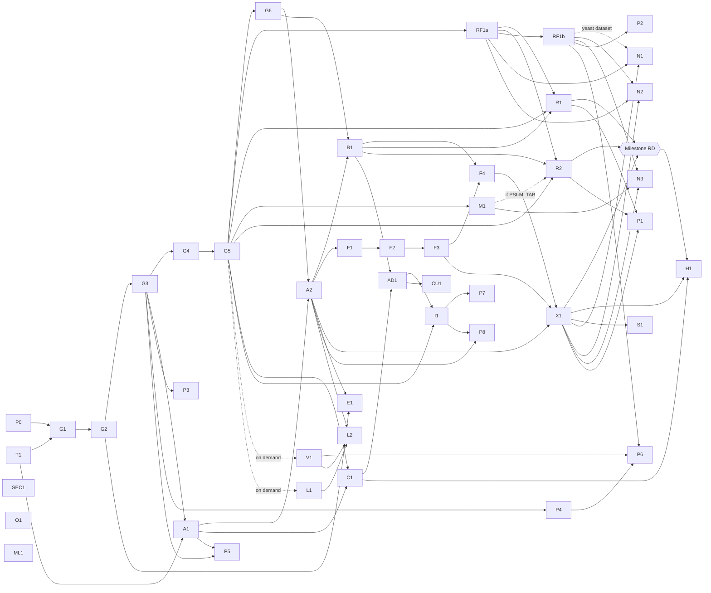

# Implementation plan

How the design in [GENERALIZATION_ARCHITECTURE.md](GENERALIZATION_ARCHITECTURE.md)
turns into reviewable pull requests.

- Section 3 is the dependency-ordered issue breakdown.
- Section 4 is the first implementation slice.
- Section 5 is the very first PR, in full.

**Status: proposed (Phase 0).** No phase starts until the owner asks for it
(brief §0). GitHub Issues are disabled on the fork, so the issue breakdown
lives here. It can be copied into Issues once they are enabled, with the
owner's approval.

## 1. Ground rules for every PR

- **Small and reversible.** One issue per PR where possible. Each PR states
  its rollback, and keeps every existing test green, along with `ruff`,
  `black --check`, `makemigrations --check` and `mkdocs build --strict`.
- **Additive.** New code goes in new apps and folders:
  `backend/graph/`, `backend/browsers/`, later `backend/graph_bridge/`, the
  fork-only `backend/portal_profile/`, and `frontend/src/features/graph/` and
  its sibling folders. Edits to shared files are appended, commented blocks
  where possible, which keeps upstream patches easy. The shared files are:
  - `backend/openpip/settings/base.py`, `backend/openpip/urls.py`,
    `backend/conftest.py` and `backend/pytest.ini` (T1);
  - `frontend/src/App.tsx`, `frontend/src/components/Navbar.tsx`,
    `frontend/src/text/registry.ts`, `frontend/src/mocks/handlers/index.ts`,
    `frontend/src/lib/navPages.ts`, `frontend/src/features/admin/adminNav.ts`
    (AD1) and `frontend/src/features/home/HomePage.tsx` (H1);
  - `mkdocs.yml`, `docs/operator-guide/configuration.md`,
    `docker-compose.yml`, `docker-compose.prod.yml` and `.gitignore` (G4), and
    `CHANGELOG.md`.

  Three issues change existing code rather than appending to it: S1 (the
  view pages), O1 (the organism lookups) and H1 (the home page). Each keeps
  today's behaviour when its new input is absent, with a test for that
  (architecture §9). ML1 changes `migration/migrate_legacy.py`.
- **No migrations in shared apps on the fork.** In particular no
  `admin_panel` migration. A fork-only migration in a shared app collides
  with upstream's numbering, and `migrate` then aborts at start-up
  (architecture D13).
- **Off by default.** Nothing typed is reachable, and no typed command
  writes, until `TYPED_GRAPH_ENABLED` is set (architecture D14).
- **Documentation with the code.**
  - Every new route gets its own `## METHOD /path` heading.
  - Every new environment variable gets a row in
    `docs/operator-guide/configuration.md`, in the same PR. The docs contract
    test requires both.
  - Every new published page gets a `mkdocs.yml` nav entry.
  - Published docs describe only behaviour that exists. Plans stay in
    `docs/project/`.
- **Safe test runs.** Tests run against a throwaway PostgreSQL 16, never a
  live database, and from a full checkout so the docs contract tests are not
  skipped. Never run the opt-in parity tests (`-m parity`), which read
  whatever database is configured. [TEST_PLAN.md](TEST_PLAN.md) gives the
  commands.
- **Conventions.** Conventional Commits, the branch prefixes in
  `CONTRIBUTING.md`, and a `CHANGELOG.md` `[Unreleased]` entry.
- **Repository scope.** Work happens only in `MilesGithub/openpip-2.0`;
  nothing goes to `Helmy-Lab/openpip-2.0` or `MilesGithub/HuRI`. No merge to
  `main`, deployment, bulk import or force-push without explicit approval.

## 2. Phases

| Phase | Goal | Issues | Done when (from brief §8, made testable) |
|---|---|---|---|
| 0 | Audit, plan and CI | P0, T1 | These documents are reviewed. The baseline is recorded (assessment §2). The owner decides, or accepts the defaults in [OPEN_QUESTIONS.md](OPEN_QUESTIONS.md). CI runs on PostgreSQL, and T1 is merged with your approval before G1 starts |
| 1 | Typed entities, provenance and evidence, with PPI unchanged | G1–G6 | Existing tests pass. `/api/search` and the other legacy responses stay byte-identical with typed rows present. Two entity types are stored, with at most one identity namespace per type and taxon. Provenance round-trips. Ambiguous identifiers come back as candidates, never guessed. Re-importing a release changes nothing. The synthetic directed release imports, and its test matrix passes at service level, through G3's summary module; following reference links waits for X1 |
| 2 | First non-PPI implementation | A1, A2, B1, F1–F4 | The API and the network distinguish A→B from B→A. Activation and repression render differently. Every edge's evidence is shown and attributed. The old PPI view is unchanged. A browser instance restricted to one release shows only that release |
| 3 | Unified explorer (completes the brief's MVP) | X1 | Two scientifically different relationship classes are explored together, with gene, protein entry and isoform kept as separate nodes. A gene search follows labelled reference links to the protein's interaction partners. Gallery filters work. Original evidence can be inspected. Routes are linkable and tested. Licence and availability status are visible. All on the synthetic release |
| **RD** | **First real cross-layer demonstration: the central integration milestone** | RF1a, R1, R2, and M1 if R2's source is PSI-MI TAB | On a private stack, never the HuRI or YeRI stacks and never deployed: `/explore` shows one real gene-level regulatory release and one real protein-level interaction release. They are joined only by `encodes` links from an approved, versioned gene-to-protein mapping release and `isoform_of` links from the approved UniProt release. A search for a human transcription factor's gene reaches its protein's interaction partners through labelled links. Every edge traces to its source records. Nothing is imported without a recorded `internal` approval. Releases are published with `internal` approval only, so the demonstration is visible to staff only, and nothing is shown to visitors without `public_view` |
| 4 | Published demonstration browsers, catalogue and administration | C1, AD1, E1, H1, I1, S1, RF1b, N1–N3, CU1 | Release-specific attribution and import validation tests pass. Source fields are kept. Imports are idempotent and resumable. Cross-dataset overlap does not duplicate evidence. Download rights are honoured |
| 5 | Advanced relationships and scale | P1–P8, SEC1 | Complexes and n-ary relations are not drawn as arbitrary PPI edges. Latency and render size meet the agreed benchmark targets. Releases can be updated and rolled back without losing provenance |
| On demand | Existing-portal adoption, and vocabulary loading | L1, L2, V1 | Built only when needed. L1 and L2 when an existing PPI portal adopts the typed graph (architecture D11). V1 when filters or counts need PSI-MI subtrees, when an aggregator-scale source makes the explicit term list a burden, when P6 needs ontologies, or when L1 and L2 are built |
| Independent | Runtime organism configuration for the legacy pages | O1 | A human portal with unset settings behaves exactly as today, and a fly portal is configured without a rebuild |
| Independent | A safe legacy reload | ML1 | A `migrate_legacy.py --reset` run on today's schema loads every table, and a failure leaves the database as it was |

**The brief's MVP** is reached after G1–G6, A1, A2, B1, F1–F4 and X1:

- the existing PPI browser;
- one typed directed demonstration network;
- one unified multi-layer query;
- a simple gallery linking both.

**Milestone RD follows it straight away.** Its data track does not wait for
the user interface:

- RF1a, then R1;
- M1 if needed, then R2.

The track can start once G5 has landed, alongside A1–X1, as soon as due
diligence ([DATASET_DUE_DILIGENCE.md](DATASET_DUE_DILIGENCE.md)) and your
approvals allow. Licence review, not code, is the likely critical path, so
it runs while G2–G6 are built. If no source clears review, the cross-layer
demonstration stays synthetic.

F1–F3 can be merged as one PR if the owner prefers fewer, larger reviews.

## 3. Issue breakdown

Sizes: S = up to a day, M = a few days, L = about a week.

### Phase 0 and tooling

| Id | Title | Depends on | Deliverable | Acceptance | Size |
|---|---|---|---|---|---|
| P0 | Phase 0 audit, architecture, plan, test plan and open questions | — | `docs/project/generalization/` | The owner approves each decision or records an override | S |
| T1 | CI on PostgreSQL from a full checkout | — | `.github/workflows/ci.yml` with a `postgres:16` service and `DATABASE_URL` set. It runs the backend checks (`pytest`, `ruff`, `black --check`, `makemigrations --check`), the frontend checks (lint, `vitest` serially, build) and `mkdocs build --strict`. Vitest runs serially because the suite times out under CPU load. Also a `postgres` pytest marker in `backend/pytest.ini`, and a session check in `backend/conftest.py` that fails when `CI=true` and the database is not PostgreSQL, and warns locally. The workflow also runs after every upstream merge | Green on `main`. A deliberately undocumented route turns it red. The log shows `connection.vendor == "postgresql"`. Parity tests stay excluded. **Must merge, with your approval, before G1 starts** (G1 adds a step to its workflow; A1 adds the first routes). **Status (2026-10-29):** merged into the fork's `main` with your approval (PR #1, merge commit `b23119e`), every check green on GitHub | S |

### Phase 1: the typed foundation, invisible to users

| Id | Title | Depends on | Deliverable | Acceptance | Size |
|---|---|---|---|---|---|
| G1 | Typed entity and identifier foundation (**first PR**, section 5) | P0, T1 | The `graph` app with registry tables (`Taxon`, `EntityType`, `IdentifierNamespace`, `RegistryState`), `Entity` with `identity_key`, and `EntityIdentifier`. Also registry JSON v1 (`uniprotkb` and `hgnc` defining identity, `ncbigene` and `ensembl_gene` as cross-references only), `graph_sync_registry`, identity normalization, the four-status resolver, and `TYPED_GRAPH_ENABLED`. Plus the strict migration allow-list, the legacy-table protection tests over a `NEW_APPS` list, the forward-and-backward migration test and its CI step, and the legacy-contract tests | As in section 5 | M |
| G2 | Provenance and licensing; the visibility function | G1 | `graph.0002`: `DataSource`, `SourceDataset`, `Publication` (with `local_key` and `local_dataset`) and its link tables, `DatasetRelease` (with `kind`, `supersedes` and `embargo_until`), `SourceFile`, `ImportRun`, `SourceRecord`, a slim `DueDiligenceRecord`, `ReleaseLicence` (with `share_alike`) and `UsageApproval` (no expiry), plus the nullable `Entity.created_by_release`. `graph/visibility.py` with `visible_release_ids(request, purpose, pinned=None)`. `graph/approvals.py`, the approval service that records and revokes decisions and enforces the rules below; G5's commands and AD1's admin wrap it. A Django admin for staff, read-only for approvals and hidden when the switch is off | (dataset, version) is unique, and so is a file checksum per release. A source dataset has at most one due-diligence record, and its status changes are kept as a history. Co-referent publication identifiers merge into one publication, and a local key is unique per source dataset. No effective approval means invisible. Approving view does not grant bulk download, and bulk is refused while the latest licence snapshot leaves redistribution unknown or not permitted. `external_services` needs an effective `internal` approval. There is one active decision per scope; a second is refused until the first is revoked. A decision is never edited: only its revoked fields may be set, once. Revoking `internal` also withdraws public view, bulk and external services. For a non-synthetic release, the approval service refuses every scope unless the dataset's due-diligence record is complete and its terms are not marked time-limited. An approval already recorded stops being effective at once when the record is reopened or blocked, or the flag is set. Under embargo only `internal` is effective: the release is visible to staff only, and its `external_services` approval sends nothing. The default release set leaves out superseded releases, and pinned or explicit selections include them, flagged. Deleting an approver's account keeps the approval (SET_NULL plus username snapshot). A release with approvals cannot be deleted (PROTECT). A licence snapshot that an approval relies on cannot be edited; new terms are recorded as a new snapshot | M |
| G3 | Relationships and evidence; `record_claim` | G2 | `graph.0003`: the `RelationshipType`, `ScoreType` and `Term` registries, `Relationship`, `EvidenceAssertion`, `AssertionParticipant` (entity, side, identifier as written, resolution basis, `isoform_entry` among the bases), `EvidenceMethod`, `EvidencePublication`, `EvidenceScore` and `EvidenceContext`. Registry JSON for `transcriptional_regulation` (gene or protein regulator, gene target), `physical_interaction`, `protein_interaction_unspecified`, `encodes` and `isoform_of`, and `score_types.json` with `synthetic:confidence` and `synthetic:rank`. `graph/claims.py` validates endpoint types, orientation, polarity and self-pairs, and builds the canonical identity. `EvidenceAssertion.interaction_level` (architecture §3.6, D20). `graph/summary.py`, which computes an edge's summary by the rules of architecture §4.5: effect and sign summaries, outcome counts, `evidence_count` (independent evidence), `assertion_count`, distinct counts and the strongest level; A2 calls it. The legacy-contract tests also run with typed relationships and evidence present | A→B and B→A are distinct for directed types. A–B equals B–A for symmetric types, enforced by a check constraint. Two types on one pair give two relationships. A row with two publications gives two assertions, with one `reported_in` each. Recording the same (record, assertion key) twice is a no-op. The outcome set is `supported`, `tested_absent`, `inconclusive` and `not_significant`. The check constraints reject an effect together with a genetic sign, and an effect or sign on any assertion that is not `supported`. NaN and infinity are rejected while the raw value is kept. The summary module passes the §4.5 cases on factory rows: records of one observation count once in `evidence_count`, independent experiments count separately, and the two limits that need no observation key behave as documented (M1 adds the observation-key cases). Legacy responses, PSICQUIC included, stay byte-identical with typed relationships present | M |
| G4 | Import framework, `canonical_tsv_v1` and the dry run | G3 | `graph/ingest/` (protocol with the adapter's `kind`, adapter registry, limits), the `canonical_tsv_v1` adapter (including `ref:<key>` publications from the release manifest), with every adapter spec declaring `isoform_specific` and a note of the changes it makes, `graph_register_release` and `graph_import --dry-run`, with `--resolutions` for a reviewed resolution file. `canonical_tsv_v1`'s own test-pinned list of accepted PSI-MI interaction types, each with its D20 level. Private file storage under `GRAPH_FILES_ROOT`, with a `graph_files` volume for `backend` and `celery` in `docker-compose.prod.yml` and a `.gitignore` entry (architecture §3.5). `docs/operator-guide/typed-data-format.md`, with a nav entry | A dry run writes only the import run and the source records. A release registered with `--synthetic` is rejected if any identifier uses a non-synthetic namespace or taxon, or if it cites a PMID or DOI. The report lists rejected rows with physical line numbers, `unmatched`, `candidate` and `ambiguous` identifiers with their candidates, every record mapped through a candidate, the entities a commit with `--create-entities` would create, new relationships, and conflicts. A record maps only through `resolved`, a unique cross-reference or alias in a declared namespace, or the resolution file; nothing is guessed. Record statuses follow architecture §4.1. Oversized lines, bad UTF-8, unknown types and interaction types missing from the adapter's list are reported, not fatal. A non-synthetic release needs an effective `internal` approval. Imports refuse on a registry version mismatch. The storage root is outside `MEDIA_ROOT` and `STATIC_ROOT`. Legacy row counts are unchanged | M |
| G5 | Commit, checkpoints and the release lifecycle | G4 | `graph_import --commit` (`--create-entities`, race-safe writes of entities, relationships and publications, batched upserts, checkpoint and resume). `DatasetRelease.stats` written at commit. Also `graph_approve` and `graph_revoke`, which wrap G2's approval service, `graph_publish_release` (which needs an effective `internal` approval and marks the release it supersedes), `graph_withdraw_release`, `graph_discard_release` (back to draft) and `graph_check`. An operator page for these commands | Importing the same file twice changes nothing. A commit killed midway completes on rerun with identical rows. Two releases committing at the same time, sharing an entity, a pair and a publication, create no duplicate or orphan rows. Publishing needs an effective `internal` approval, not `public_view`, and publishing an internal-only v2 supersedes an internal-only v1. Publishing v2 is refused while v1 has an effective `public_view` and v2 does not, so a correction never hides public data. A publication-identifier conflict is reported, not fatal. Without `--create-entities`, no entity is created and the records stay unresolved; with it, new entities are `provisional`. A second release keeps its own evidence. Publishing v2 marks v1 superseded, and withdrawing v2 does not restore v1. Withdrawn data leave `visible_release_ids` at once. Discarding returns the release to draft, keeps its audit trail, and deletes no entity, relationship or primary identifier. Legacy row counts are unchanged | M |
| G6 | Synthetic directed demonstration release | G5 | `backend/graph/demo_data/synthetic_regulation/` (a manifest that declares the two title-only synthetic publications by local key, `release_v1.tsv`, `release_v2.tsv` where v2 supersedes v1, and a README stating that it is synthetic) and `graph_load_demo --approve-as`, which commits with `--create-entities` | Every case in architecture D12 is asserted at service level, through G3's summary module and G1's resolver: the rows reported and never imported, the summary rules of architecture §4.5, the label cases (`resolved`, `candidate` and `ambiguous`), the stored reference chain (`encodes`, `isoform_of`, and the physical edge beyond it), and the separation of v1 from v2 (v1 out of the default view, readable when selected). Following the chain is X1's | S |

### Phase 2: the first non-PPI implementation

| Id | Title | Depends on | Deliverable | Acceptance | Size |
|---|---|---|---|---|---|
| A1 | `/api/graph/v1` foundation | T1, G3 | The base view (switch gate in `initial()`, visibility, throttles, the site-wide network budget), `status`, `vocabularies`, `resolve` and `entities/{entity_id}`, both with `releases=` and the default release set otherwise. `docs/developer/api/typed-graph.md` with a nav entry. Throttle rates | With the switch off, every route except `status` returns 404 (parametrized over the URL resolver), and `/api/schema/` still returns 200. The docs contract passes. `resolve` answers with the four statuses (`resolved`, `candidate`, `ambiguous`, `unmatched`) for visible entities only, counted over distinct entities. A single alias or a case or version mismatch is a `candidate`, never `resolved`; one entity matched in several ways is not `ambiguous`; two or more entities are. Unknown parameters give 400 | M |
| A2 | Network, relationship and evidence endpoints | A1, G6 | The neighbourhood service, which summarizes edges through G3's summary module: per-seed pre-limits, ranking by indexed counts of visible assertions, caps, a statement timeout inside `transaction.atomic()` on PostgreSQL, and deterministic truncation that reports what a pre-limit cut. The default release set leaves superseded releases out; `releases=` includes them, flagged, on all three endpoints. The `network`, `relationships/{relationship_ref}` and `relationships/{relationship_ref}/evidence` endpoints, with contract tests on the synthetic release | `direction=out` returns SYN-TF1 → SYN-G1 but not SYN-G1 → SYN-TF1. A symmetric relationship matches a seed on either endpoint whatever `direction` says. Tested-absent-only edges are hidden by default and flagged when shown. SYN-TF2 → SYN-G2 is `mixed`. By default the network, the relationship page and its evidence list show only v2's corrected effect, never `mixed`. `evidence_count` is the independent count and `assertion_count` the raw one. Physical edges carry the strongest stored level. The summary rules hold under evidence-level filters, and an `outcome` or `effect` filter ranks by the matching counts. Caps set `truncated` and a warning. The query count is bounded whatever the fan-out. The timeout does not persist on the connection. Unapproved releases contribute nothing | M |
| B1 | Browser instances | A2, G6 | The `browsers` app (`BrowserInstance` with registry M2Ms, `assays`, and `BrowserInstanceRelease`), a Django admin, the `browsers` and `browsers/{slug}` endpoints, presentation schema v1 and computed availability. The `browser=` parameter on `resolve`, `entities`, `network` and both relationship endpoints. `browsers` joins `NEW_APPS`, so G1's migration guards cover it. `browsers` takes a filter for every facet brief §6 lists: `q` (title and summary text), `tag` (biology area), `relationship_type`, `taxon`, `assay`, `year` (header publication year), `status` and `availability`. `graph_load_demo` also creates the demo instance and a `portal_ppi` entry pointing at `/search` | A typed instance computes as `live` only while every selected release is published or superseded, and visible to the caller. An instance pinned to v1 therefore stays live after v2 is published. Otherwise it computes as `metadata_only`, shown as "data unavailable", and withdrawing a release changes this at once. Each filter narrows the list, filters combine, and an unknown value gives 400. An external instance needs an https URL. All text is plain. Evidence outside an instance's releases is not counted when `browser=` is given. The allow-list, deny-list, foreign-key fence (model metadata and database catalogue) and dependency tests pass for `browsers`, whose migrations depend only on `browsers`, `graph` and the user model | M |
| F1 | Frontend typed client, types and MSW fixtures | A2 | `frontend/src/api/graph/` (keys under `['graph', …]`), `features/graph/types.ts`, `mocks/handlers/typedGraph.ts`, and fixtures mirroring G6 | Hooks are typed against the documented shapes. MSW covers every route in use. Existing suites are untouched | S |
| F2 | Typed network, stylesheet and legend | F1 | `features/graph/network/*` and `features/graph/legend/*` | Triangle, tee, diamond and hollow vee map to the four effect summaries. Role-ordered non-causal types get a circle marker. Dashed tested-absent edges are hidden by default. A→B and B→A render as two edges. Taps on string ids resolve. The layout does not re-run on selection. The legend lists only the channels present, in words | M |
| F3 | Panels, evidence list and edges table | F2 | `features/graph/panels/*` and `features/graph/tables/*` | Evidence rows show release, publications, methods, basis, assertion method, outcome, effect (as stated and as mapped) and typed scores. Physical edges show the strongest stated level. The panel shows the independent evidence count beside the assertion count, with the stated counting limits. Source text is never rendered as HTML. The table is fully keyboard-usable and opens the same panel | M |
| F4 | Gallery and instance pages | B1, F3 | Lazy routes `/browsers` and `/browsers/:slug`. The gallery has a title search box and B1's filters, kept in the URL. An instance page has a header (citation, release versions, organisms, licence, synthetic badge) and the scoped network. The Browsers nav link appears only when `status` says the feature is on. The "Explore in the unified network" action comes with `/explore` in X1 | Deep links survive a reload. Each filter and the title search narrow the gallery, filters combine, and a shared URL reproduces the filtered gallery. Planned, external, metadata-only, retired and synthetic entries look different. External links use `rel="noopener noreferrer"`. With the switch off, no nav entry appears and the routes say "not enabled on this portal". Legacy route tests are unchanged | M |

### Phase 3: unified explorer (completes the MVP)

| Id | Title | Depends on | Deliverable | Acceptance | Size |
|---|---|---|---|---|---|
| X1 | Unified explorer `/explore` | F3, A2, F4 | Search with a disambiguation step, layer toggles with counts, and filters for release, type, direction, effect, outcome, basis, method, score type and taxon. URL state `v=1`, truncation banners, navigation to and from instances (including the "Explore in the unified network" action on instance pages, and the Explore nav link), `/entities/:id` and `/entities/:namespace/:value`, and `expand=reference` on `GET network` (architecture §4.6): derived seeds marked with their path, reference edges labelled with their type and release, and a visible "follow gene-to-protein links" toggle, on by default | Regulation and physical layers display together, with gene, protein entry and isoform kept as separate nodes and joined only by labelled reference links. From one gene search, the gene's regulation edges and its encoded protein's physical partners appear in one view. The closure follows typed paths only: a gene search never reaches another gene through a shared protein entry (a factory case with one entry encoded by several genes, like histone H4). An unapproved or withdrawn mapping release adds no `encodes` join, while entry–isoform joins stay, tested with separate synthetic mapping and UniProt-style releases built by factories, because G6 states both links in one release, and with the toggle off the result equals plain depth 1. A view that pins a superseded mapping release keeps its join, flagged. A shared URL reproduces the view. Ambiguous terms are never auto-picked, and `/entities/:namespace/:value` redirects only on a `resolved` result. The legacy `/search` page and its tests are unchanged | M |

### Milestone RD: first real cross-layer demonstration

This is the central integration milestone (architecture §4.6). It runs on a
private stack, never the HuRI or YeRI stacks, and nothing is deployed. Every
import needs your recorded `internal` approval. The candidate sources, and
what is still unknown about each, are in
[DATASET_DUE_DILIGENCE.md](DATASET_DUE_DILIGENCE.md). No third-party file is
downloaded until you approve its due diligence.

| Id | Title | Depends on | Deliverable | Acceptance | Size |
|---|---|---|---|---|---|
| RF1a | Human reference and gene-to-protein mapping releases | G5 | Reference adapters (`kind = reference`) for taxon 9606. An HGNC gene release: HGNC IDs define identity; approved symbols (role `symbol`), previous symbols (`secondary`) and alias symbols (`alias`) go in `hgnc_symbol`, so a match says which kind it hit; NCBI Gene and Ensembl Gene become cross-references. A UniProt human protein release: entry accessions and isoform accessions, `-1` included, with `isoform_of` where UniProt states it. A gene-to-protein mapping release, imported and approved separately, that states `encodes` (lead candidate: HGNC's UniProt column, Swiss-Prot entries only, which HGNC marks as mapped by the EBI; alternative: UniProt's own HGNC cross-references; [DATASET_DUE_DILIGENCE.md](DATASET_DUE_DILIGENCE.md) §3.3). Each has its licence recorded. Adds `EntityIdentifierSource`, and `EntityIdentifier.origin` with database default `release`, before any non-primary identifier is stored; from here every release writes a source row for each identifier it states, primary included. Race-safe writes of non-primary identifiers. Service-level pieces: a release filter on the resolver, a function that lists an entity's visible identifiers, and the visible reference relationships. RF1a also switches A1's `resolve` and `entities/{entity_id}` routes, and X1's reference closure if X1 has merged, to those functions, with a route-level test that an alias stated only by an unapproved or embargoed release never leaks, so the order in which A1, X1 and RF1a merge does not matter. Each namespace it adds, such as `hgnc_symbol`, has its case and format rules verified against its authority (open question D4) | Every gene and protein entity created is `active` and traces to its reference release. After RF1a migrates, the G6 entities still resolve by their primary identifiers. A value held by more than one gene is never used to map; it is reported. An unapproved or withdrawn mapping release adds no `encodes` relationship to the visible set, and the UniProt release's `isoform_of` links stay. An alias that only an unapproved release states is neither returned by the visible-identifier function nor matched by the filtered resolver. A newer reference release supersedes the old one, and its genes and proteins stay visible in the default set. Two releases committing at once and sharing an alias create no duplicate | M |
| R1 | First real directed regulatory release (lead candidate: TRRUST v2, human, data under CC BY-SA 4.0; alternatives: CollecTRI, DoRothEA, a SIGNOR subset) | G5, B1, RF1a. Due diligence can start at any time | The due-diligence record. After your approval: the adapter, with mapping tests that pin every column; symbols mapped through RF1a's HGNC release; a browser instance | Every edge traces to its source record and paper. The source's regulation mode maps to `effect`, and "unknown" stays unknown. Public view carries TRRUST's attribution and a note of changes, and bulk export of TRRUST stays per release, never combined with other releases, until ShareAlike has been evaluated (open question C13, decided). No symbol is guessed: ambiguous and unresolved rows appear in the report, and are not imported | M |
| M1 | Record-level PSI-MI TAB adapter | G5 | `mitab_typed`: one assertion per row and publication; column 36 becomes `tested_absent`; the column 12 type is kept as stated; column 15 scores keep their namespaces; column 9 publications have co-referent ids merged; column 7 methods; participant roles; column 14 is the record key. It also has an explicit, test-pinned list of accepted PSI-MI interaction types with their D20 levels, and rejects any other. It fills `observation_key` from shared observation ids, adds the PSI-MI participant fields, records PSI-MI pseudo-taxa as `assay_system` context, and refuses a whole file if any row names `openPIP:openPIP` as its source database. Rows that give only a gene identifier for a protein participant are reported as unresolved (open question B4) | MI:0403 and MI:0208 never map to a physical type. A portal's own PSICQUIC output is refused, file and all. The repository's IntAct sample imports with one assertion per row and publication, and no reciprocal collapse. G3's summary-module tests gain the observation-key cases: equal keys count once, different keys count separately, and a keyed record and an unkeyed record of one experiment count twice, as stated | M |
| R2 | First real protein-interaction release (lead candidate: BioPlex 3.0, human, whose website states no data licence while its NDEx deposits carry a CC0 field, so it waits for open question C14; recommended alternative: HuRI, whose portal states CC BY 4.0, pending a dry run of its PSI-MI file; IntAct copies of HuRI and BioPlex 3.0 to verify; DATASET_DUE_DILIGENCE.md §2.6) | G5, B1, RF1a; M1 if the source is PSI-MI TAB, otherwise its own adapter. Due diligence can start at any time | The due-diligence record. After your approval: the adapter, with mapping tests; UniProt entries and isoforms kept as the source states them, with each isoform-suffixed accession mapped to its UniProt entry through a verified `isoform_of` link (basis `isoform_entry`), keeping the accession as written, because BioPlex's analysis is not isoform-specific (open question B12, decided); the study's assay recorded as a release-level statement only where due diligence quotes it (open question C12); a browser instance for the single study | Protein entities resolve through RF1a, and isoform accessions stay isoforms, joined to entries only through `isoform_of`. A row that gives only a gene identifier is reported as unresolved, with the candidate protein entries, unless a reviewed resolution file maps it (open question B4). BioPlex rows are `physical_interaction` at level `association`, labelled "co-complex association (AP-MS)" with the type marked as assigned by openPIP from the stated assay (open question B14, decided); never binding or a direct binary interaction (D20). An isoform accession with no verified `isoform_of` link is reported, never stripped. The cross-layer path from R1 is milestone RD's criterion | M |

### Phase 4: published demonstration browsers, catalogue and administration

These follow milestone RD. H1 comes after the first real release, and AD1 once
someone without shell access must manage releases, instances or approvals.

| Id | Title | Depends on | Deliverable | Acceptance | Size |
|---|---|---|---|---|---|
| C1 | Catalogue API and `/datasets` pages | A1, G5 | The `datasets`, `datasets/{slug}` and `releases/{release_id}` endpoints, the `/datasets` pages and the Datasets nav link. The counts come from `DatasetRelease.stats`, written at commit (G5) | Only visible releases show counts. Licence, attribution and approval status are shown. Candidate datasets are labelled "metadata only". `/download` is unchanged | M |
| AD1 | React admin for instances, releases and approvals | B1, C1 | `/admin/browsers` and `/admin/releases`, the admin endpoints (one documented heading per method), and items in `adminNav.ts` that do not prefix-match `/admin/data` | Approvals need a rationale and are append-only. Instances can be created, edited, reordered and retired without a rebuild. The availability gate cannot be bypassed | L |
| E1 | Filtered exports with a licence manifest | A2, G2 | `exports/network` (a streaming zip) and the `graph_export` throttle | The export returns 403, naming the blocked releases, unless every release in scope has an effective `public_bulk` approval (architecture §7.2). An export that would combine a release whose licence snapshot has `share_alike` set to `yes` or `unknown` with any other release is refused, naming it, while that release alone can still be exported (open question C13). Each release's licence, attribution and note of changes travel with the data. The manifest lists the query, the releases with checksums and adapter and mapping versions, the licences, the attribution and the approvals relied on. `evidence.csv` carries the release, record key and publication. Non-PPI edges are never written as SIF `pp` or as MITAB. CSV cells are guarded against formula injection | M |
| H1 | Hub homepage sections | X1, C1, milestone RD | A hub section on the home page, shown only when the switch is on: unified search, a gallery strip, and figures from the stored statistics of visible releases, served by `GET /api/graph/v1/summary` (architecture §7.2) under its own documented heading | No figure that is not computed. Totals sum only releases and assertions; datasets are counted distinct over the visible releases; entity and relationship counts are never summed across releases. The existing home page is unchanged when the switch is off (snapshot test) | S |

Each dataset issue starts with a `DueDiligenceRecord`, and needs a recorded
`internal` approval before any file is imported (brief §7). Every candidate
named here has unverified terms.

| Id | Title | Depends on | Deliverable | Size |
|---|---|---|---|---|
| RF1b | Further reference releases and enrichment providers | RF1a | Reference releases and organism-owned symbol namespaces for other organisms, each with its case policy verified (for example yeast for N1, fly for FlyBi), and the RNA references N2 needs. Strain taxa matched to their species through `Taxon.parent` (for example yeast 559292 and 4932 *(verify)*). Opt-in, versioned enrichment providers that respect `external_services` and add descriptive fields only, never identifiers (architecture §8), with an explicit enrichment action on typed pages, offered only where the instance allows it and every visible release has an effective `external_services` approval | M |
| I1 | Web upload and asynchronous imports | G5, AD1 | Upload stores the file first. `graph.tasks.run_import(import_run_id)` with `acks_late` and time limits on the task. A report viewer | L |
| S1 | Saved, shared and public explorer views | X1 | `state.kind = "explore"`. `query` holds a display string. The three view pages dispatch on `kind` before calling the search page. Pinned releases | M |
| N1 | Genetic interaction study browser (first Horlbeck et al. 2018, human, CC BY 4.0, which needs only RF1a; then Costanzo et al. 2016, yeast, CC0 on Dryad; DATASET_DUE_DILIGENCE.md) | RF1a, X1; RF1b for the yeast dataset | Registry entries, including ordered suppression and epistasis types; `genetic_sign` with score types that state their null model (the SGA score against a multiplicative null, the CRISPRi GI against a quadratic fit), never pooled; sign and score filters; one declared threshold tier per release; sub-threshold pairs, if a release imports them, are `not_significant` with their scores and statistics, never `tested_absent` (open question B13, decided); the yeast gene identity namespace that open question D7 settles, before any yeast import; an instance | L |
| N2 | RNA interaction study browser (candidate: Helwak et al. 2013, CLASH; terms to verify, DATASET_DUE_DILIGENCE.md) | RF1a, RF1b, X1 | `mirna_binding` kept separate from `mirna_repression`, a case-exact miRBase namespace *(verify)*, mature-miRNA and transcript reference releases with `mature_form_of` and `transcribed_from`, and an instance. CLASH chimeras are binding observations, never repression | L |
| N3 | Host–pathogen or ligand–receptor study browser | M1, RF1b, X1 | Cross-taxon pairs; ligand and receptor roles, never presented as cell–cell communication; an instance | L |
| CU1 | Curator role without `is_staff` | AD1 | A group-based curator permission for catalogue, instance and approval management, exposed to the UI. An optional two-person rule for `public_bulk`: the approval becomes effective only after a second, different user confirms it on the same `UsageApproval` row, so the one-active-decision constraint still holds. CU1 adds the confirmation fields to the columns that may be set after insertion, and widens G2's test to match (architecture §3.7, D9, open question C2) | M |

### On demand

Built only when the trigger in each title occurs, and with your approval.

| Id | Title | Depends on | Deliverable | Acceptance | Size |
|---|---|---|---|---|---|
| V1 | Controlled-vocabulary reference releases (when filters or counts need PSI-MI subtrees, an aggregator-scale source makes M1's term list a burden, P6 needs ontologies, or L1 and L2 are built) | G5 | An ontology adapter that loads PSI-MI (and later ECO) terms, labels, definitions and `is_a` parents as a versioned reference release, with its licence recorded. The PSI-MI subtree crosswalk to relationship types | Subtree queries work (MI:0407 is under MI:0915, which is under MI:0914). MI:0403 and MI:0208 never map to a physical type. The crosswalk has unit tests pinned to the loaded release version | M |
| L1 | Legacy bridge (when an existing PPI portal adopts the typed graph, architecture D11) | G5 | The `graph_bridge` app (`BridgeRun`, `LegacyProteinLink` with the matched accession and taxon, and `LegacyDatasetLink`, which holds no decision of its own), added to `NEW_APPS` with its declared legacy links as the only exception to the foreign-key fence. Live-legacy releases that record the legacy dataset's id and name, and approvals that record its content basis (architecture D11). `graph_bridge_sync`, a dry run unless `--commit` is given, with `--assume-taxon` and `--unlink`, and a report of duplicate and unlinkable rows | The sync is idempotent. Duplicate legacy rows for one accession are reported and left unlinked, and so are datasets whose name is NULL or shared. `Protein.ensembl_id` and `entrez_id` never become protein identifiers or `encodes` links. Legacy dataset and protein deletes still work (CASCADE). A simulated legacy reload empties the bridge tables and no typed table. A re-sync then restores the same entity ids, and re-attaches, with their approvals, only the live-legacy releases whose dataset id and name both match. A dataset deleted and re-created under the same name gets a new release with no approvals. After a simulated reload and re-sync, a dataset with a typed re-import is still excluded. No legacy row is modified | M |
| L2 | Read-time federation of legacy PPI (with L1) | L1, A2, V1 | A federation provider for the neighbourhood service, `ppi-*` ids, and the mapping rules in architecture D11 | Edge ids equal `/api/search` interaction ids for the same seed on fixtures. The edge type comes from the stated type only, and inferred types are shown as labelled metadata. Whatever the number of dataset links, the interaction's values (negative, type, score, roles, methods, annotations) appear at edge level as "contributing dataset unknown". `negative = true` never becomes a tested-absent assertion and never hides the edge. Only datasets with an effective approval whose content basis still matches appear; after a later upload to the dataset, it shows "changed since approval". Query capture shows no write to a legacy table. The `/api/search` contract test still passes. The per-seed cap holds for a high-degree protein | M |

### Phase 5: scale and advanced relationships

| Id | Title | Depends on | Deliverable | Size |
|---|---|---|---|---|
| P1 | Benchmarks and performance | X1, R1, R2 | A benchmark harness on production settings with realistic data, and agreed p95 targets. The numbers decide on depth 2, `pg_trgm` suggestions (PostgreSQL only) and caching in a separate Redis database | L |
| P2 | Site-specific modification | RF1b | `SequenceSite` pinned to the sequence version, the site qualifier in identity, and `kinase_site_preference` kept separate from phosphorylation | M |
| P3 | Complexes and reactions as n-ary entities | G3 | Complex and reaction entities, with evidence-backed membership roles and stoichiometry, and display projections labelled as projections | L |
| P4 | Genomic regions and variants | G3 | Coordinate- and allele-identified entities with an assembly registry; rsIDs as aliases only | L |
| P5 | Entity merge and split | G3, A1 | An audited command that also re-points relationships under their unique key; merged entities answer 301 in the API | M |
| P6 | Phenotype and disease associations | P4, RF1b, V1 | `disease` and `phenotype` entity types from licensed ontology reference releases, and the association types of architecture §4.2, never drawn as causal (brief §8, Phase 5) | L |
| P7 | Scheduled release updates, where a source's terms allow them | I1 | A scheduler that registers a new release and runs its dry run when a source publishes one. It never commits, approves or publishes without a person (brief §8, Phase 5) | M |
| P8 | Observability | A2, I1 | Structured logs and metrics for import runs, query latency, truncation and throttling, with no personal data (brief §8, Phase 5) | M |
| SEC1 | HTML sanitizer and CSP | — | Sanitization of admin-authored HTML, and a Content-Security-Policy in `frontend/nginx.conf`, tested against the existing pages. Required before any rich-text instance content and before a public hub launch | M |

### Independent track

| Id | Title | Depends on | Deliverable | Acceptance | Size |
|---|---|---|---|---|---|
| O1 | Runtime organism and third-party enrichment switch for the legacy pages | — | An organism taxon (nullable) and an enrichment switch (`default=True, db_default=True`). If upstream accepts them first, they go in `AdminSettings` upstream. Otherwise they go in a fork-owned `backend/portal_profile/` app with a public read endpoint and an admin edit, and no `admin_panel` migration; that app joins `NEW_APPS`, so G1's migration guards cover it. Also `frontend/src/lib/organisms.ts` with verified human and fly presets, which replaces the hard-coded human values in `enrichment.ts`, `externalLinks.ts`, the node and protein panels and `tables/ncbi.ts`. Supersedes the unmerged `feature/species-config` branch | With unset settings, human portals send byte-identical requests and show byte-identical links (snapshot tests). Taxon 7227 gives the fly codes. With enrichment off, no request reaches g:Profiler (MSW assertion). O1 adds no column to `admin_settings`, and a test asserts that its column set is unchanged, so `migrate_legacy.py` behaves exactly as before | M |
| ML1 | Make `migrate_legacy.py` safe on today's schema | — | Run the whole reload in one transaction, so any failure leaves the database as it was. Fill the NOT NULL columns that the legacy dump lacks from an explicit map beside `TABLES`, taken from the model defaults. A test fails when a table in `TABLES` gains a NOT NULL column with no database default that the map does not cover. Update `docs/operator-guide/migrating.md`. Not part of the typed graph; listed because architecture §6.3 and L1 rely on reloads. Upstream has the same script, so proposing the fix there is the owner's decision | Against a scratch PostgreSQL only, never a live database: a `--reset` run from a small dump in the legacy schema loads every table, including the seven that fail today (`admin_settings`, `organism`, `interaction`, `dataset`, `interaction_network`, `data_file` and `external_link`; architecture §6.3). A forced failure in a late table leaves every table as it was before the run. Not started without your approval; the docs-only warning (PR #2, branch `docs/legacy-reset-warning`) is separate | S |

### Dependency graph

### Traceability to the brief's starter issues (brief §11)

| Brief issue | Here |
|---|---|
| 0 Audit · 1 ADR | P0: the assessment and the architecture |
| 2 Entity and identifier tables | G1 |
| 3 Provenance models | G2 |
| 4 Map existing proteins to entities | L1, deferred to the on-demand track; the unified resource imports PPI directly (R2) (architecture §12) |
| 5 Relationship and evidence models | G3 |
| 6 Import adapter protocol and validation report | G4, G5 |
| 7 v2 search endpoints | A1, A2, under `/api/graph/v1/` (architecture D16) |
| 8 Cytoscape typed multigraphs | F2, F3 |
| 9 First directed regulatory example | G6 (synthetic), R1 (real, after due diligence, in milestone RD) |
| 10 BrowserInstance configuration and API | B1 |
| 11 Gallery and instance route | F4, plus C1 for `/datasets` |
| 12 Unified multi-layer explorer | X1 |
| 13 Due diligence and licensing workflow | G2 (records and approval service), G5 (commands), AD1 (UI), E1 (export control) |
| 14 Second non-PPI type | N1 or N2 |
| 15 Performance and release-update hardening | P1, P7, P8, I1, G5 |

## 4. The first implementation slice

The brief's deliverable 4 asks for "a typed-entity and relationship
foundation plus a deliberately small example of a non-PPI network". That
slice is **G1 to G6**: six PRs, each independently reviewable and
reversible. They build on T1 (CI, PR #1), which you approved and merged
into the fork's `main` on 2026-10-29 (`b23119e`).

| PR | Adds | What a reviewer can check |
|---|---|---|
| G1 | Registries, entities, identifiers, resolver, the switch, guard rails | Constraint, identity and resolver tests (HGNC for human genes, isoforms kept apart, one alias versus several entities); the migration allow-list and legacy-table protection; migrations forward and back; legacy responses unchanged |
| G2 | Provenance and licensing | Release, record and approval constraints; nothing visible without a decision; superseded releases out of default views |
| G3 | Relationships and evidence | Identity per family; the three meanings of "negative" kept apart; the summary module, with duplicates counted once |
| G4 | Import dry run | The report on the synthetic files, rejected and ambiguous rows included |
| G5 | Commit and lifecycle | Idempotent re-import, resume after a kill, race-safe concurrent commits, supersession, discard, withdrawal |
| G6 | Synthetic directed release | The D12 matrix and the summary rules at service level; reference following waits for X1 |

After G6 the database can hold a directed, evidence-backed, licensed non-PPI
network and answer service-level queries about it, through the resolver and
G3's summary module. Nothing is visible to
users yet; Phase 2 adds the API and the screens.

## 5. The first PR

### 5.1 Summary

**Title.** `feat(graph): typed entity and identifier foundation (off by default)`

**Branch.** `feature/generic-entities`, from `main` after T1 (PR #1, merged
as `b23119e`); the name the brief suggests (brief §10).

**What it does.** It adds the `graph` app with:

- the first registry tables: taxa, entity types and identifier namespaces,
  plus a registry-state row;
- the entity and identifier tables;
- registry JSON v1, and the `graph_sync_registry` command that loads it;
- identity normalization, with at most one identity namespace per entity
  type and taxon: HGNC IDs for human genes, and UniProtKB accessions for
  protein entries and, separately, for isoforms (`-1` included); NCBI Gene
  and Ensembl Gene as cross-references only. Where no namespace defines
  identity, as for fly genes today, no entity can be created;
- a read-only resolver whose four statuses count distinct entities:
  `resolved` (one entity, matched by an exact primary identifier),
  `candidate` (one entity, matched only in another way, to confirm),
  `ambiguous` (two or more entities) and `unmatched`. It never takes a first
  match;
- the `TYPED_GRAPH_ENABLED` switch, off by default. With it off, the sync
  command refuses to write.

It also adds the guard rails that every later PR inherits:

- no foreign key from the new app into any pre-existing table except `user`,
  checked both in the model metadata and in the database;
- no import of a legacy app;
- a strict allow-list of migration operations (`CreateModel`, `AddField`,
  `AddIndex`, `AddConstraint`), with a deny-list backstop, checked over a
  `NEW_APPS` list that each later app joins in the PR that creates it;
- protection of every pre-existing table: its schema stays identical while
  `graph` migrates forward, back and forward again, and so do the row counts
  of the pre-existing apps' tables. Django's bookkeeping tables change only
  by rows for `graph`. The pre-existing apps' migrations match a pinned
  manifest;
- migrations tested forward and backward, in the suite and as a CI step;
- legacy responses byte-identical when typed rows using the same strings
  exist.

**What it does not do.** There is no route, frontend change, documentation
page beyond the configuration row, importer, relationship, provenance model
or bridge. It reads and writes no legacy table. On every portal that upgrades
with the switch off, it creates empty tables, plus the `django_migrations`,
`django_content_type` and `auth_permission` rows that Django adds for every
new app, and nothing else.

### 5.2 Files

New files:

| File | Contents |
|---|---|
| `backend/graph/__init__.py` | Package marker |
| `backend/graph/apps.py` | `GraphConfig(name="graph", verbose_name="Typed relationship graph")` |
| `backend/graph/models.py` | `Taxon`, `EntityType`, `IdentifierNamespace` (with its allowed-entity-type M2M), `RegistryState`, `Entity` and `EntityIdentifier`, with the fields, check constraints (`check=`, Django 5.0.6), partial unique constraints and indexes from architecture §3.3–3.4, including `label_key` and the `Upper("lookup")` index. `Entity.created_by_release` arrives in G2, and identifier provenance (`EntityIdentifierSource`) in RF1a |
| `backend/graph/registry/__init__.py` | `REGISTRY_VERSION`, JSON loading and validation, and `registry_state()` |
| `backend/graph/registry/v1/entity_types.json` | `gene`, `protein` and `protein_isoform`, each with a definition, the taxon policy `required` and the identity scheme `identifier` |
| `backend/graph/registry/v1/namespaces.json` | Defining identity: `uniprotkb` (global; `protein` for an entry accession, `protein_isoform` for any suffixed accession, `-1` included), `hgnc` (gene, taxon 9606 fixed), `synthetic_gene` (gene) and `synthetic_protein` (protein, protein_isoform), the last two fixed to taxon 32630. Cross-reference only (`defines_identity` false): `ncbigene` (gene) and `ensembl_gene` (gene; version split off). Each declares allowed entity types, scope, case policy, version policy, `defines_identity`, a pattern, a URL template, and the authority document its rules were copied from. G1's review verifies the rules of `uniprotkb`, `hgnc`, `ncbigene` and `ensembl_gene` against those documents, because G1's tests rely on them; each later namespace is verified by the PR that adds it (open question D4) |
| `backend/graph/registry/v1/taxa.json` | 9606, 7227 and 32630, with labels to check against NCBI Taxonomy in review |
| `backend/graph/identity.py` | Pure functions with no database access: `parse_prefixed()`, `normalize(namespace, value)` → (lookup, version), `scope_key(namespace, taxon_id)`, `identity_key(namespace, scope_key, lookup)`, and `uniprot_entity_type(value)`, which returns `protein_isoform` for any suffixed accession, `-1` included, and `protein` for an entry accession |
| `backend/graph/entities.py` | `create_entity(entity_type, label, taxon, namespace, value)`, which inserts with `ON CONFLICT DO NOTHING` on `identity_key` and re-selects, creating the entity and its primary identifier in one transaction, and sets `label_key`. `add_identifier(...)`; no import stores a non-primary identifier until RF1a adds identifier provenance, so G1's tests create such rows through factories. Validation of the taxon policy, of namespace–type compatibility, and of the identity rule: only the namespace that defines identity for the type and taxon creates an entity, and a value that an existing entity of that type and taxon holds in any role never creates a second one. Typed errors: `TaxonPolicyError`, `NamespaceTypeError`, `IdentityNamespaceError`, and `IdentityConflict` carrying the existing entity's id |
| `backend/graph/resolution.py` | `resolve(term, namespace=None, taxon=None, entity_type=None, limit=20)` and `resolve_many(terms, ...)`, returning `Resolution(status, candidates)`. Each candidate is one entity with all its matches, and the status, `resolved`, `candidate`, `ambiguous` or `unmatched`, counts distinct entities (architecture §4.1). Read-only, with deterministic ordering |
| `backend/graph/management/__init__.py`, `backend/graph/management/commands/__init__.py` | Package markers |
| `backend/graph/management/commands/graph_sync_registry.py` | Idempotent sync of the registry JSON into the tables: creates missing rows, and on existing rows updates only descriptive fields. It refuses, naming the rows, any change to a field that stored data depend on while rows use it (architecture §3.3). `--dry-run`; `--check`, which writes nothing and exits 1 if a sync would write anything; reports, and never deletes, rows missing from the JSON; records the version in `RegistryState`; refuses while `TYPED_GRAPH_ENABLED` is off |
| `backend/graph/migrations/__init__.py` | Package marker |
| `backend/graph/migrations/0001_initial.py` | Generated by `makemigrations`: only `CreateModel`, `AddConstraint` and `AddIndex`. No dependency on any legacy app |
| `backend/graph/tests/__init__.py` | Package marker |
| `backend/graph/tests/conftest.py` | A `registry` fixture that runs the sync with the switch overridden on. Test-only namespaces cover every case, scope and version policy, so tests depend on no real-world rule beyond the four namespaces G1's review verifies |
| `backend/graph/tests/factories.py` | factory_boy factories, in the style of `backend/proteins/tests/factories.py` |
| `backend/graph/tests/test_registry.py` | Registry integrity and the sync command |
| `backend/graph/tests/test_identity.py` | Normalization rules |
| `backend/graph/tests/test_entities.py` | Database constraints and service validation |
| `backend/graph/tests/test_resolution.py` | Candidate behaviour |
| `backend/graph/tests/test_isolation.py` | Over `NEW_APPS` (only `graph` so far): foreign-key fences, the migration allow-list and deny-list, and migration dependencies. Also the import fence, the legacy schema snapshot, the legacy migration manifest, reversibility, the switch's default, and no `api/graph` routes yet |
| `backend/graph/tests/legacy_migrations.json` | The pinned manifest: every migration of every pre-existing app at the base commit. An upstream sync that brings new upstream migrations updates it in that PR |
| `backend/tests/compat/__init__.py` | Package marker |
| `backend/tests/compat/test_legacy_contracts.py` | Legacy responses with and without typed rows; the `/api/search` shape |

Edited files:

| File | Change |
|---|---|
| `backend/openpip/settings/base.py` | Append `"graph"` to `INSTALLED_APPS` (`base.py:36-55`). Add `TYPED_GRAPH_ENABLED = env.bool("TYPED_GRAPH_ENABLED", default=False)` |
| `docker-compose.yml` | `TYPED_GRAPH_ENABLED: ${TYPED_GRAPH_ENABLED-}` in the backend and Celery `environment` blocks. `docker-compose.prod.yml` extends this file; containers receive only the variables compose lists |
| `docs/operator-guide/configuration.md` | One row for `TYPED_GRAPH_ENABLED`. `test_every_environment_variable_is_documented_and_real` requires it |
| `.github/workflows/ci.yml` | One step at the end of the backend job, with `TYPED_GRAPH_ENABLED=1` for that step only: `migrate`, `graph_sync_registry`, `graph_sync_registry --check` (which fails the step if the tables and the JSON differ), `migrate <app> zero` for each app in `NEW_APPS` in reverse dependency order (only `graph` for now), then `migrate` again, on the job's own throwaway database |
| `CHANGELOG.md` | `[Unreleased]` › Added: groundwork tables for typed entities and identifiers, behind `TYPED_GRAPH_ENABLED` (off by default). Existing pages, APIs and data are unchanged |

### 5.3 Tests

**`test_registry.py`**

- The first sync creates the rows, and a second sync reports no changes.
- `--dry-run` writes nothing. `--check` writes nothing; it exits 0 after a
  sync, and 1 when a sync would write something, when a change would be
  refused, and when a row is missing from the JSON (each case tested).
- An entry removed from the JSON is reported, not deleted.
- A changed label is applied. A changed case policy on a namespace that an
  identifier already uses is refused, and the refusal names the rows.
- The command refuses while the switch is off.
- Every namespace's allowed entity types exist.
- No namespace may identify both `gene` and `protein`.
- For each entity type and taxon, at most one namespace defines identity: no
  two global namespaces, and no two fixed to one taxon, define identity for
  the same type. `ncbigene` and `ensembl_gene` do not define identity and
  are never a global fallback.
- Every pattern compiles and accepts its documented examples.

**`test_identity.py`**

- A UniProtKB value `p04637` keeps its original value and gets the lookup
  `P04637`.
- `P04637-2` is classified as `protein_isoform`, never as `P04637`.
- `P04637-1` is also a `protein_isoform`: a separate entity from the
  `P04637` entry, never collapsed into it, and the entry is never treated as
  its canonical isoform.
- A test-only `exact`, taxon-scoped namespace keeps `h` and `H` as two
  distinct primary identifiers, as for Drosophila hairy and Hairless.
- A test-only `insensitive` namespace matches them and reports
  `case_exact = False`.
- A versioned value `ENSX0001.4` splits into `ENSX0001` and `4`.
- An unknown prefix (`intact:EBI-…`) is unmatched, never turned into a gene
  name. Contrast `backend/datasets/upload_parser.py:63-77`.
- `scope_key` is `''` for global namespaces and `t:<taxid>` for taxon-scoped
  ones.

**`test_entities.py`**

- A second primary identifier with the same (namespace, lookup, scope key)
  raises `IntegrityError`.
- A second primary identifier on one entity raises `IntegrityError`.
- The same `xref`, `secondary`, `alias` or `symbol` value on two entities,
  created through factories, is allowed; that is the UniProt split and HGNC
  previous-symbol case.
- The role check constraint accepts exactly `primary`, `xref`, `secondary`,
  `alias` and `symbol`.
- A gene without a taxon fails validation.
- A `uniprotkb` identifier on a gene fails validation.
- A human gene is created only from an `hgnc` value. An `ncbigene` or
  `ensembl_gene` value never creates a gene (`IdentityNamespaceError`).
- A gene in taxon 7227, where no namespace defines gene identity, cannot be
  created from any namespace (`IdentityNamespaceError`).
- A value that an existing entity of the same type and taxon already holds,
  in any role, never creates a second entity.
- Status `merged` without `merged_into` violates the check constraint.
- A gene and a protein with the same label are separate entities.
- Creating the same entity twice gives one row. The variant from two
  concurrent transactions carries the `postgres` marker, because SQLite's
  test database locks the table for the second writer.
- `IdentityConflict` returns the existing entity's id.
- `label_key` is the upper-cased label.
- An identity key built from a 255-character lookup, a 64-character scope key
  and a 50-character slug fits the column.

**`test_resolution.py`**

Non-primary identifiers here are factory rows, because nothing imports them
before RF1a.

- One entity matched by an exact primary identifier, and no other entity, is
  `resolved`.
- An entity whose label equals its primary value, searched with no
  namespace, is `resolved`: one entity matched twice counts once.
- A value that is the primary identifier in two taxon-scoped test namespaces
  is `ambiguous`, with both candidates, and adding the taxon makes it
  `resolved`.
- A value that is entity A's primary identifier and entity B's secondary
  accession, as after a UniProt split, is `ambiguous`, with A listed first,
  never `resolved`.
- A value held only as an alias of one entity, as a symbol is, is
  `candidate`, with its match kind, even when the taxon is given. The same
  value held as an alias of two entities is `ambiguous`, with both. A value
  that is one entity's label and also its alias is one `candidate` with two
  matches.
- A single case-mismatched match in a case-exact namespace, and a single
  version-mismatched match, are `candidate`, never `resolved`.
- A label shared by a gene and a protein is `ambiguous`, with two candidates
  of different types.
- An unknown value is `unmatched`.
- Ordering is deterministic and the limit is enforced.
- `resolve_many` over 25 terms uses a constant number of queries.
- No `INSERT` or `UPDATE` is issued (captured queries).
- On PostgreSQL (`postgres` marker), with sequential scans turned off,
  `EXPLAIN` shows an index scan for a `label_key__startswith` prefix search
  and for the case-insensitive `lookup` match that finds case-mismatch
  candidates.

**`test_isolation.py`**

Every check except the `backend/graph/` import scan runs over `NEW_APPS`,
which holds only `graph` in G1. B1, O1 and L1 add their apps, so the same
tests, including the schema snapshot and the round trip to zero, cover them.
Apps are reversed in reverse dependency order. The user model is `core.User`,
so "the user model" in the dependency test means the `core` app's user
migration.

- Every foreign key in a new app's models points at a model of a new app or
  at the user model (model metadata).
- Introspecting the constraints of every new app's table, no foreign key
  points at a table other than a new app's table or `user`. The rule is
  wider than `migrate_legacy.TABLES`, because a reload's cascade reaches
  tables outside that list (architecture §3.1), and it needs no file outside
  `backend/`.
- **Allow-list.** Every operation in a new app's migration is `CreateModel`,
  `AddField`, `AddIndex` or `AddConstraint`, on that app's own models.
- **Deny-list backstop.** No new app's migration contains `RunPython`,
  `RunSQL`, `DeleteModel`, `RemoveField`, `RenameModel`, `RenameField`,
  `AlterModelTable` or `SeparateDatabaseAndState`, whatever the allow-list
  later admits.
- Each new app's migrations depend only on the apps it may use (architecture
  §6.1); for `graph`, on `graph` and the user model.
- No module under `backend/graph/` imports `proteins`, `interactions`,
  `datasets`, `admin_panel`, `sharing` or `psicquic` (an AST scan).
- **Legacy schema snapshot** (`postgres` marker). The columns, types,
  nullability, defaults, constraints and indexes of every pre-existing table,
  read from the database catalogue, are identical before the new apps
  migrate forward, after they migrate back to zero, and after they migrate
  forward again. The row count of every table of the pre-existing project
  apps is unchanged, and `django_migrations`, `django_content_type` and
  `auth_permission` differ only by rows for the new apps.
- **Legacy migration manifest.** The migrations of every pre-existing app
  equal `legacy_migrations.json`, so a fork-only migration in a shared app
  fails.
- Migrating each app in `NEW_APPS` to zero, in reverse dependency order, and
  forward again succeeds.
- `settings.TYPED_GRAPH_ENABLED` is false by default.
- No URL pattern starts with `api/graph`.

**`test_legacy_contracts.py`**

The test builds a small legacy fixture with the existing factories: two
proteins with identifiers, two interactions (one with `negative=True`), one
dataset, a category, and a user with one saved network. It records these
responses:

- `GET /api/search?q=<symbol>` and `POST /api/search/interactors`;
- `GET /api/counts`;
- `GET /api/proteins`, `/api/proteins/autocomplete?q=` and
  `/api/proteins/<identifier>`;
- `GET /api/datasets`;
- `GET /api/networks` and `/api/networks/<pk>`, as the fixture user;
- `GET /api/home/network`, compared by key set only, because it samples with
  `order_by("?")` (`backend/interactions/views.py:100-102`);
- `GET /psicquic/rest/query?q=*&format=tab28` and
  `/psicquic/rest/query/count?q=*`.

It then syncs the registry and creates typed entities and identifiers that
use the same strings. It asserts that every response except
`/api/home/network` is byte-identical, that `/api/home/network` keeps its key
set, and that every legacy table's row count is unchanged.

A second test pins the `/api/search` shape:

- the eight top-level keys;
- the key sets of the protein, interaction and nested interactor objects;
- `''` for missing text;
- the query protein in `interactor_A`
  (`backend/interactions/search_service.py:325-335`).

Both run in the default suite, not only in the opt-in parity suite.

**Gates that must stay as they are:**

- the full existing backend suite: 584 passed on `94345c3` from a full
  checkout, with the parity tests deselected;
- `ruff check .`, `black --check .` and
  `python manage.py makemigrations --check`;
- the docs contract tests, which the configuration row keeps green;
- `mkdocs build --strict`.

### 5.4 How to verify it safely

These steps follow the isolated set-up used for the baseline (assessment §2):

1. Start a throwaway `postgres:16` container on a private Docker network
   with no published ports. Do not use the default compose project, and never
   connect to the HuRI or YeRI stacks.
2. Build the backend image from `backend/`. Run it on that network with
   `DATABASE_URL` pointing at the throwaway database, on a copy of the full
   repository so `docs/` sits next to `backend/`
   ([TEST_PLAN.md](TEST_PLAN.md) §3).
3. Run `pytest` (parity tests stay deselected by `backend/pytest.ini`), then
   `ruff`, `black --check` and `makemigrations --check`.
4. On the same scratch database:
   - run `python manage.py migrate`;
   - with `TYPED_GRAPH_ENABLED=1`, run `graph_sync_registry`, then
     `graph_sync_registry --check`, which must exit 0;
   - run `python manage.py migrate graph zero`, then `migrate` again;
   - check that every legacy table's row count is unchanged.
5. Remove the containers and the network.

### 5.5 Rollback

Nothing user-visible changes, and the switch is off, so there is nothing to
turn off.

1. On any database that applied `graph.0001`, run
   `python manage.py migrate graph zero` while the code is still deployed.
   Before Phase 2, only development or hub databases can contain rows; every
   other portal holds empty tables.
2. Revert the merge commit and deploy the reverted code. It touches only new
   files plus small appended hunks in `base.py`, `docker-compose.yml`,
   `configuration.md`, the CI workflow and the changelog, so it reverts
   cleanly. Do this promptly: the containers run `migrate` at start-up, so a
   restart between steps 1 and 2 would apply `graph.0001` again.
3. Only now, with `graph` no longer installed, run
   `python manage.py remove_stale_contenttypes --include-stale-apps`, which
   deletes the `graph` content types and, by cascade, their permissions.
   While `graph` is installed its content types are not stale, so running it
   earlier deletes nothing. It lists every stale content type and asks
   before deleting. Confirm only if the list holds nothing but `graph`
   models, and never pass `--noinput`.

If the revert is deployed before step 1, the `graph_*` tables remain as inert
orphans. No legacy table references them and no legacy code reads them, so
they can be dropped later together with their `django_migrations` rows,
followed by the same `remove_stale_contenttypes` step. No
legacy table, column, row or migration is involved, so HuRI, YeRI and FlyBi
never need a data rollback.

### 5.6 After this PR

G2 adds the provenance and licensing models to the same app. That is where the
brief's "dataset, release, source record" distinction becomes concrete. T1
lands first: G1 extends its workflow, and its PostgreSQL guard is what makes
the isolation, snapshot and constraint tests trustworthy without a manual
container run. Meanwhile due diligence for milestone RD continues as
research only, and nothing is imported without your approval.
