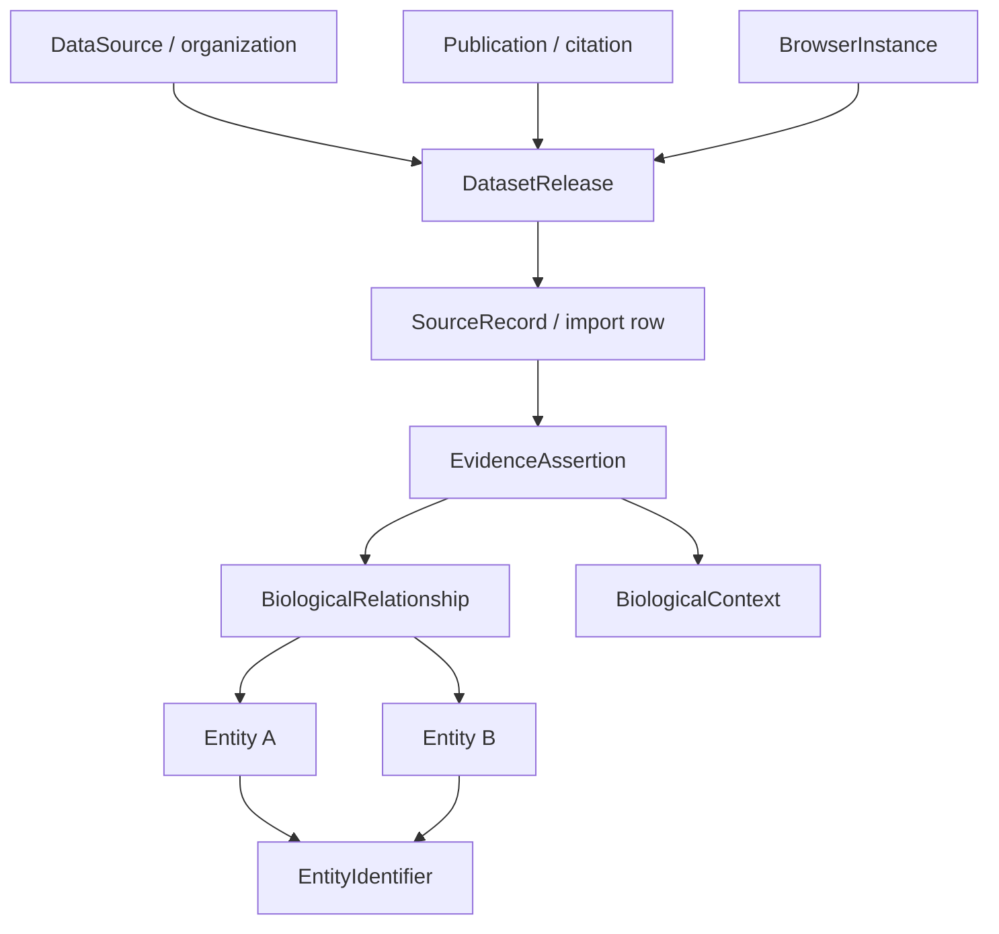

# OpenPIP Generalization Project
## Project brief, product requirements, technical direction, and instructions for Claude Code

> Provided by the project owner on 2026-10-28 and kept as written. It states
> requirements and direction, not implemented behaviour. The audit and design
> documents next to it (see `README.md` in this folder) record what the code
> actually does and the decisions taken.

**Document status:** Proposed implementation brief — not a report that these features already exist  
**Prepared:** 2026-10-28  
**Primary development repository:** https://github.com/MilesGithub/openpip-2.0  
**Original upstream repository:** https://github.com/Helmy-Lab/openpip-2.0  
**Separate HuRI-specific repository:** https://github.com/MilesGithub/HuRI  
**Current starting point:** OpenPIP 2.0, a customizable protein–protein interaction (PPI) publication and network-exploration portal.

---

## 0. Instructions to Claude Code: read this first

You are helping develop **the generalized OpenPIP platform** in the user's independent fork, `MilesGithub/openpip-2.0`. The goal is **not** simply to add a few new interaction types to the existing search page. It is to turn OpenPIP into a reusable biological relationship platform with two related public products:

1. **Unified Biological Interaction Resource:** One integrated, searchable biological relationship database, linking appropriately normalized entities and interaction evidence from many datasets, with cross-dataset network exploration.
2. **Dataset-Specific Browser Gallery:** A browsable directory of focused, publication-linked interaction-browser implementations. Each browser has a distinct dataset, citation, biological question, filters, and presentation, but reuses common software and (where appropriate) the canonical database. Some entries may link to independent OpenPIP deployments maintained by other labs.

This architecture should also preserve the existing third use case: **a laboratory can install OpenPIP independently and publish its own datasets without needing to populate the whole integrated resource**.

### Required operating principles

- **Inspect actual current code before editing.** Treat file paths and implementation observations in this brief as a verified starting snapshot, not as a substitute for examining the working tree, branches, migrations, tests, and current documentation.
- Work **only in the intended fork and working branch**; do not change `Helmy-Lab/openpip-2.0`, `MilesGithub/HuRI`, any live database, or any deployed website without an explicit separate request.
- Preserve the existing PPI application, HuRI/YeRI use cases, legacy API contracts, PSI-MI TAB/PSICQUIC support, search behavior, exports, and administrator workflows while adding generalized functionality.
- Develop **incrementally**, with database migrations, tests, reviewable PR-sized changes, and reversibility. Do not replace legacy models or delete production data in the first milestone.
- **Do not assume a gene, protein, and transcript are the same entity.** Cross-layer links are explicit biological relationships, not silent merges.
- **Do not collapse distinct scientific claims**—e.g., an undirected physical interaction, a signed genetic interaction, a directed TF→gene regulation claim, a miRNA→transcript binding observation, and a gene–disease association are different kinds of records.
- **Provenance is mandatory** for imported records. Retain the original dataset, release, record ID, publication, evidence/method, organism, context, confidence semantics, and license information as available.
- **License review is a gate** before publicly redistributing third-party records. An academic publication or publicly accessible download is not automatically authorization to rehost the underlying database.
- Never invent datasets, counts, licensing permissions, accession mappings, or experimental validation. Mark unresolved facts explicitly.
- First provide an **architecture assessment and phased plan**, identify design decisions/risks, and propose the smallest useful slice. Implement a phase only when explicitly asked or when that phase is the clearly authorized current task. Do not silently launch an all-at-once rewrite.

### Initial deliverables requested from Claude Code

1. A short `CURRENT_ARCHITECTURE_ASSESSMENT.md` based on actual code and tests.
2. An architecture proposal (`GENERALIZATION_ARCHITECTURE.md`) with a data-model diagram, migration strategy, API/interface contracts, and alternatives/trade-offs.
3. A prioritized, dependency-aware implementation plan and GitHub issue breakdown (small independently testable pieces).
4. Suggested first implementation slice: a **typed-entity and relationship foundation plus a deliberately small example of a non-PPI network**, isolated from production PPI behavior.
5. A regression test plan and a written list of open questions.

The sections below are **requirements and guiding design**, not a demand to adopt every proposed model name or field literally. Where the actual repository suggests a better migration-compatible approach, explain the trade-off.

---

## 1. Vision and product concept

### What exists now

OpenPIP was created to help research groups publish and explore protein–protein interaction maps. It provides network visualization, gene/protein search, filters, dataset downloads, evidence/citation details, site customization, saved/shareable network views, and machine-readable APIs.

### What we want to build

A broadly reusable **OpenPIP Biological Interaction Platform** that can represent multiple forms of biological relationships, both within individual experiments and across datasets. The integrated resource should answer questions such as:

- Which proteins physically interact with a protein of interest?
- What are its positive or negative genetic interaction partners?
- Which transcription factors regulate a gene, and are the reported effects activating or repressing?
- Which miRNAs target relevant transcripts?
- Which kinases modify a protein and at which sites?
- Which ligands and receptors participate in potential intercellular signaling?
- Which variants, phenotypes, and diseases are associated with genes of interest?
- What is the evidence for every displayed connection, which study produced it, and are studies in agreement?
- Can the user move between a focused, publication-specific experimental network and a cross-dataset network centered on the same biological entity?

### Three complementary products from one codebase

| Product | Purpose | Data boundary | Example route (proposed) |
|---|---|---|---|
| **Unified Resource** | Search and visualize across many compatible datasets and relationship types | All licensed/available integrated data | `/explore` |
| **Browser Gallery + instances** | Explore a specific published dataset with purpose-built filters, context, figures and citation | One or more selected datasets/releases | `/datasets` and `/browsers/:slug` |
| **Independent lab portal** | Let an external lab publish its own map using the open-source platform | That installation's own data | Separate deployment/domain |

**Important:** A browser instance is *not the same thing* as a dataset. An instance is a configuration of presentation, selected datasets/releases, permitted entity/edge types, filters, metadata, and optional external URL. One dataset may power multiple views; one browser may include multiple selected releases. Prefer a shared canonical database for the main hub and its internal gallery instances, but preserve support for completely independent installations.

### Example hub navigation

- Home
- Explore Unified Network
- Dataset-Specific Browsers
- Datasets / Sources / Publications
- Downloads & API
- Documentation / Build Your Own Portal
- About / Methods

The homepage should prominently offer (1) a unified search box, (2) direct access to the unified network, (3) a gallery of specialized browser instances, and (4) transparent information about dataset coverage and provenance. Do **not** advertise fabricated counts such as “1.2B interactions” or “100+ integrated datasets” unless actual imported records support them. Distinguish candidate gallery entries from live/available entries.

---

## 2. What the repository currently does (starting snapshot)

Source: `MilesGithub/openpip-2.0`, default `main`, inspected 2026-10-28.

### Stack

- Backend: Django 5, Django REST Framework, PostgreSQL 16, Celery, Redis.
- Frontend: React 19, TypeScript, Vite, React Router, TanStack Query, Zustand, Cytoscape.js.
- Deployment: Docker Compose; MkDocs documentation.
- Existing PPI interface: protein list/detail, `/search` network, node/edge information panels, category/score/tissue filters, downloads, saved/shared networks, administrative upload, PSI-MI TAB and PSICQUIC.

### Verified relevant code paths

| File / area | Existing role | Generalization concern |
|---|---|---|
| `backend/proteins/models.py` | `Protein`, `Identifier`, `ProteinIdentifier`, `Organism`, domains, complexes, annotations | Assumes the only searchable biological entity is a protein; identifiers include untyped/free-form entries |
| `backend/interactions/models.py` | `Interaction` has `interactor_A`/`interactor_B` foreign keys to `Protein`; categories, datasets, support information, participants | Binary protein-only endpoints; missing explicit direction/sign/context on the canonical interaction |
| `backend/datasets/models.py` | `Dataset` includes author, PubMed, DOI, citation fields and About text | Valuable basis; needs releases, source identifiers, license, ingest provenance, available/withdrawn states |
| `backend/datasets/upload_parser.py` | PSI-MI TAB and CSV parsing, protein identifier lookup, undirected pair deduplication | A–B = B–A and pair reuse are not generally valid for directed/multi-evidence relationships |
| `backend/datasets/tasks.py` | Celery import tasks, progress, protein enrichment via UniProt/Ensembl/NCBI | Generalization needs per-source adapters, entity-aware enrichment and safe ingestion workflows |
| `backend/interactions/search_service.py` | Protein-specific search response and network expansion | Existing output must remain supported; new search should be typed and separately versioned |
| `backend/psicquic/` | PSI-MI / MIQL functionality | Preserve molecular-interaction standards; do not force generic non-PSI edges into misleading MITAB |
| `frontend/src/types/search.ts` | Search response types assume `all_proteins` and `all_interactions` | New typed network response needed |
| `frontend/src/features/search/network/cytoscapeElements.ts` | Builds protein nodes and PPI edges | Support entity types, directed arrows, effects, evidence, edge classes, multi-edges |
| `frontend/src/features/search/network/cytoscapeStyles.ts` | Existing node/edge styles | Accessible graph legend and semantic styles without breaking PPI styling |
| `frontend/src/features/search/EdgeInfoPanel.tsx` and `NodeInfoPanel.tsx` | Protein/PPI-specific panels | Make generic panels with specialized type-specific sections |
| `frontend/src/App.tsx` | Router: `/`, `/search`, `/proteins`, admin, downloads, saved/shared pages | Add `/explore`, `/datasets`, `/browsers/:slug`, generalized entity detail routes |
| `docs/operator-guide/data-formats.md` | Documents CSV/MITAB semantics | New import format and behavior must be independently specified and documented |
| `docs/project/README.md` | Clarifies project notes record past design decisions | Historical plans may be obsolete; favor running code, operator docs, and tests |

### Specific pitfalls confirmed in current code/docs

1. `Interaction` references **two `Protein` rows**, preventing a generic gene→disease or miRNA→transcript edge without architectural change.
2. `_existing_interaction()` resolves an active pair in **either orientation**, and the importer credits a reused interaction to the next dataset. This can collapse directional or scientifically distinct claims, and cannot be the rule for generalized ingestion.
3. Current `Interaction.negative` means an experimental **non-interaction** in MITAB. This is **not equivalent** to a biologically negative/inhibitory effect, such as repression or a negative genetic interaction. Do not reuse this Boolean as a universal `sign`.
4. `Interaction.score` is a short string; scores across datasets are **not intrinsically comparable**. Confidence needs score type, method, scale and calibration context.
5. Search response and Cytoscape mapping assume protein IDs and protein-centric annotations.
6. Current importer enriches newly created proteins using UniProt/Ensembl/NCBI; RNA, gene, disease, variant and region entities need separate enrichment rules.
7. Current `Dataset` already has citation and About fields; extend rather than discard this capability.
8. Do not convert old PPI data destructively in the first migration. Existing HuRI/YeRI installations may rely on database table names, PSI-MI representation and legacy API shapes.

Useful repository links:

- https://github.com/MilesGithub/openpip-2.0/blob/main/README.md
- https://github.com/MilesGithub/openpip-2.0/blob/main/backend/interactions/models.py
- https://github.com/MilesGithub/openpip-2.0/blob/main/backend/datasets/upload_parser.py
- https://github.com/MilesGithub/openpip-2.0/blob/main/frontend/src/features/search/network/cytoscapeElements.ts
- https://github.com/MilesGithub/openpip-2.0/blob/main/docs/operator-guide/data-formats.md

---

## 3. Scientific and product scope

### Relationship families that the platform should eventually support

| Family | Example endpoints | Typical semantics | Complexity |
|---|---|---|---|
| Physical PPI | protein ↔ protein | Physical binding/association, often undirected | Existing foundation |
| Functional protein associations | protein ↔ protein | Statistical/functional association, **not proof of binding** | Low–medium |
| Genetic interactions | gene ↔ gene | Synthetic lethal, suppression, positive/negative interaction **relative to a model** | Medium |
| Transcriptional regulation | TF protein/gene → target gene | Activates, represses, regulates; directional with evidence qualifiers | Medium |
| miRNA targeting | miRNA → transcript/gene | Binds or functionally regulates; direct observation vs prediction | Medium |
| RNA-binding protein interactions | protein ↔ RNA/transcript/region | Binding; sometimes location/site dependent | Medium–high |
| Protein signaling | enzyme/protein → substrate/target | Activation, inhibition, phosphorylation/dephosphorylation and site context | Medium–high |
| Ligand–receptor | ligand protein/complex → receptor protein/complex | Molecular compatibility; expression-based cell communication is a separate inference | Medium–high |
| Host–pathogen | host protein ↔ pathogen protein | Physical interactions; cross-organism | Medium |
| Gene–phenotype/disease | gene ↔ phenotype/disease | Association, evidence-backed; **not assumed causal** | Medium |
| Variant–trait and eQTL | variant → phenotype / gene | Statistical association, tissue, assembly, significance | High |
| Enhancer/promoter interactions | genomic region → gene/region | Regulatory evidence or chromatin contact | High |
| Biochemical pathways | reaction ↔ participants | Many-to-many, substrate/product/catalyst stoichiometry | High |
| Protein complexes | complex ↔ components | Membership and stoichiometry, not all-to-all binding | High |
| Co-expression and co-essentiality | gene ↔ gene | Derived statistical network with method and threshold | Medium–high |

### Must not conflate these concepts

- **Molecular binding** ≠ **regulatory control** ≠ **functional association** ≠ **statistical co-variation**.
- **Inhibition/repression/negative genetic score** ≠ **experimentally observed absence of a physical interaction**.
- **Evidence for regulation** ≠ **presence of a TF binding motif**.
- **Ligand–receptor pair** ≠ **demonstrated cell-to-cell communication**.
- **Gene** ≠ **protein product** ≠ **isoform** ≠ **transcript**.
- **Publication** ≠ **dataset** ≠ **dataset release** ≠ **source record** ≠ **canonical biological assertion**.

Every kind of relationship should have explicit semantics, and the UI should explain them.

---

## 4. Data architecture: proposed target concepts

Build a **typed, evidence-centered graph represented in PostgreSQL**. A graph database is not required for the MVP; good relational indexing and bounded neighborhood queries are sufficient to begin. Reconsider storage strategy only after benchmarking real query workloads.

### Suggested conceptual schema



This is conceptual: exact cardinalities and field placement must be decided with Django migrations in mind.

### Core models / tables (suggested)

**`BiologicalEntity`**

- Stable internal ID; `entity_type` (e.g. gene, protein, protein_isoform, transcript, miRNA, lncRNA, genomic_region, variant, chemical, complex, reaction, phenotype, disease, cell_type, organism).
- Primary display name, description, taxon if applicable; relevant assembly/context for coordinate-defined entities.
- Type-specific details in normalized extension tables or explicit JSON metadata with documented schemas; don't create one giant sparse table.
- Keep the existing `Protein` model compatible. Initial path could attach a `BiologicalEntity` to each legacy protein rather than replacing the old protein rows.

**`EntityIdentifier`**

- Entity FK; namespace; accession/string; organism/taxon and version/assembly where applicable; primary/preferred/alias indicator; provenance.
- Namespaces include UniProtKB, Ensembl gene/transcript/protein, NCBI Gene, HGNC, MGI, RNAcentral, miRBase, ClinVar/variation identifiers, MONDO, DOID, HPO, ChEBI, PubChem, Reactome, etc. Only use appropriate namespaces for each entity type.
- Uniqueness keys should include **namespace and identifier** plus taxon/assembly/context where the namespace requires it. Do not silently case-fold accessions whose case matters.
- Ambiguous names return candidates; no arbitrary first-match for cross-species symbols, isoforms, transcript versions or unmapped source IDs.

**`RelationshipType` / ontology registry**

- Stable machine-readable slug, readable label, definition; allowed endpoint types and valid directionality; default visual style.
- Preserve source-level terms (e.g. PSI-MI) and map to common types only where scientifically defensible.
- Examples: `physical_association`, `genetic_interaction`, `transcriptional_regulation`, `mirna_binding`, `phosphorylates`, `ligand_receptor`, `associated_with_disease`, `encodes`, `member_of_complex`.

**`BiologicalRelationship`**

- Endpoint entities, relation type, directed/undirected semantics, optional standardized effect (`activating`, `inhibiting`, `mixed`, `unknown`, `not_applicable`), optional specific target site.
- Do not assume every relation is a simple directed cause-and-effect edge.
- A relationship is a scientifically defined *claim type*; canonicalization/deduplication must include orientation, type, effect, biological context and granularity as needed. For example A→B and B→A are different for transcriptional regulation.
- Multiple edges between the same endpoints are allowed when they represent different biological claims.
- A separate **tested-absent/negative experimental observation** state belongs at evidence/assertion level when appropriate, preserving the special meaning of MITAB `negative`.

**`EvidenceAssertion` / `InteractionObservation`**

- Foreign keys to relationship, dataset release and original source row; method, identifiers, publication, confidence value **and score namespace**, sign/effect evidence if present, experimental support vs prediction vs computational inference, test result (observed/not observed), qualifiers, source details and optional context.
- **Two publications reporting the same relationship should create two evidence assertions**, even if the UI aggregates them into one displayed edge. Contradictions must remain accessible.
- Preserve source values exactly, plus mapped normalized values in separate fields.

**`BiologicalContext`**

- Taxon/organism, tissue/cell type, condition, cell line, compartment, sample/assay, perturbation, experimental system, genomic assembly, timepoint, and other qualifiers when relevant.
- Avoid inventing context; unknown is not the same as ubiquitous or applicable to all conditions.

**`DataSource`, `Dataset`, `DatasetRelease`, `SourceRecord`, `Publication`**

- Record canonical source and publisher; dataset/study identity; version/release date; citation DOI/PMID; import timestamp, source URL and file checksum; redistribution terms and obligations; transformation/adaptor version; import state and row-level provenance.
- Publication records and supporting citations can be many-to-many with releases/assertions.
- Support data correction, updates, withdrawal, re-import, and audit of provenance.
- Dataset releases should be reproducible; avoid silently overwriting a release with a newer download.

**`BrowserInstance`**

- `slug`, title, summary, status (`planned`, `available`, `retired`), internal vs external, optional external URL, display theme, selected datasets/releases, organism restrictions, accepted entity/relation types, defaults for filters/layout, supported evidence panels, citation/methods/content, ordering, and administrator-managed visibility.
- Browse instances in a card gallery. Reuse shared React components but allow specialized filters and scientifically appropriate node/edge presentation.
- A gallery entry can link out to an independent lab-hosted deployment without duplicating that lab's content in the shared database.

### Two related but distinct relationship layers

- **Entity/reference relationships:** e.g. gene `encodes` protein; transcript `transcribed_from` gene; isoform `isoform_of` protein; variant `located_in` region. These make heterogeneous traversal possible.
- **Evidence-backed scientific interaction/association relationships:** e.g. proteins physically interact; TF regulates a gene; miRNA targets a transcript; variant is associated with phenotype.

Do not automatically infer a protein PPI edge to be a gene–gene physical binding edge. When the UI uses gene-centric summaries, label projections explicitly.

### Important special representations

- **Protein complexes** need a first-class complex node with member roles, stoichiometry and supporting evidence; avoid replacing with all-to-all PPIs.
- **Biochemical reactions** need reaction nodes and roles such as substrate/product/catalyst/regulator; hyperedges can be projected for display, but retain underlying n-ary semantics.
- **Genomic contacts** require coordinates, genome build, assay and normalization; contact matrices should not be imported wholesale as billions of naive edges without a storage/query design.
- **Site-specific enzyme modification** needs site positions/isoforms, modification types and method provenance.

---

## 5. Ingestion, integration and identity resolution

### File and importer strategy

Keep existing CSV and PSI-MI TAB importers working for PPI use cases. Introduce a **new canonical typed import interface** plus source-specific adapters.

Suggested pipeline:

1. **Acquire** source release under documented use terms (or load a small synthetic/licensed fixture).
2. **Register** data source, dataset, release, publication, original files and checksums.
3. **Parse** original format with a source adapter; preserve raw records and error provenance.
4. **Validate** columns, relationship semantics, identifier namespaces, taxon, method and context.
5. **Resolve identities** to typed canonical entities; flag ambiguous or unmapped IDs rather than inventing merges.
6. **Map relationships and observations**, retaining directionality, effects, non-interactions, scores and source-specific fields.
7. **Stage and review** a dry-run report: new entities, mapped IDs, existing claims, new evidence, unresolved records, conflicts, license status.
8. **Commit/upsert** idempotently using source release + source record identifiers, in batches/transactions, with progress and restart support.
9. **Build indexes/summary statistics** and publish an auditable import report.
10. **Enable an instance** only when approved and appropriately attributed.

For large sources, stream ingestion rather than pushing all lines at once into a Celery task payload. Choose batch size, checkpoint/restart, schema constraints and storage based on benchmarks. Validate maximum file sizes and malicious/untrusted input; no arbitrary code execution from uploaded data. Keep file storage and quotas manageable.

### Example canonical records (ILLUSTRATIVE, NOT ASSERTIONS ABOUT SPECIFIC DATASETS)

**Simplified CSV that can show a directed relation and evidence:**

```csv
source_record_id,source_entity_id,target_entity_id,source_namespace,target_namespace,source_entity_type,target_entity_type,source_taxon,target_taxon,relationship_type,directed,effect,evidence_type,publication_doi
example-001,TP53,CDKN1A,HGNC_symbol,HGNC_symbol,gene,gene,9606,9606,transcriptional_regulation,true,activating,literature_curated,
example-002,P04637,Q00987,UniProtKB,UniProtKB,protein,protein,9606,9606,physical_association,false,not_applicable,experimentally_detected,
```

These two rows are **schema illustrations only**, not imported study records. For actual ingestion, accession namespaces and symbols must be verified and source publications attached at the assertion level.

**Normalized API example:**

```json
{
  "nodes": [
    {"id": "entity:123", "type": "gene", "label": "Example gene A", "identifiers": [{"namespace": "example", "value": "A"}]},
    {"id": "entity:456", "type": "gene", "label": "Example gene B", "identifiers": [{"namespace": "example", "value": "B"}]}
  ],
  "edges": [
    {
      "id": "relationship:789",
      "source": "entity:123",
      "target": "entity:456",
      "type": "transcriptional_regulation",
      "directed": true,
      "effect": "inhibiting",
      "evidence_count": 2,
      "datasets": ["dataset_release:17"],
      "evidence_summary": {"experimental": 1, "curated": 1}
    }
  ],
  "page": {"has_more": false},
  "warnings": []
}
```

Do **not** interpret a common numerical score as comparable across all sources. Expose source-specific scoring metadata and filters.

### Data integration and update rules

- **Canonical entity IDs** are stable across source imports, subject to explicit controlled merge/split procedures.
- **Source assertions** remain distinct. Deduplicate reimports by stable provenance keys, not merely by endpoint pair.
- **Cross-dataset support aggregation** is a UI/query projection, not permanent destruction of the evidence records.
- Preserve old releases and support datasets being removed from public view for licensing/correction reasons.
- Never silently match genes by symbols alone across organisms, and never automatically merge gene/protein/transcript records.
- Version every adapter and maintain fixture-based importer regression tests.
- Avoid auto-crawling or scraping sources without confirmation of appropriate permissions and access method.

---

## 6. Frontend experience and gallery

### Unified browser features (target)

1. Search by gene, protein, RNA, chemical, disease, phenotype, variant or identifier; offer type/taxon disambiguation.
2. Expand a **bounded** neighborhood around a search result. Support per-type expansion controls and warning/limits on large requests.
3. Toggle **interaction layers** (PPI, genetic, TF regulation, miRNA targeting, signaling, ligand–receptor, disease, etc.).
4. Filter by source dataset/release, species, relationship type, method, evidence class, study, confidence scale, tissue/cell line/condition, and direction/effect where relevant.
5. Cytoscape graph conventions: node shape/type, accessible legend, directed arrowheads, effect colors/line patterns, curved parallel edges, negative-tested evidence distinct from inhibitory effects.
6. Side panels for node details, canonical cross-references, relationship meaning, source citations, individual evidence records and context. Do not present associations as proven mechanisms.
7. Table views and filtered exports: `nodes.csv`, `edges.csv`, `evidence.csv`, and optionally provenance manifest; show license restrictions for exports.
8. Shared/saved views persist filters, selected releases, identifiers, and data-version context. Existing PPI saved views continue to work.
9. Server-side pagination, indexing and lazy loading; never send the entire multi-dataset graph to the browser.
10. Accessible keyboard navigation, responsive layout, high-contrast palettes, and explanatory tooltips/legends.

### Specialized browser instance features

- Header with dataset/study title, source, citation, publication link, method summary, organism(s), data-release version, download/license information.
- Search and visualization focused on this data's actual entity and relationship types.
- Customizable but **typed** filter panels appropriate to the study (e.g. genetic interaction effect and score; TF regulation direction; CLASH hybrid reads; host vs pathogen organism).
- Data provenance and methods visible at edge level.
- Optional study-specific text, images and links, without bespoke code forks for every instance.
- Clear “**Explore these entities in the unified network**” action that transfers a canonical entity and preserves context where meaningful.
- A clear route back to “All browsers” and option to find related studies.

### Gallery directory features

- Full-text/title search; filters for biology area, interaction type, species, assay, publication year, status and data availability.
- Distinguish *live interactive browser* from *planned*, *external portal*, and *metadata-only/unavailable data*.
- Dataset cards show recognizable publication/year and interaction class, **not just aggregator database logos**.
- An administrator can register/disable/reorder instances without deploying a new frontend build.

### Site architecture choice

For the central hub, prefer **one Django/PostgreSQL deployment with multiple configured browser views** and one normalized internal catalog, unless evidence supports separate services. For independent labs, keep the current ability to deploy OpenPIP alone using their own database. Do not implement heavyweight multi-tenancy, authentication sharing, or per-dataset microservices prematurely.

---

## 7. Prioritized publication-linked implementation candidates

The gallery is intended to emphasize **specific published experimental maps and defined datasets**, *not* make each large aggregator (STRING, IntAct, BioGRID) the principal identity of a browser. Aggregators may still provide enrichment/source support in the integrated resource.

**Initial candidates** (verify publication metadata, release download, dataset rights, organism, identifiers and import complexity before use):

| Priority | Proposed instance | Relationship class | Publication |
|---|---|---|---|
| 1 | **HuRI** — Human Reference Interactome | Experimental binary PPI | Luck et al. (2020), *A reference map of the human binary protein interactome*, **Nature**. DOI: https://doi.org/10.1038/s41586-020-2188-x |
| 1 | **YeRI** — Yeast Reference Interactome | Experimental yeast PPI | Identify the exact primary YeRI release/paper from the existing deployment or repository; **verify title, authors, DOI and files rather than relying on an assumed citation**. |
| 1 | **BioPlex 3.0** | Human protein association / AP-MS complex-proximal network | Huttlin et al. (2021), *Dual proteome-scale networks reveal cell-specific remodeling of the human interactome*, **Cell**. DOI: https://doi.org/10.1016/j.cell.2021.04.011 |
| 1 | **Costanzo yeast global genetic interaction map** | Genetic interaction | Costanzo et al. (2016), *A global genetic interaction network maps a wiring diagram of cellular function*, **Science**. DOI: https://doi.org/10.1126/science.aaf1420 |
| 1 | **Horlbeck human CRISPRi genetic interaction map** | Human genetic interaction | Horlbeck et al. (2018), *Mapping the Genetic Landscape of Human Cells*, **Cell**. DOI: https://doi.org/10.1016/j.cell.2018.06.010 |
| 1 | **Helwak human CLASH miRNA interaction map** | miRNA–RNA | Helwak et al. (2013), *Mapping the human miRNA interactome by CLASH reveals frequent noncanonical binding*, **Cell**. DOI: https://doi.org/10.1016/j.cell.2013.03.043 |
| 1 | **Ramilowski human ligand–receptor network** | Ligand–receptor | Ramilowski et al. (2015), *A draft network of ligand-receptor-mediated multicellular signalling in human*, **Nature Communications**. DOI: https://doi.org/10.1038/ncomms8866 |
| 1 | **Gordon SARS-CoV-2–human interaction map** | Host–pathogen PPI | Gordon et al. (2020), *A SARS-CoV-2 protein interaction map reveals targets for drug repurposing*, **Nature**. DOI: https://doi.org/10.1038/s41586-020-2286-9 |
| 2 | **Van Nostrand human RBP binding map** | Protein–RNA binding | Van Nostrand et al. (2020), *A large-scale binding and functional map of human RNA-binding proteins*, **Nature**. DOI: https://doi.org/10.1038/s41586-020-2077-3 |
| 2 | **Norman combinatorial Perturb-seq** | Perturbation and gene interaction phenotypes | Norman et al. (2019), *Exploring genetic interaction manifolds constructed from rich single-cell phenotypes*, **Science**. DOI: https://doi.org/10.1126/science.aax4438 |
| 2 | **Replogle genome-scale Perturb-seq** | Gene perturbation → transcriptional phenotype | Replogle et al. (2022), *Mapping information-rich genotype-phenotype landscapes with genome-scale Perturb-seq*, **Cell**. DOI: https://doi.org/10.1016/j.cell.2022.05.013 |
| 2 | **Fulco enhancer–gene CRISPR map** | Enhancer → gene | Fulco et al. (2019), *Activity-by-contact model of enhancer–promoter regulation from thousands of CRISPR perturbations*, **Nature Genetics**. DOI: https://doi.org/10.1038/s41588-019-0538-0 |
| 2 | **Havugimana human soluble protein complexes** | Complex membership | Havugimana et al. (2012), *A census of human soluble protein complexes*, **Cell**. DOI: https://doi.org/10.1016/j.cell.2012.08.011 |
| 3 | **Johnson human kinome specificity atlas** | Kinase substrate specificity, not necessarily a confirmed endogenous protein→protein edge | Johnson et al. (2023), *An atlas of substrate specificities for the human serine/threonine kinome*, **Nature**. DOI: https://doi.org/10.1038/s41586-022-05575-3 |
| 3 | **Rao human chromosome contact map** | Genomic region contact | Rao et al. (2014), *A 3D map of the human genome at kilobase resolution reveals principles of chromatin looping*, **Cell**. DOI: https://doi.org/10.1016/j.cell.2014.11.021 |

### Useful background sources, not necessarily dedicated first-wave gallery identities

- TRRUST, CollecTRI, DoRothEA: curated TF–target regulation; useful for directed-edge MVP fixtures and a dedicated curated-resource browser if their use terms allow.
- SIGNOR and OmniPath: directed causal signaling and integrated relations; preserve each original evidence source.
- miRTarBase, DIANA-TarBase, ENCORI, NPInter: RNA/miRNA relationships and supporting methods.
- connectomeDB2025: curated ligand–receptor pairs; separate pair knowledge from inferred cell–cell communication.
- Open Targets, Monarch, ClinVar, HPO, GWAS Catalog: disease, variant and phenotype associations.
- Reactome, Complex Portal, CORUM: pathway/reaction/complex relationships; require advanced graph modeling.
- ENCODE, 4D Nucleome, GTEx and eQTL Catalogue: regulatory intervals and variant-to-gene evidence.

### Licensing and data availability gate

For each proposed dataset, create a machine-readable or administratively maintained **dataset due-diligence record** with:

- Primary publication and exact released data URL.
- Data version/date and expected checksum.
- Stated legal license, permitted uses, bulk redistribution, commercial reuse, API limits, required citation/attribution and any ambiguity.
- Availability of entity-pair/edge tables versus supplementary matrices/raw experiment files.
- Organism and identifier namespace mapping plan.
- Provenance and quality/evidence fields actually present.
- Whether the resource is approved for (a) internal experimentation, (b) public visualization, and (c) public bulk download; these are distinct decisions.

**No bulk public integration until approved.** Begin with wholly synthetic fixtures or datasets with verified appropriate permissions.

---

## 8. Implementation phases and acceptance criteria

### Phase 0 — Repository audit and preservation baseline

**Work:** Review code, migration graph, test baseline, API contracts, PSICQUIC behavior, saved view formats, deployment and actual data fixtures. Record known inconsistencies and gaps. Propose architecture decisions with alternatives.

**Done when:** A reviewed technical plan exists; baseline tests run (or documented environmental blockers); exact non-breaking migration sequence is understood.

### Phase 1 — Add typed entities and provenance without changing PPI behavior

**Work:** New additive entity/identifier/source/release/relationship/evidence structures, schema constraints and indexes; migration/bridge to existing proteins; small synthetic fixture and read API; no destructive table migration.

**Done when:** Existing PPI tests still pass; old `/api/search` response remains unchanged; two different entity types can be stored; provenance/source references round-trip; ambiguous IDs are detected; data migrations are rerunnable and safe.

### Phase 2 — A first genuinely non-PPI implementation

**Work:** Choose a legally usable small **directed** TF–gene regulatory dataset/fixture (TRRUST-like if permissions and source data check out). Create first adapter, direction/effect semantics, typed query API and new Cytoscape rendering.

**Done when:** Search distinguishes A→B from B→A; activation and repression render differently; evidence is displayed and attributable; old PPI view remains correct; browser instance can restrict to the chosen dataset.

### Phase 3 — Unified search + browser gallery

**Work:** `/explore` multi-layer query with bounded expansions; `/datasets` catalog; `/browsers/:slug` configurable specialized views; navigation between instances and unified resource; admin-managed instance metadata.

**Done when:** At least two scientifically different relation classes are explored together without entity conflation; gallery filtering works; users can inspect original dataset evidence; routes are linkable and tested; license/availability status is visible.

### Phase 4 — Three to five high-quality published demonstration browsers

**Work:** Add one genetic interaction study, one RNA study, and one host–pathogen or ligand–receptor study after source validation; refine importer architecture, organism resolution, site-specific fields and UI filters.

**Done when:** Release-specific scientific attribution and import validation tests are in place; source fields are retained; import is idempotent and resumable; cross-dataset overlap does not duplicate evidence; download rights are honored.

### Phase 5 — Advanced relationships, scale and sustainable maintenance

**Work:** Complex membership, reaction nodes, genomic region/variant types, broader disease associations; update scheduler where authorized; performance benchmarks and observability; publishing and operator documentation.

**Done when:** Complex/n-ary relations are not misrepresented as arbitrary PPI edges; query latency and render sizes meet defined benchmarks on a realistic dataset; imports can be updated/rolled back without losing provenance.

### Deliberate MVP boundary

The **smallest meaningful end-to-end MVP** should contain the **existing working PPI browser**, **one typed directed non-PPI demonstration network**, **one unified multi-layer query**, and **a simple gallery linking both**. Do *not* use the number of integrated datasets as the first success metric.

---

## 9. Tests, performance, security and deployment

### Existing documented checks

From `CONTRIBUTING.md`:

```bash
# Backend, from backend/ and with dependencies/database configured
pytest
ruff check .
black --check .

# Frontend, from frontend/
npx vitest run
npm run lint
npm run build

# Documentation
mkdocs build --strict
```

Adapt these to installed local/virtualenv paths. Verify Docker Compose and PostgreSQL connectivity rather than unintentionally running against a fallback SQLite file. Never run migration tests on a live user database.

### Essential new tests

- Legacy PPI import and search parity; existing PSI-MI roundtrips including MITAB `negative`; PSICQUIC/MIQL unchanged where applicable.
- Protein A–B duplicate handling stays unchanged in the **legacy path**.
- Directed A→B vs B→A stored separately in the **new path**; same endpoints may carry distinct relation types and evidence.
- Inhibitory effect vs observed non-interaction vs negative genetic score remain separate fields and UI labels.
- Same source row imported twice is idempotent; two independent evidence records on the same relationship are preserved.
- Organism/namespace/isoform ambiguity does not silently merge entities.
- Gene, transcript and protein related to one another by explicit canonical links, not same ID.
- Filter semantics, dataset release restrictions, evidence counts, pagination and export provenance.
- Multi-type Cytoscape rendering, directed arrows, accessible styles, parallel edges, responsive layout.
- Sharing/saved views and legacy API response regression tests.
- Invalid files, oversized payloads, malicious strings, concurrency, permissions, and safe rollback of failed import batches.

### Performance and operational constraints

- Use PostgreSQL indexes on `(type, entity IDs)`, source release, external identifiers, relationship endpoints, evidence/source keys and relevant filter dimensions.
- For the unified graph, use server-side limited neighborhood expansion and lazy evidence loading. Offer explicit limits and user feedback on truncation.
- Avoid N+1 ORM queries and unbounded fanout; benchmark before adding graph infrastructure.
- Use snapshot-based or release-aware cached statistics; distinguish canonical relationships from evidence assertions and raw rows.
- Persist import manifests, logs, source checksums and schema/adapter versions.
- Maintain existing privacy/authentication policies for saved/shared networks and administrator tasks.
- Sanitize content from data sources before rendering in browser or rich text panels; uploaded files are untrusted input.

---

## 10. Git branching, project boundaries and documentation

- **Repository to work in:** `MilesGithub/openpip-2.0`.
- **Upstream to read/sync selectively:** `Helmy-Lab/openpip-2.0`; syncing is not automatic and may produce merge conflicts. Do not push to upstream.
- **HuRI site-specific work:** `MilesGithub/HuRI` is separate and not automatically changed by this fork. Do not modify it as part of generalization unless explicitly directed.
- Start from the current fork's verified baseline, create small topic branches (`feature/generic-entities`, etc.), and propose reviewable PRs; follow its `CONTRIBUTING.md` conventions and existing test practices.
- No automatic production deployment, bulk dataset import, repository rename, destructive migration, force-push, or merge to `main` without explicit approval.
- Avoid copying and changing existing historical migrations; generate new additive migrations.
- Where old repo documentation discusses “Phase 1 parity / Phase 2 improvements,” treat it as historical project context, not an instruction forbidding the independently authorized fork project. Nonetheless preserve interoperability and upstream patchability.
- New docs should describe actually implemented behavior separately from proposed future functionality. Update API docs at the same time as new endpoints, because the repository has documentation contract tests.
- Keep adapter-specific scientific decisions under documented code/config, with mapping tests and references to data origin.

---

## 11. Starter GitHub issue breakdown

The exact issue count/dependencies should be refined after the audit. Suggested initial issues:

| Order | Issue title | Deliverable |
|---|---|---|
| 0 | Audit PPI architecture and baseline tests | Verified map of models, APIs, import, frontend and backward-compatibility contracts |
| 1 | ADR: generalized entity and relationship model | Design choices, ontology/identity rules, compatibility and migration plan |
| 2 | Add typed `BiologicalEntity` and identifier tables | Additive models, constraints and tests |
| 3 | Add dataset source, version and import-provenance models | Dataset releases, source records and attribution tests |
| 4 | Map existing proteins to generic entities without replacing legacy records | Safe bridge/migration and parity tests |
| 5 | Add typed biological relationship and evidence assertion models | Direction/sign/negative-tested semantics, multi-evidence tests |
| 6 | Design generic import adapter protocol and validation report | Synthetic fixture import, unmapped-ID report, idempotent reimport |
| 7 | Add v2 entity/relationship search endpoints | Paginated typed network and evidence detail response |
| 8 | Extend Cytoscape for typed directed multigraphs | Arrowheads, effect styles, legends, details |
| 9 | Ship first directed regulatory example | One source-verified or synthetic non-PPI browseable network |
| 10 | Add `BrowserInstance` configuration and API | Gallery metadata, internal/external modes, availability status |
| 11 | Build dataset browser gallery and instance route | `/datasets`, `/browsers/:slug`, filtering and citation blocks |
| 12 | Build unified multi-layer explorer | `/explore`, layer toggles, source/evidence inspection |
| 13 | Add import due-diligence and licensing workflow | Approval fields, attribution, export control and docs |
| 14 | Add second non-PPI relationship type | Genetic or RNA network with source-specific semantics |
| 15 | Performance and release-update hardening | Benchmarks, checkpoints, version-aware updates and rollback |

---

## 12. Decisions Claude Code must explicitly resolve or present as options

Do not silently make major architectural decisions. Evaluate and recommend, with implications:

1. **Bridge vs immediate replacement:** Keep legacy PPI tables and add v2 parallel models, or promote them gradually into a unified schema? **Default recommendation:** additive bridge and compatibility API first.
2. **Model polymorphism:** Single typed entity base + extension tables, vs separate model families with common interface? **Default:** core entity table, type-specific details in extension tables where appropriate.
3. **Canonical relationship identity:** Which qualifiers define equivalence? Must vary by scientific relationship type.
4. **Source-level data vs canonical edges:** Store raw claims and aggregate on read vs materialize normalized edges; likely store assertions separately and compute/index projections.
5. **Direction/sign/evidence vocabulary:** Prefer controlled types with explicit meanings and crosswalks, not arbitrary strings as the sole authority.
6. **Instance architecture:** Multiple configurable views in one main deployment vs independent deployment for every study. **Default:** shared main database/views + optional external instances.
7. **Identity resolution:** Scoped namespace/taxon/assembly matching, manual review for ambiguous mappings, and versioned crosswalk providers.
8. **Search engine/storage:** PostgreSQL for MVP; postpone graph DB until demonstrated need.
9. **Scientific licensing:** Who approves third-party imports and export restrictions? Build a visible approval record.
10. **Publication and source hierarchy:** Handle datasets with multiple papers or papers containing several releases.
11. **Migration strategy:** Whether and when existing PPI data will become first-class canonical relations without changing original IDs/URLs.
12. **Minimum useful demonstration:** Exactly which small legally usable directed dataset or fixture will validate the whole architecture.

---

## 13. How Claude Code should respond to this brief

**First response after reading and checking the repository:**

1. Summarize the current architecture based on actual code, including the highest-risk protein-specific assumptions.
2. Confirm separation of the fork from upstream and HuRI deployment.
3. Propose an incremental schema and API design; show how existing PPI data and routes remain intact.
4. Explain the distinction between a dataset, source record, release, evidence assertion, canonical relationship, and browser instance.
5. Identify the **very first small implementation PR** with exact file changes, tests and a rollback strategy.
6. State unresolved scientific/licensing/identity questions and recommend safe defaults.

Then proceed only within the scope the user authorizes. Prefer working code and tests in small PRs over a large unreviewable change. Do not substitute conceptual diagrams or placeholder interfaces for functioning behavior when a coding phase is requested.

### Concise project statement

> Generalize OpenPIP 2.0 from a protein–protein interaction portal into an extensible biological relationship platform. Its flagship hub will integrate properly identified, typed, evidence-backed interactions from many sources in one database and allow cross-dataset exploration. The same platform will provide a gallery of focused, publication-specific dataset browsers, with shared software, configurable views, source-level provenance and scientific semantics. Preserve existing PPI/PSI-MI functionality, prioritize additive backward-compatible changes, demonstrate at least one directed non-PPI relationship early, and build in careful licensing, release management and testing from the start.

---

## 14. Technical/source reference links

### OpenPIP code/documentation

- Fork: https://github.com/MilesGithub/openpip-2.0
- Upstream: https://github.com/Helmy-Lab/openpip-2.0
- Current app README: https://github.com/MilesGithub/openpip-2.0/blob/main/README.md
- Contribution/test instructions: https://github.com/MilesGithub/openpip-2.0/blob/main/CONTRIBUTING.md
- Existing protein models: https://github.com/MilesGithub/openpip-2.0/blob/main/backend/proteins/models.py
- Existing interaction models: https://github.com/MilesGithub/openpip-2.0/blob/main/backend/interactions/models.py
- Existing dataset models: https://github.com/MilesGithub/openpip-2.0/blob/main/backend/datasets/models.py
- Existing importer: https://github.com/MilesGithub/openpip-2.0/blob/main/backend/datasets/upload_parser.py
- Existing network renderer: https://github.com/MilesGithub/openpip-2.0/blob/main/frontend/src/features/search/network/cytoscapeElements.ts
- Format/operator docs: https://github.com/MilesGithub/openpip-2.0/blob/main/docs/operator-guide/data-formats.md
- Historical documentation warning: https://github.com/MilesGithub/openpip-2.0/blob/main/docs/project/README.md

### Scientific standards and sample resources

- PSI-MI TAB / PSICQUIC: https://psicquic.github.io/
- HuRI project: https://www.interactome-atlas.org/
- BioPlex: https://bioplex.hms.harvard.edu/
- Yeast global genetic interaction map: https://thecellmap.org/
- TRRUST: https://www.grnpedia.org/trrust/
- OmniPath: https://omnipathdb.org/
- SIGNOR: https://signor.uniroma2.it/
- miRTarBase: https://awi.cuhk.edu.cn/miRTarBase/
- connectomeDB: https://connectomedb.org/
- Reactome: https://reactome.org/
- Complex Portal: https://www.ebi.ac.uk/complexportal/
- Open Targets Platform: https://platform.opentargets.org/

**End of brief.**
